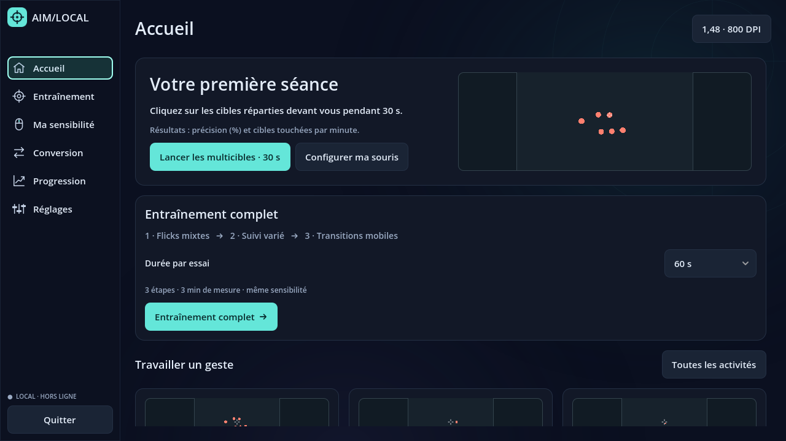

# AIM/LOCAL

Aim trainer 3D hors ligne pour Windows, en **Godot 4.7.2 stable + GDScript**.

La **0.7.0 — Precision Lab** remplace la calibration courte par **cinq exercices × cinq sensibilités × 60 secondes** (45 s au choix). Les scores ajustent les essais suivants et resserrent progressivement la recherche ; le bilan fournit un réglage unique à appliquer. Nouveautés : multicibles libres, flicks mixtes, suivi 3D et entraînement en trois étapes ; aperçu d’arme de profil sans mains, éclairage unique, anticrénelage 4×, hitmarker ambre et décompte sonore **3, 2, 1, GO**. La [spécification originale](docs/SPECIFICATION.md) reste la cible complète : les 55 exercices, le déplacement du joueur, l’ADS et les routines personnalisées ne sont pas encore implémentés.

Priorités : fidélité des mouvements de souris, pertinence des exercices, mesure réelle de la progression.



[Voir la bibliothèque d’exercices](docs/screenshots/exercices.png) · [Voir le parcours de sensibilité](docs/screenshots/sensibilite.png) · [Choix d’interface et équipements](docs/UI_UX.md)

**Sur Mac :** [voir la galerie](docs/screenshots/README.md) ou [télécharger les captures PNG](https://github.com/sarbhakan/aimtrainer/raw/refs/heads/main/downloads/AimLocal-0.7.0-visuels.zip), menus, calibration, dix-huit exercices et armes 3D. [Direction artistique et concepts](docs/art-direction/README.md). Le ZIP est une galerie, pas un exécutable Mac. Pour le régénérer : `bash tools/visual_smoke.sh`, puis `python3 tools/package_visuals.py`.

## Ouvrir sous Windows

Télécharger [AimLocal-0.7.0-windows-x64.zip](https://github.com/sarbhakan/aimtrainer/raw/refs/heads/main/downloads/AimLocal-0.7.0-windows-x64.zip), puis extraire **tout** le dossier et lancer `AimLocal.exe` : **aucune installation de Godot nécessaire**. Vérification facultative : [somme SHA-256](downloads/AimLocal-0.7.0-windows-x64.zip.sha256), ou `Get-FileHash .\AimLocal-0.7.0-windows-x64.zip -Algorithm SHA256` sous PowerShell. Seule la dernière distribution est conservée dans `downloads/`.

Pour ouvrir les sources, installer l'édition standard de Godot **4.7.2 stable** et ses export templates de la même version depuis les [releases officielles](https://github.com/godotengine/godot-builds/releases/tag/4.7.2-stable). Importer `project.godot`, puis lancer le projet avec F6 depuis `Main.tscn`, ou F5.

- **Accueil** : accès rapide à l’entraînement ou à la recherche de sensibilité.
- **Ma sensibilité** : entrer les DPI actuels de la souris et modifier la valeur AIM/LOCAL, ou importer la sensibilité et les DPI du jeu source. CS2 et Valorant proposent leurs coefficients documentaires ; CoD et les autres jeux nécessitent le titre/version et une mesure à la règle. L’import conserve les DPI actuels et la distance physique calculée ; il ne reconfigure pas la souris.
- **Calibration** : micro-précision → grands mouvements → switching → suivi horizontal → suivi réactif. Cinq sensibilités différentes par exercice, 60 s chacune par défaut, ou 45 s. Environ **28 min**, ou **22 min**, avec décomptes et pauses minimales ; reprise sauvegardée et essais interrompus rejouables.
- **Réglage connu** : recherche locale autour du réglage actuel. **Nouveau réglage** : point de départ lent/normal/rapide, recherche initiale plus large et extension si le meilleur score reste au bord.
- Premier essai au départ, deuxième plus rapide. S’il régresse, le suivant est plus lent que le départ ; s’il progresse, on teste entre les deux. Les deux derniers explorent les intervalles autour du meilleur. L’activité suivante hérite d’une zone resserrée. Aucun questionnaire de confort, aucun tir de 15 s présenté comme calibration complète.
- Le résultat montre les cinq essais, leurs scores et mesures. Le bilan fournit **Votre sensibilité**, avec **Appliquer**, puis conversion. En cas d’égalité, le réglage de référence est privilégié ; le choix final correspond à un réglage réellement testé.
- **Entraînement** : cartes, filtres, recherche et bulle de démonstration au survol, au focus ou au clic ; 18 exercices de 15/30/60 secondes, avec consigne courte et bouton de lancement toujours accessible.
- **Entraînement complet** : flicks mixtes → suivi multidirectionnel avec profondeur → transitions mobiles, 45 ou 60 s par étape. Même réglage, trois scores distincts ; pause entre les étapes et nouveau décompte.
- **Conversion** : traduire le réglage actuel vers CS2, Valorant ou le profil mesuré de CoD/autre jeu ; choisir aussi les DPI destination. Valeurs à saisir dans le jeu, sans modification de fichiers ni interaction avec ses processus. L’ADS et le ressenti à FOV différent ne sont pas équivalents automatiquement.
- **Progression** : courbes des 20 dernières séances comparables, score habituel (médiane récente), record, tendance après 10 séances et export CSV/JSON. Aucun résultat de démonstration n’est ajouté à vos données.
- Tableau chronologique filtrable par famille et exercice. Un record sauvegardé à conditions identiques déclenche une célébration discrète ; abandon, warm-up, données incohérentes et écriture refusée ne deviennent pas des records.
- **Réglages** : Pulse, Vector ou Classic, aperçus d’armes entières de profil sans mains ; sons et volume, arme masquée ou visible, animations réduites. Cliquer produit un tir ; en suivi, maintenir le clic joue un son continu facultatif **sans modifier le score**. Enregistrer pour conserver ces préférences.
- **Viseur** : point, croix, cercle ou T ; taille, épaisseur, espacement, couleur et contour, avec aperçu immédiat. Hitmarker après impact, sans recul de caméra ni modification de hitbox.
- **Test souris**, dans les réglages avancés : repère 3D sans score. **Échap** et perte de focus suspendent le jeu et arrêtent les sons ; la reprise reste explicite.
- **En pause** : modifier la sensibilité AIM/LOCAL, Valorant ou CS2 puis appliquer. L’essai redémarre pour séparer les scores ; ce réglage reste verrouillé pendant la calibration.
- **Precision Lab** : décor clair biseauté, une seule lumière directionnelle projetant les ombres du décor et des cibles, ambient diffus et MSAA 4×. Cibles corail, hitmarker compact ambre, scroll sans barre et actions par icônes. Les démos n’affichent plus de légende redondante ; aucune consigne n’est répétée pendant le décompte.

Défaut : **800 DPI, 35 cm/360°, FOV vertical 75°**, soit `914,4 / (800 × 35)` degré par count. Aucun lissage, accélération ni facteur de delta temporel n'est ajouté à la souris. Les DPI ne sont pas détectés matériellement. La calibration conseille un réglage dans la plage testée, **pas un optimum universel garanti** : relire le [protocole et les formules](docs/CALIBRATION.md), retester un autre jour et mesurer la distance réelle à la règle.

Les données sont dans `user://aim_local`, soit **`%APPDATA%\AIM_LOCAL\aim_local` sous Windows**. Séances et bilans sont immuables ; profil et checkpoint utilisent un remplacement atomique avec backup. Un fichier corrompu est conservé et signalé, jamais écrasé silencieusement.

**C03/M01/T10 sont en révision 5** : positions libres, mélange de transitions courtes/larges et suivi 3D à rayon constant. D01/D02/S02 restent en révision 4 ; les cinq empreintes de calibration restent en révision 3. Chaque pratique rejouée renouvelle sa graine ; une calibration partage la graine entre les cinq essais d’une activité. [Mécaniques 0.7](docs/EXERCISE_DESIGN_070.md). Le nouveau protocole 4 utilise un fichier distinct ; les anciennes comparaisons sont conservées et leurs services restent testés, sans les réinterpréter dans le parcours public. Seuls les contextes cohérents et identiques sont comparés.

## Développer dans le cloud Linux

Depuis `/workspace/aimtrainer` :

```bash
bash tools/setup_godot.sh
bash tools/godot.sh --headless --editor --import
bash tools/test.sh
bash tools/godot.sh --headless --quit-after 10
```

L'installation vérifie les SHA-512 officiels et conserve Godot, les archives et les templates Windows/Linux x86-64 dans `/workspace/.aim-local-tools`, hors du dépôt. Les téléchargements vérifiés sont réutilisables hors ligne. `AIM_LOCAL_TOOLS_DIR` permet de choisir un autre emplacement ; `GODOT_BIN` peut sélectionner un binaire existant de la version requise.

La commande `godot` globale du cloud reste indépendante : utiliser le wrapper du projet pour obtenir la version épinglée. Avec un environnement graphique, `bash tools/godot.sh --editor` ouvre l'éditeur et `bash tools/godot.sh` lance l'application. Le mode headless ne simule pas une souris physique ni sa capture.

Pour vérifier l’interface sur Linux : `bash tools/visual_smoke.sh`. Ce contrôle démarre un affichage virtuel temporaire si nécessaire, rend les écrans à 800×450, 1280×720 et 1920×1080, refuse les débordements horizontaux et sauvegarde les captures dans `dist/preview/`. Voir [les choix UX et les ressources](docs/UI_UX.md). Ce rendu logiciel n’est pas un benchmark matériel.

## Exporter pour Windows

Cloud Linux, avec `curl`, `unzip`, `sha512sum` et Python 3 disponibles :

```bash
bash tools/export_windows.sh
```

Ce script importe, exécute les tests, exporte en release, ouvre le pack avec le moteur Linux dans un dossier isolé, vérifie le format PE x86-64 et le PCK embarqué, puis crée :

- `dist/AimLocal.exe`
- `dist/AimLocal-0.7.0-windows-x64.zip`, avec l’exécutable, les instructions et les notices Godot/tiers.
- `dist/AimLocal-0.7.0-windows-x64.zip.sha256`

Sous Windows, depuis PowerShell :

```powershell
.\tools\export_windows.ps1 -Godot "C:\Dev\Godot\Godot_v4.7.2-stable_win64_console.exe"
```

Le script PowerShell produit l'EXE, sans nécessiter Python. Avec Python 3, `python tools/package_windows.py` crée ensuite le ZIP. Une fois les templates installés, l'export et l'application fonctionnent hors ligne. Le preset désactive la signature et l'édition des ressources Windows : aucun outil `rcedit` n'est requis pour l'export depuis Linux.

`dist/` et `.godot/` sont ignorés par Git. Ne pas distribuer seulement le projet source : extraire tout le ZIP, puis démarrer `AimLocal.exe` sur Windows sans Godot installé.

## Validation et performances

Les tests couvrent souris et focus, conversions, catalogue, collisions, scoring, replay tracking à 60/144/240 FPS, recommandation, reprise, sauvegardes et progression. `tools/test.sh` refuse aussi les erreurs de script malgré un code Godot nul. Le pack exporté est ouvert hors du checkout et les 18 exercices sont exercés avec leurs ressources embarquées.

Le moteur utilise six sphères réutilisables, un tampon d'input préalloué et une intégration tracking à 240 Hz indépendante du rendu. Benchmark logiciel reproductible : `bash tools/godot.sh --headless --script res://tests/benchmark.gd`. Il ne mesure **ni polling matériel, ni latence, ni FPS Windows**.

Voir le [plan de tests](docs/TEST_PLAN.md), les [décisions](docs/DECISIONS.md) et l'[architecture](docs/ARCHITECTURE.md). Les essais natifs Windows, le scaling, le `cm/360` physique et les souris 2–8 kHz restent obligatoires avant de revendiquer une fidélité matérielle validée.
