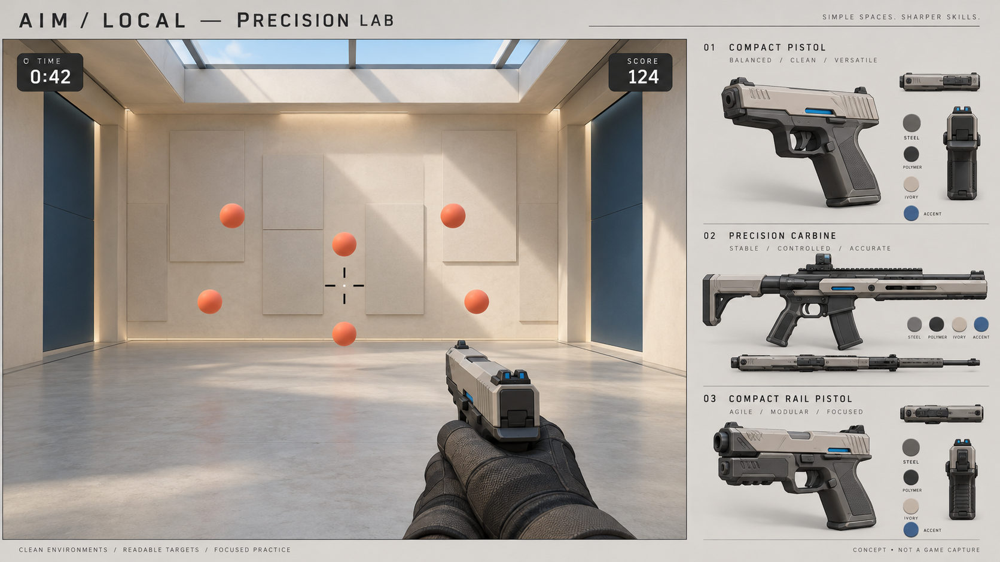
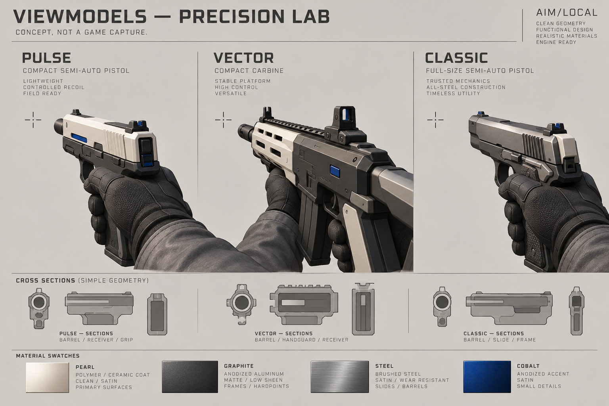

# Precision Lab — direction artistique 0.6

Ces deux planches ont été générées avant l’implémentation. **Ce sont des concepts, pas des captures de Godot ni une promesse de rendu photoréaliste.** Les captures réelles sont dans `docs/screenshots` et le ZIP des visuels.

## Règles de réalisation

- Laboratoire clair : enduit perle, béton mat, cadres graphite et panneaux cobalt. Pas de quadrillage, de néons ni de texte dans la zone de visée.
- Grandes surfaces à éclairage directionnel, ombres et volumes lisibles. Géométrie architecturale statique ; pas de particules permanentes ni de post-traitement coûteux.
- Cibles corail mates, ombrées et contrastées. La silhouette visible et la hitbox doivent rester identiques ; aucune marge invisible.
- Armes originales 3D : Pulse compact perle, Vector carabine graphite/perle, Classic acier satiné. Chanfreins, matériaux distincts, prise gantée, canon convergeant vers le viseur. Les silhouettes et le niveau de détail sont adaptés au petit cadrage réellement disponible.
- Deux compteurs dans les coins pendant l’exercice. Décompte sans répétition de la consigne ; détails uniquement avant l’essai ou dans le bilan dépliable.
- Menus bleu nuit conservés pour la continuité de navigation ; scroll naturel sans barre affichée, commandes évidentes par icônes avec infobulles et focus clavier.

## Découpage de l’équipe

Un agent UI/UX s’occupe du scroll, des commandes et des aperçus ; un agent armes traduit les études en meshes ; un agent mécaniques traite les patterns, tailles et distances. L’intégration gère le décor, la sensibilité en pause, la séparation des scores et les contrôles graphiques.

Les illustrations sont originales. Aucun modèle, son, texture ou algorithme propriétaire d’Aimlabs n’est récupéré. Godot Compatibility reste le moteur : ces changements ne justifient pas une migration qui mettrait l’input et les données en risque.
