# AIM/LOCAL — Cahier des charges V2
## Exercices, expérience visuelle et calibration de sensibilité

**Révision : 12 octobre 2026 · Langue : français · Cible : application Windows Godot/GDScript.**

Ce dossier remplace les choix de catalogue, de présentation et de calibration du cahier V1. Il définit **huit programmes publics de 60 secondes**, trois niveaux par programme, un visuel reproductible et un protocole de comparaison de sensibilité à gain soutenu. Les données du kit contiennent **24 configurations entièrement résolues et 54 phases** ; Codex n’a pas à inventer les coefficients manquants.

**Statut : spécification de conception et références numériques vérifiées.** Les dimensions, vitesses, distributions, scores et marges proposés sont des choix originaux d’AIM/LOCAL. Ils doivent être réceptionnés dans le moteur puis avec des joueurs. Ce dossier ne prétend ni reproduire l’algorithme propriétaire d’Aimlabs, ni avoir validé scientifiquement une « sensibilité parfaite ».

Le document source utilisateur décrit une application 0.9.0, Godot 4.7.2 et le commit `68b111699409972e7799994969ef5e90983c7277`. Ces indications décrivent l’existant fourni ; **le dépôt, ce commit et un exécutable Windows n’ont pas été examinés pendant cette rédaction**. Codex devra commencer par vérifier la version et les modules réellement présents. [U01]

## Sommaire

- [1. Périmètre, décisions et utilisation du kit](#chapitre-1)
- [2. Décision de catalogue et simplification réelle](#chapitre-2)
- [3. Lacunes concrètes que la V2 ferme](#chapitre-3)
- [4. Contrat commun aux 24 configurations](#chapitre-4)
- [5. Randomisation et placement reproductibles](#chapitre-5)
- [6. Modèles de mouvement exécutables](#chapitre-6)
- [7. Fiches des huit programmes](#chapitre-7)
- [8. Références visuelles et contrat d’interface](#chapitre-8)
- [9. Contrat d’exécution, de tir et de mesure](#chapitre-9)
- [10. Pratique, progression et historique](#chapitre-10)
- [11. Architecture Godot et distribution Windows](#chapitre-11)
- [12. Calibration de sensibilité : protocole soutenu et comparaison sur deux jours](#chapitre-12)
- [13. Gain, DPI, conversion et application du résultat](#chapitre-13)
- [14. Données, empreintes, événements et persistance](#chapitre-14)
- [15. Recette, preuves et limites](#chapitre-15)
- [16. Ordre d’implémentation pour Codex](#chapitre-16)
- [17. Sources et traçabilité](#chapitre-17)

---

<a id="chapitre-1"></a>

## 1. Périmètre, décisions et utilisation du kit

### 1.1 Expérience recherchée

L’expérience vise des tâches courtes, immédiates à comprendre, visuellement sobres et mécaniquement précises. Le joueur doit savoir quel geste travailler, ce qui constitue une réussite et pourquoi son résultat change. Les réglages du système doivent permettre de reproduire une séance et d’expliquer chaque apparition, mouvement, impact, disparition et résultat.

Les références publiques d’Aimlabs et les catégories de Voltaic orientent la séparation acquisition/suivi/transitions, ainsi que la recherche d’un environnement lisible. Elles ne fournissent pas les paramètres complets de nos exercices. Mouselabs décrit publiquement une analyse alimentée par la pratique ; ses coefficients internes et sa méthode complète ne sont pas publiés dans la source consultée. Le protocole ci-dessous est donc défini et testable indépendamment. [S02] [S05] [S08]

La V2 réduit réellement le catalogue : un seul déroulement par carte, sans sélecteur caché de sous-variantes ni combinaison libre. Les phases complémentaires sont annoncées et leurs résultats restent séparés. Une différence de taille, d’axe ou de comportement ne devient une carte supplémentaire que si elle demande un geste suffisamment distinct et si elle ne trouve pas sa place dans les huit programmes.

### 1.2 Ce que Codex doit livrer

| Domaine | Résultat attendu |
|---|---|
| Exercices | Huit cartes, 24 configurations, phases exactes, placements et trajectoires reproductibles, scores versionnés. |
| Rendu | Arène 3D, sphères aux bonnes dimensions, caméra correcte, contraste fixe, UI native dynamique conforme aux planches. |
| Entrées | Gain appliqué une fois par mouvement reçu ; ordre motion/clic conservé ; aucune dépendance au facteur d’échelle UI. |
| Calibration | Exploration locale, comparaison A/B à gain soutenu sur deux jours, résultat descriptif par compétence, application volontaire et réversible. |
| Données | Définitions validées, plans immuables, graines, événements, rapports et conditions exactes. |
| Distribution | Export Windows autonome ; toutes les ressources nécessaires sont livrées avec le programme. |
| Réception | Tests mathématiques, tests moteur, essais Windows hors dépôt et vérification du comportement avec des joueurs. |

Le joueur final n’installe pas l’éditeur Godot, Python, Node, un environnement de développement ou un outil de création graphique. **Codex travaille dans l’environnement de développement ; le joueur reçoit l’application exportée.** Un export avec PCK embarqué peut regrouper les ressources dans l’exécutable. Les bibliothèques natives éventuellement nécessaires à un autre driver restent à distribuer avec le programme ; l’intégration du PCK ne les absorbe pas. [AV01] [AV02]

### 1.3 Fichiers et responsabilités

| Fichier ou dossier | Rôle | Autorité |
|---|---|---|
| `AIM_LOCAL_SPECIFICATIONS_V2.md` | Présent contrat, explications, états et critères de réception | Sens et invariants du comportement |
| `donnees/catalogue.v2.json` | 24 configurations résolues, sans multiplicateur implicite de difficulté | Valeurs numériques des exercices |
| `schemas/catalogue.schema.json` | Structure fermée et familles de paramètres | Validation structurelle de cette révision |
| `donnees/interface.theme.json` | Palette, fontes, tailles et rectangles de référence | Tokens de présentation |
| `donnees/runtime.contract.json` | Précision, tolérances de collision et budgets d’intégration | Constantes numériques de l’exécution |
| `visuels/EX01…EX08_*.svg/.png` | Une planche et une vue de jeu par exercice | Références visuelles aux paramètres indiqués |
| `visuels/00_vue_ensemble.*`, `visuels/UI02…UI06_*.*` | Catalogue, préparation, résultats, calibration | Composition et hiérarchie UI |
| `ATLAS_EXERCICES_V2.html` | Lecture animée hors ligne des trois niveaux et de leurs phases | Outil documentaire, sans tirs ni mesure humaine |
| `donnees/atlas.etats.json` | États initiaux et trajectoires compilées des illustrations | Reproduction des figures |
| `donnees/calibration_v2_*.json` | Protocole, exemple de plan, stimuli et exemples de décision | Contrats et fixtures CAL |
| `outils/*.py` | Géométrie, mouvements, empreintes, calculateur et contrôles | Références de développement à porter |
| `rapports/` | Résultats des vérifications du livrable | Preuves limitées à leur périmètre déclaré |
| `assets/fonts/` | Polices et notices de redistribution | Ressources à embarquer |

L’HTML de l’atlas contient ses propres données et ses fontes ; il ne fait aucun appel réseau. Il sert à examiner les mouvements. Il ne remplace pas l’application 3D, n’émule pas un capteur de souris et n’effectue pas la calibration. Les scripts Python sont des références pour Codex et des outils de validation de développement, jamais une dépendance chez le joueur.

### 1.4 Règles d’interprétation

**DOIT** désigne une exigence obligatoire de la version de référence. **DEVRAIT** désigne une recommandation avec arbitrage documenté. **EXEMPLE** désigne des valeurs illustratives sans provenance humaine.

Une configuration résolue contient des paramètres et des distributions. Un **manifeste** contient les choix réalisés pour une séance déterminée. Dans un exercice à remplacement sur impact, le nombre d’instances dépend des entrées ; la configuration seule ne peut pas être le manifeste de toutes ces instances futures. La reproductibilité de ce cas exige également les entrées horodatées et les marqueurs de rendu.

Les valeurs JSON et les invariants de ce document forment un même contrat. Une contradiction est une erreur à corriger ; Codex ne doit pas choisir silencieusement la version la plus facile. Les figures expliquent ce contrat et n’autorisent pas à agrandir une cible, déplacer le joueur ou modifier le gain pour « mieux ressembler à l’image ».

Les annotations de planche — cotes, axes, trajectoires, cercles de transition, numéros de slots — sont **hors du rendu mesuré**. Les valeurs fictives des écrans de résultat sont des exemples de contenu dynamique. L’application ne doit pas les conserver comme scores par défaut.

### 1.5 Suppressions et limites volontaires

La première version publique n’expose pas de durée libre, de pulsation arbitraire, de shrink global, de régénération de PV, de double impact ou de création automatique de nouvelles variantes. Le rayon des cibles reste stable, à l’exception du rétrécissement annoncé d’EX03 et de la perspective réelle d’EX07. Le niveau reste fixe pendant une séance.

Les fonctionnalités suivantes ne sont pas nécessaires à cette livraison : compte en ligne, classement mondial, télémétrie distante, apprentissage automatique en production, injection dans un autre jeu, overlay tiers, téléchargement de ressources au premier lancement. L’historique local et l’export explicite suffisent au parcours décrit.

---


<a id="chapitre-2"></a>

## 2. Décision de catalogue et simplification réelle

Le catalogue public contient **huit cartes**, et chaque carte lance **un seul programme de 60 secondes**. Le joueur choisit uniquement Novice, Standard ou Avancé avant le départ. Aucun sélecteur public d’axe, de courbe, de pulsation, de nombre de coups, de régénération ou de combinaison ne multiplie les configurations derrière ces cartes. Il existe exactement 24 configurations de base.

Une **carte** est l’objet visible dans le catalogue. Un **programme** est son déroulement complet de 60 s. Une **phase** est une portion annoncée de ce déroulement et possède ses propres mesures. Un **modèle mécanique** est une primitive interne réutilisable ; sa présence dans le moteur ne crée pas une nouvelle carte. Un **niveau** résout les tailles, vitesses et tolérances avant le départ ; il ne les adapte pas au score pendant la séance.

| Carte | Programme par défaut | Phases et intervalles exacts | Résultat public |
|---|---|---|---|
| EX01 — Acquisition | Changer proprement d’échelle de geste | Micro `[0,20)` ; général `[20,40)` ; amplitude `[40,60)` | Trois scores C, puis totaux descriptifs |
| EX02 — Multicibles | Organiser une séquence de clics | Grille `[0,20)` ; précision `[20,60)` | Deux scores C ; aucun score de benchmark mélangeant les deux |
| EX03 — Temporisées | Choisir et exécuter dans une fenêtre imposée | Fixe `[0,30)` ; rétrécissante `[30,60)` | Deux scores P, 10 opportunités par phase |
| EX04 — Clic mobile | Lire puis intercepter un déplacement | Linéaire `[0,20)` ; évasif `[20,40)` ; arcs `[40,60)` | Trois scores C et diagnostics propres à chaque mouvement |
| EX05 — Suivi fluide | Tenir le contact sur des trajectoires continues | Horizontal `[0,20)` ; vertical `[20,40)` ; ellipse `[40,60)` | Trois scores T et indice de contact du programme |
| EX06 — Suivi réactif | Corriger après des changements non périodiques | Une phase continue `[0,60)` | Score T, réactivité spontanée et réactivité de bord séparées |
| EX07 — Contrôle 3D | Suivre une cible dont la distance varie réellement | Une phase continue `[0,60)` | Score T et diagnostics selon distance/diamètre apparent |
| EX08 — Transitions | Acquérir, maintenir, détruire, repartir | Statique `[0,20)` ; mobile `[20,40)` ; évasif `[40,60)` | Trois scores S et indice de travail utile sur 60 s |

La grille et la précision restent réunies dans une séance de pratique, car elles se complètent dans l’organisation d’une séquence. Leurs résultats restent distincts : six petites cibles ne représentent pas la même tâche que trois grandes cibles posées sur neuf nœuds. La même règle protège les trois phases de clic mobile. Le suivi fluide et le suivi réactif conservent deux cartes, car prédire un parcours et répondre à une inversion imprévue posent des problèmes différents. La profondeur conserve sa carte : sa variation de taille vient de la géométrie, pas d’un vieillissement arbitraire.

Les programmes de calibration restent dédiés. La moyenne d’une carte mêlant plusieurs phases de pratique ne devient jamais, par simple réemploi, un test de sensibilité.

### 2.1 Ce qui disparaît réellement

Les bases publiques n’incluent plus les variantes `pulse`, `metronome`, `stop_go`, `size_per_spawn`, `two_hit_shrink`, `reacquire`, `regen`, `diagonal_lanes`, `figure_eight`, `free_2d`, `free_evasive` et `spline_control`. Les éventuelles primitives nécessaires à de futures expérimentations sont désactivées et absentes du parcours utilisateur. Un changement de nom ne suffit pas à les réintroduire.

Le sélecteur de durée 15/30/60 s est retiré des huit cartes de référence : chaque programme affiche 60 s et dure 60 s de temps actif. Un aperçu non mesuré peut illustrer la mécanique avant le départ. Une interruption conserve ses diagnostics, mais ne crée pas un score comparable de « programme court ».

### 2.2 Correspondance avec les exercices décrits dans l’existant

| Anciennes entrées | Décision V2 | Conséquence sur l’historique |
|---|---|---|
| C01, C02, C04, M01 | Repris dans les trois phases d’EX01 ; abandon des tailles tirées et du shrink universel | Nouveaux identifiants ; aucun ancien record transféré |
| C03, C05 | Repris dans EX02, avec grille puis dispersion précise | Le volume de cibles et les diamètres changent ; comparaison ancienne/nouvelle impossible |
| C07 | Retrait de la carte de clic strictement vertical ; composante verticale présente dans l’acquisition générale | L’ancien exercice reste consultable comme historique retiré |
| D01 | Refondu en EX03 avec calendrier exogène et issues exclusives | Nouvelles métriques d’opportunité |
| D02 | Étendu et défini par les trois phases d’EX04 | Le générateur et les conditions font partie de la nouvelle clé |
| T01, T02, T04 | Réunis dans EX05 | Chaque phase garde une mesure identifiable |
| T03, T09 | Retrait des cartes spécialisées ; les deux axes et la difficulté sont couverts sans prétendre reproduire ces anciens tests | Aucun équivalent exact déclaré |
| T05 | Remplacé par EX06 réellement non périodique | Les anciennes alternances et scores restent historiques |
| T10 | Refondu en EX07 avec rayon physique constant, sans shrink d’âge | La perspective est isolée |
| S01, S02 | Refondu dans EX08 avec maintien et PV réels | L’ancien one-shot ne devient pas rétroactivement du switching à maintien |


<a id="chapitre-3"></a>

## 3. Lacunes concrètes que la V2 ferme

La V1 fixait déjà utilement les angles, tailles, scores, limites d’accélération et exceptions au shrink. Ses 15 fiches et variantes autorisées laissaient encore trop de possibilités à interpréter. La V2 ferme les points suivants :

| Lacune de V1 | Décision exécutable V2 |
|---|---|
| Carte, variante, durée et routine pouvaient multiplier les entrées | Huit programmes publics, trois niveaux, aucune combinaison libre |
| Réserve de spawn « prévalidée » non décrite | Limite de 128 candidats, puis treillis déterministe défini et échec explicite |
| Générateur aléatoire seulement dit versionné | xorshift32, dérivation SHA-256 des sous-flux, tirages entiers sans modulo biaisé et graine d’illustration définis |
| Proportions de bandes sans politique de sac complète | Sac de 12, quatre occurrences de chacune des trois bandes, Fisher–Yates, rechargé uniquement vide |
| Réactif insuffisamment défini aux frontières et en pleine rampe | Préemption analytique, préservation de position/vitesse, seuils de réarmement, ordre des événements et compilateur de référence |
| « Pas de suite excessive » sans définition chiffrée | Aucune règle cachée de rejet des suites ; distributions déclarées seulement |
| Initialisation des trajectoires imprécise | État initial propre à chaque modèle : phase d’arc uniforme, phase de cycle, âge de vol, vitesse signée ou phases indépendantes |
| Arcs avec grande liberté de hauteur et de durée | Une hauteur et un temps de vol par niveau ; seules la durée de repos et l’inversion à l’atterrissage restent aléatoires |
| Demi-tour lissé sans cycle complet pour l’aperçu | Quatre segments périodiques avec retrait de bord, durée et période calculables |
| Normalisation d’ellipse insuffisamment contrainte pour reproduire la vitesse | Métrique sphérique, Simpson, table 4096 cellules, inversion bornée et contrôle de vitesse explicites |
| Sortie de phase et partials de switching non traités comme programme composite | Ordre au timestamp frontière, censure, partials crédités à 20/40/60 s et PV identiques entre phases |
| Visuels décrits en prose mais pas directement implémentables | Géométrie et trajectoires issues du JSON, planches SVG normatives distinctes des indications de debug runtime |


<a id="chapitre-4"></a>

## 4. Contrat commun aux 24 configurations

### 4.1 Unités et espace

Le joueur reste immobile. Position de l’œil : `(0 ; 1,6 ; 0)` m. Axe avant : `−Z`, droite : `+X`, haut : `+Y`, roulis nul. Le sol est à `y=0`. Le mur de référence visuelle est à `z=−18 m` et ne sert pas de plan implicite de placement des cibles. Les cibles sont placées selon leur distance à l’œil, généralement 4 m. La profondeur d’EX07 varie entre 3 et 5 m.

Yaw et pitch définissent le **centre** de la cible. Les enveloppes données dans les fiches sont des enveloppes de centres ; on doit encore vérifier la totalité de la sphère dans le frustum et au-dessus du sol. La garde minimale au sol est 0,05 m. Le rendu et le collider partagent exactement la même sphère.

Pour le diamètre angulaire complet `D`, la distance de centre `d` et le rayon physique `r` :

```text
r = d × sin(D/2)
direction(yaw,pitch) = (cos(pitch)sin(yaw), sin(pitch), −cos(pitch)cos(yaw))
centre_monde = œil + d × direction
```

Les fonctions trigonométriques reçoivent des radians. `diameter_deg` désigne un diamètre complet, jamais un rayon. Dans EX07, ce champ désigne le diamètre **de référence à 4 m** ; le rayon constant stocké dans `size.world_radius_m` devient l’autorité de la taille au cours du temps.

Le repère de comparaison caméra utilise un FOV horizontal de 103° à 16:9. Le FOV vertical correspondant est stocké dans le JSON ; les conversions et les contours projetés exacts relèvent du module géométrique de référence. La V2 ne remplace pas une sphère décentrée par un cercle arbitraire de pixels de même diamètre nominal.

### 4.2 Temps actif et changement de phase

Toutes les phases se suivent sans temps mort ajouté. Un préavis HUD apparaît deux secondes avant la frontière ; le jeu continue, les cibles restent actives et le timer avance. Pas de fondu, gel, recentrage automatique ou arrêt du score à 18/38 secondes. À la frontière, l’orientation de la caméra est conservée.

À `t=20`, `t=30` ou `t=40` selon le programme :

1. Intégrer le contact de l’ancienne phase jusqu’à la frontière.
2. Appliquer une destruction dont le seuil est atteint exactement à cet instant. Ne pas créer une remplaçante de l’ancienne phase.
3. Fermer les épisodes de contact ; créditer les fractions de dégâts sur toutes les cibles encore vivantes en switching.
4. Clore les autres instances avec `censored_phase`, pas avec une expiration humaine.
5. Fermer le rapport de phase, créer les instances de la nouvelle phase.
6. Affecter un front de tir horodaté exactement à la frontière à la nouvelle phase. L’éligibilité de première image moteur reste applicable : une remplaçante non encore rendue ne peut pas être touchée par ce front.

À `t=60`, la même finalisation du contact et des destructions s’applique, puis la séance est fermée. Aucun tir ni nouveau spawn à 60 s n’apporte de point. L’ordre de réception départage deux entrées qui partagent le même timestamp faute de résolution plus fine.

Un coup sur une cible temporelle exactement à sa deadline est trop tard : la fenêtre est `[onset,deadline)`. Une mort calculée par l’intégrale de contact exactement en fin de phase reste une mort de l’ancienne phase. Ces deux règles sont compatibles parce qu’elles concernent des événements différents.

### 4.3 Tir, maintien et rendu

Le clic libre et temporisé utilisent un front de pression par tentative. Maintenir ne répète pas les coups. Il n’existe ni dispersion, recul, cible aimantée ni cadence artificielle de projectiles. Une tentative ne touche qu’une cible.

Le suivi mesure le contact sans exiger de bouton. En switching, le joueur maintient un rayon infligeant 100 PV/s de contact utile. Le départ exige un relâchement puis une nouvelle pression pendant la séance ; aux frontières de phase, un maintien déjà armé continue sans imposer de relâchement.

Un spawn après hit ou kill est logique à l’instant de la destruction, sans délai de jeu prévu. Sa première image moteur admissible est enregistrée par `first_rendered_frame`. Ce repère n’est pas une présentation physique certifiée de l’écran. Les coordonnées de hit et la pose visible sont traitées conformément au contrat d’entrée/rendu du dossier principal.

L’exposition du scénario est la durée active planifiée entière de la phase, y compris son acquisition initiale. Le proxy `first_rendered_frame` protège l’admissibilité du numérateur de contact ; il ne décale ni le début ni la fin du dénominateur. Une perte de cible due au geste du joueur, une cible non encore regardée ou une sortie du viewport ne réduisent jamais cette exposition. Les anomalies techniques de rendu sont identifiées séparément et peuvent rendre la séance non comparable ; elles ne sont pas déguisées en erreurs de visée.

### 4.4 Scores et clés de comparaison

Soit `H` le nombre de hits valides, `S` le nombre de fronts de tir de la phase, `T` sa durée active nominale, `O` ses opportunités, `C` son temps de contact admissible, `E` sa durée d’exposition active planifiée entière, `K` ses destructions et `p_i` les fractions de dégâts de ses cibles vivantes à la fermeture. Pour ces programmes sans masquage de cible de suivi, `E=T` : 20 s par phase d’EX05 et 60 s dans EX06/EX07, indépendamment des premiers marqueurs de rendu.

| Famille | Formule de phase | Interprétation |
|---|---|---|
| C, `click_v3` | `1000 × (H/T) × H/max(S,1)` | Débit pondéré une fois par la précision ; exposant de précision = 1 |
| P, `opportunities_v2` | `1000 × (H/O) × H/max(S,1)` | Opportunités réussies pondérées par la précision ; dix opportunités par phase complète |
| T, `contact_v2` | `1000 × C/E` | Fraction d’exposition couverte par le contact |
| S, `switch_work_v3` | `1000 × (K + Σp_i)/T` | Destructions équivalentes par seconde, avec travail incomplet conservé |

Une phase interrompue ou présentant un défaut technique invalidant n’a pas de score classable. Une phase complète sans aucun contact admissible obtient un score T de zéro sur sa durée planifiée ; elle ne transforme pas le retard de première image en temps exclu. Les divisions par zéro ne se résolvent pas par un score artificiel. Les métriques brutes restent disponibles.

EX01, EX02, EX03 et EX04 ne publient pas de score global mélangeant leurs phases : les totaux de hits, tirs, ratés, opportunités ou temps sont descriptifs. EX05 publie `1000 × ΣC/ΣE` et les trois scores de phase. EX06 et EX07 ont une seule phase. EX08 publie `1000 × Σ(K+Σp_i)/60` en conservant ses trois scores ; le diamètre et les PV identiques entre ses phases rendent cette unité de travail cohérente.

Un score de programme décrit ce programme. Il ne constitue pas un score général de talent et ne remplace pas ses diagnostics. Le champ JSON `rank_key_suffix` est un **suffixe** : les conditions d’entrée, le gain de sensibilité, le DPI déclaré, le FOV, le rendu, les versions de définition et les empreintes requises par le dossier principal complètent obligatoirement la clé. Deux niveaux ou deux phases n’utilisent pas le même record.


<a id="chapitre-5"></a>

## 5. Randomisation et placement reproductibles

### 5.1 PRNG et séparation des sous-flux

Le contrat portable est `xorshift32_v1`. L’état est stocké comme entier 64 bits positif, masqué à 32 bits après chacune des trois opérations :

```text
x = (x XOR (x << 13)) AND 0xffffffff
x = (x XOR (x >> 17)) AND 0xffffffff
x = (x XOR (x << 5))  AND 0xffffffff
```

Un état initial nul est remplacé par `0x6D2B79F5`. Le tirage réel utilise `(next_uint32 + 0,5)/4294967296`, donc des intervalles ouverts. Pour choisir un entier parmi `n`, rejeter les valeurs `x >= floor(2^32/n)×n`, puis calculer `x mod n`. Le mélange Fisher–Yates parcourt le tableau de la dernière case vers la seconde et tire `j` uniformément entre 0 et l’indice courant inclus.

La graine d’un sous-flux correspond aux quatre premiers octets, interprétés big-endian, du SHA-256 du tableau JSON canonique suivant :

```text
[catalogue_revision, session_seed_hex, program_id, difficulty, phase_id, stream_name]
```

Ce sont six chaînes ASCII, sérialisées sans espaces, BOM ni retour à la ligne. La graine de séance comporte 32 caractères hexadécimaux. `stream_name` suit `domain/slot/generation/purpose`, avec indices décimaux sans zéro initial. Les domaines layout, timing, motion, diagnostic et cosmetic sont séparés. Le compilateur de référence fixe l’ordre autoritatif des consommations ; ses fixtures protègent cet ordre. Ajouter un son ou un effet ne modifie aucune trajectoire.

La reproductibilité promise est : **même révision, même configuration, même graine, mêmes entrées horodatées et mêmes marqueurs de rendu admissible → même résultat logique**. Des réussites à des instants différents donnent naturellement des remplacements différents. Les programmes de clic libre ne doivent donc pas être décrits comme des calendriers d’exposition identiques pour deux joueurs. Les opportunités d’EX03 et les tâches dédiées de calibration peuvent, elles, être préconstruites indépendamment des hits.

### 5.2 Échantillonnage spatial

Pour une dispersion rectangulaire sur la sphère, tirer yaw uniformément et `sin(pitch)` uniformément dans leurs bornes. Pour une transition comprise entre `a` et `b`, échantillonner directement l’anneau sphérique autour du centre de référence : azimut uniforme sur un tour, `cos(distance)` uniforme entre `cos(b)` et `cos(a)`. Rejeter les points hors de l’enveloppe. EX01 et EX03 utilisent ce second mécanisme.

La distance entre deux directions unitaires est `atan2(|u×v|, u·v)`. La séparation requise entre deux cibles simultanées est la somme de leurs rayons angulaires plus 0,75°. Les nombres du JSON sont des diamètres, il faut donc les diviser par deux dans cette somme.

L’ancre d’une transition est le **centre précédent** de la cible détruite, ou le centre précédent programmé d’une opportunité. À la première apparition d’une phase, l’ancre conventionnelle est `(yaw=0,pitch=0)`. Aucune sélection ne dépend de la direction présente du viseur. Un déplacement de la souris ne fait pas fuir le prochain spawn.

Pour un respawn libre, remplacer uniquement le slot détruit ; les autres instances conservent position, vitesse, âge, vie et flux aléatoire. L’indice de génération augmente pour ce slot seulement. L’ordre initial de placement est celui des slots, de 0 à `target_count−1`.

### 5.3 Fin de recherche et absence de blocage

Chaque recherche teste au plus 128 candidats. Tous les candidats subissent les mêmes contrôles : enveloppe, frustum, garde au sol, séparation instantanée, bande d’amplitude et contraintes propres au modèle. Aucun contrôle ne disparaît lors d’un fallback.

Le fallback d’une position libre utilise un treillis de 0,25° en yaw/pitch, bornes incluses, yaw croissant puis pitch croissant. Celui d’un couloir ou d’une chambre ne parcourt que yaw par pas de 0,25°, la composante verticale ayant déjà été déterminée par le mouvement. Celui d’un cycle à demi-tours lissés utilise les fractions `j/4096`, pour `j=0..4095`. Le cas grille possède un ensemble fini de nœuds admissibles et n’a pas besoin d’un treillis supplémentaire.

Le candidat valide de plus petit hash est choisi ; le hash est le SHA-256 canonique du sous-flux dont `purpose` vaut `fallback_lattice_<index>`. Comparer les 32 octets lexicographiquement ; en cas d’égalité, choisir le plus petit indice. Cette définition évite un résultat dépendant de l’ordre d’un dictionnaire ou d’un parcours de scènes Godot. Les bornes du treillis sont produites par indices entiers, pas par additions flottantes répétées.

S’il n’existe aucun candidat, enregistrer `spawn_constraint_failure` et rendre la séance non comparable. Ne pas recentrer, réduire une cible, relaxer une distance ou choisir le dernier candidat malgré le refus. En calibration, cette situation doit être détectée avant que l’utilisateur ne commence. En pratique, `fallback_spawn_count` et le motif d’échec restent dans le rapport.

Pour les mouvements à couloirs, tirer une fois les paramètres de mouvement indépendants de yaw, puis rechercher yaw. Pour les arcs, tirer l’âge de vol et le signe une fois, puis rechercher la position horizontale. Pour le cycle lissé d’EX08, rechercher directement la phase du cycle ; une position imposée arbitrairement pourrait sinon être incompatible avec la vitesse initiale. Les cibles persistantes de suivi tirent directement leur état initial de trajectoire : elles ne passent pas par une recherche de respawn artificielle.

Le helper `static_layout()` du kit construit une scène illustrative sans entrées. Il ne constitue pas le spawner de remplacement du runtime. Lors de l’implémentation Godot, une création après hit doit recevoir les autres instances encore vivantes et vérifier la candidate contre leurs poses présentes, sans les régénérer. Les positions initiales d’un atlas ne remplacent pas ce contrat de cycle de vie.


<a id="chapitre-6"></a>

## 6. Modèles de mouvement exécutables

Ces modèles ne constituent pas des variantes publiques supplémentaires. `pose_at(t)` ne tire aucun nombre aléatoire et peut être appelée dans n’importe quel ordre. Les boucles sur les segments permettent de traverser plusieurs événements entre deux images sans les perdre. Les trajectoires utilisent des doubles pour les coefficients et une horloge logique versionnée ; la sérialisation finale des timestamps suit le contrat de microsecondes.

### 6.1 Réflexion linéaire instantanée — EX04 linéaire

Pour les bornes `L,R`, `W=R−L`, la position de départ `x0`, la vitesse signée `v` et le temps depuis naissance `t` :

```text
z = positive_mod((x0−L)+v×t, 2W)
x = L + (z si z≤W, sinon 2W−z)
```

Le pitch du couloir ne change pas. Le signe de vitesse s’inverse exactement au bord. Cette primitive comporte un choc de vitesse assumé : aucune limite finie d’accélération ne lui est attribuée. Les bornes concernent les centres ; la marge visuelle de la sphère est vérifiée séparément.

### 6.2 Rampe de vitesse commune

Pour passer de `v0` à `v1` pendant `τ` :

```text
u = (t−t0)/τ
S(u) = 3u²−2u³
v(t) = v0+(v1−v0)S(u)
x(t) = x0+v0(t−t0)+(v1−v0)τ(u³−0,5u⁴)
τ = max(τ_nominal, 1,5|v1−v0|/a_max)
```

Conserver l’origine et les coefficients de cette primitive lorsqu’un segment est coupé par un événement : remplacer seulement ses bornes de validité. Recalculer une nouvelle « rampe identique » depuis le sous-segment fausserait la trajectoire. Une préemption crée ensuite une nouvelle primitive avec la position et la vitesse atteintes à cet instant.

La quantification au microseconde le plus proche introduit une tolérance bornée ; elle ne permet pas de revendiquer une identité réelle infiniment précise. Les fixtures et le compilateur de référence fixent cette tolérance et les critères de vitesse/accélération. La continuité exigée est celle de la position et de la vitesse. Une accélération peut changer brusquement lors d’une préemption, tout en restant bornée.

### 6.3 Réactif préconstruit — EX04 évasif, EX06, EX08 évasif

Le centre démarre dans l’intervalle intérieur aux seuils de demi-tour : pour yaw±24° et retrait3°, le domaine initial est `]−21,+21[`. Le signe initial est équiprobable ; la vitesse initiale a déjà une norme tirée dans l’intervalle du niveau. Il n’existe pas de départ imposé depuis une vitesse nulle.

À chaque décision spontanée, le générateur choisit inversion avec probabilité0,7, puis une nouvelle norme uniforme. Dans les 30% restants, il conserve le signe mais retire la norme. Les tirages de mélange et de durée définissent le plateau qui suit la fin de la rampe. Une vitesse très proche de la précédente ne justifie pas un nouveau tirage caché. Aucune règle de « trois répétitions maximum » ne s’ajoute aux distributions.

Le script alterne des portions de vitesse constante et des rampes. Une décision ne survient pas pendant une rampe simplement parce qu’un délai global aurait continué de décompter : la durée de plateau commence à sa fin. Les passages de frontière sont l’exception prioritaire.

Le demi-tour de frontière se déclenche à `L+3` ou `R−3` quand le mouvement est sortant. Rechercher **le premier instant** où cette condition est atteinte, y compris à l’intérieur d’une rampe. La position d’une rampe est quartique ; partitionner sa plage aux zéros éventuels de vitesse puis résoudre la racine dans les intervalles monotones. Une bissection bornée convient ; tolérance de racine du JSON : `10⁻9 s` avant quantification.

Si l’état initial se trouve exactement sur un seuil avec une vitesse sortante, créer l’événement de frontière à `t=0` et commencer immédiatement la rampe de demi-tour. Ne pas chercher uniquement une traversée strictement postérieure à zéro : cela manquerait la frontière déjà atteinte. Cet événement initial ne crée aucun segment de durée nulle.

À ce déclenchement, couper la portion précédente, garder la position et la vitesse actuelles, puis viser la direction entrante à la **dernière norme de plateau tirée**. Ne pas réutiliser comme norme cible une vitesse instantanée devenue presque nulle au milieu d’un virage : cela créerait un plateau d’arrêt non demandé. Recalculer la durée minimale de la rampe avec le cap d’accélération. L’ancien timer spontané est abandonné ; un nouveau plateau commence après ce demi-tour.

Mémoriser le dernier bord déclenché. Le contrôle est réarmé seulement lors d’un retour entre les seuils avec une **vitesse entrante depuis ce bord**. Une position située quelques microdegrés à l’intérieur, due à un arrondi de la racine vers le bas, ne suffit pas si la vitesse reste sortante. Cette condition empêche de produire deux demi-tours identiques séparés d’une microseconde.

Si le retour entrant et la fin du segment de contrôle reçoivent le même timestamp quantifié, traiter les deux opérations dans un événement unique `rearm_and_control_end`. Réarmer puis passer au plateau ou à la rampe suivante au même instant, sans morceau vide, nouveau décalage temporel ni double événement de contrôle. Si le réarmement survient strictement au milieu d’une rampe, conserver l’origine et les coefficients de cette rampe dans ses deux sous-segments.

Un événement de bord qui partage un timestamp avec un événement spontané est prioritaire. Les événements de bord sont marqués séparément. Le changement de signe effectif se situe au zéro de vitesse pendant la rampe, pas au moment où la décision de tourner est prise. Les diagnostics de réacquisition doivent annoncer leur origine ; le contrat retient le changement effectif de signe et exporte aussi le début de rampe si l’on veut étudier la réaction anticipée.

Les couloirs ajoutent une sinusoïde verticale continue indépendante. EX04 : amplitude1,2°, période4s. EX08 : amplitude0,9°, période4s. La direction horizontale ne dépend pas du viseur ni de la présence de contact. Le cap annoncé est celui de yaw ; la vitesse totale est `sqrt(cos(pitch)²×yaw_rate² + pitch_rate²)`.

**Autorité de reproduction :** le module `outils/mouvements_reference.py` et ses fixtures du kit fixent l’ordre exact des tirages initialization/events/vertical_phase, les numéros de générations et les règles aux égalités. Ne pas réimplémenter une seconde interprétation simplifiée pour les tâches de calibration.

### 6.4 Croisière à demi-tours lissés — EX08 mobile

Ce mouvement est périodique et prévisible. Il ne partage pas les décisions spontanées du modèle réactif. Pour une borne de centre `B`, une vitesse `v` et une durée de demi-tour `τ=0,24s`, définir le retrait `δ=5vτ/16`. Le demi-tour droit commence en `B−δ` à vitesse `+v` ; il atteint `B` au milieu de la rampe et revient en `B−δ` à vitesse `−v` à sa fin.

Le cycle de référence commence à la sortie du demi-tour gauche, `x=−B+δ`, vitesse `+v` :

1. Croisière jusqu’à `B−δ`, durée `2(B−δ)/v`.
2. Rampe `+v→−v` de durée0,24s.
3. Croisière jusqu’à `−B+δ`, même durée.
4. Rampe `−v→+v` de durée0,24s.

La période vaut deux croisières plus deux rampes. Tirer la fraction initiale uniformément dans `[0,1[` ; le signe initial supplémentaire reflète le cycle autour de zéro. Aucun tirage n’intervient pendant l’évaluation. Le JSON stocke retrait, durée de croisière, période et accélération maximale `3v/τ` déjà calculés.

### 6.5 Arcs dans des chambres — EX04 arcs

La parabole est angulaire, pas une simulation de la gravité terrestre. Avec plancher angulaire `p0=−8°`, hauteur `h` et durée de vol `F` :

```text
pitch(a) = p0 + (4h/F)a − (4h/F²)a², 0≤a≤F
pitch_rate(0) = 4h/F
pitch_acceleration = −8h/F²
```

Le premier état tire un âge de vol uniforme dans `]0,F[` ; toutes les instances commencent en vol, avec des âges indépendants. Le premier atterrissage survient après `F−âge_initial`. Aux atterrissages suivants, tirer un repos au sol entre0,05 et0,18s. Le pitch reste à−8° pendant ce repos, puis un nouveau vol commence. La vitesse verticale change brusquement lors du rebond : il s’agit d’une impulsion explicitement choisie.

Yaw se déplace à vitesse constante et rebondit sur les deux limites de la chambre du slot. Ce déplacement continue pendant le repos au sol. À l’atterrissage, inversion de yaw avec probabilité0,5. Si un atterrissage coïncide avec un mur, consommer le tirage d’atterrissage puis imposer la direction entrante ; une double inversion ne renvoie pas la cible dans le mur. Après hit, remplacer la seule instance du slot, tirer un nouvel âge initial, un signe et une position admissible.

Les quatre chambres évitent le besoin d’une force de séparation qui altérerait les arcs. Les cibles peuvent donc être interprétées et rejouées indépendamment. Une cible ne disparaît pas au sommet ni après un vol raté.

### 6.6 Sinusoïdes sur un axe — EX05 horizontal/vertical

La coordonnée active vaut `A sin(ωt+φ)` ; l’autre vaut zéro. La phase initiale est uniforme sur un tour. Le JSON stocke `ω=v_max/A`, la période `2π/ω` et l’accélération maximale `v_max²/A`. La vitesse est nulle instantanément aux extrémités, sans plateau d’immobilité de durée positive. Il n’existe pas de second changement de rythme caché.

### 6.7 Ellipse à vitesse angulaire constante — EX05 ellipse

Définir `yaw(q)=16° cos(q)` et `pitch(q)=10° sin(q)`. La longueur d’arc utilise la sphère :

```text
f(q) = sqrt(cos(pitch_rad(q))² × yaw_rad_prime(q)² + pitch_rad_prime(q)²)
L(q) = intégrale de f entre0 etq
```

Construire4096cellules uniformes en `q` ; chaque cellule utilise Simpson à ses deux extrémités et son milieu. L’arc cumulé forme une table monotone. Tirer une fraction initiale uniforme de **longueur d’arc**, pas une phase `q` uniforme. Tirer le sens avec probabilité1/2.

À l’instant `t`, l’arc visé est `(arc_initial ± vitesse_rad_s×t) mod longueur_totale`. Rechercher la cellule par dichotomie, puis inverser localement par Newton encadré/bissection ; conserver la solution dans la cellule. Tolérance absolue d’arc : `10⁻9rad`, au plus16itérations. Le calcul de l’intégrale locale emploie la même quadrature de référence.

La recette compare des résolutions et mesure la vitesse obtenue, avec une erreur relative de vitesse maximale de0,1%. Une bonne longueur totale seule ne valide pas une table qui crée des accélérations localisées. La limite de changement du vecteur vitesse est70°/s² pour les trois presets. La cible ne s’arrête pas aux extrêmes de yaw ou de pitch : elle continue autour de la courbe fermée.

### 6.8 Profondeur à rayon constant — EX07

Les fonctions sont indépendantes mais partagent le temps depuis le début de phase :

```text
yaw(t) = 20° sin(ω_h t + φ_h)
pitch(t) = 10° sin(ω_p t + φ_p)
d(t) = 4m + 1m sin(ω_d t + φ_d)
```

Les trois phases initiales sont uniformes et indépendantes. Le rayon physique est fixé au début, `r=4sin(D_reference/2)`. Le diamètre visible est `2asin(r/d(t))`. Il n’existe ni respawn tous les dix secondes, ni shrink d’âge, ni compensation de taille écran. La vitesse radiale et la vitesse angulaire sont mesurées séparément.


<a id="chapitre-7"></a>

## 7. Fiches des huit programmes

Abréviations des tableaux : N=Novice, S=Standard, A=Avancé. Les angles de taille désignent toujours le diamètre. Les trois niveaux gardent le même ordre de phases et le même total de60s. Les valeurs sont résolues dans le JSON ; une différence entre prose et JSON doit être corrigée avant livraison.

### 7.1 EX01 — Acquisition

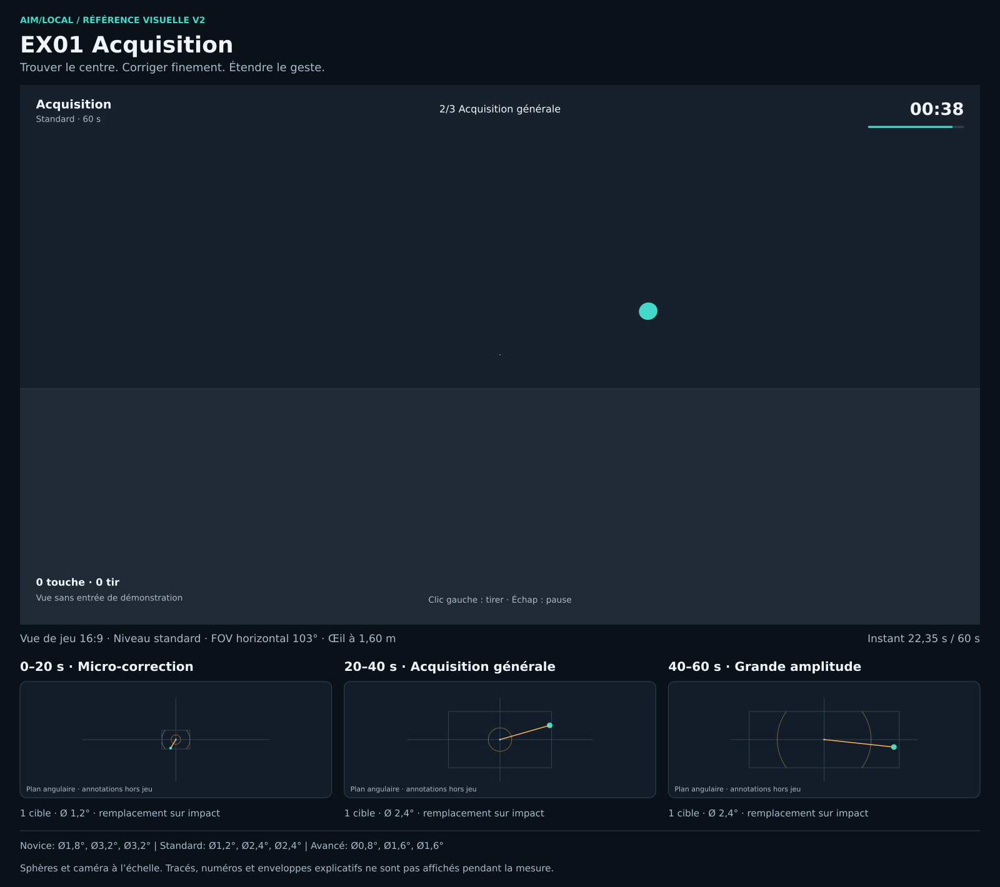

**Enjeu.** Acquérir une cible unique puis changer d’échelle de déplacement. La phase micro réclame une correction courte ; la phase générale répartit les amplitudes ; la phase finale exige un mouvement ample sans imposer une urgence artificielle.

| Phase | Durée | Diamètre N / S / A | Enveloppe des centres yaw / pitch | Distance de transition |
|---|---:|---|---|---|
| `micro` | 20s | 1,8 / 1,2 / 0,8° | ±6° / ±4° | 2–6° |
| `general` | 20s | 3,2 / 2,4 / 1,6° | ±22° / ±12° | Sac : 5–12°, 12–22°, 22–32° |
| `amplitude` | 20s | 3,2 / 2,4 / 1,6° | ±32° / ±12° | 20–38° |

Une cible, d=4m, immobile, taille constante. Elle reste jusqu’au hit ou à la clôture de sa phase. Un miss ne change ni position, ni taille, ni durée de vie. Une nouvelle instance apparaît logiquement au hit, selon l’anneau centré sur l’ancienne cible. Les limites angulaires restent celles du repère de l’arène, pas un rectangle qui suivrait la caméra.

Dans la phase générale, le sac contient douze bandes : quatre occurrences de chacune. Mélanger au début, consommer à chaque naissance, recharger uniquement quand il est vide. Les bandes sont `[5,12)`, `[12,22)` et `[22,32]` ; la convention aux frontières évite un double classement. Le rayon de transition est uniforme en angle solide dans la bande, conditionné par l’enveloppe. Le tirage n’est pas uniforme en degrés de distance.

La première apparition de chaque phase utilise l’origine neutre comme ancre. Sa latence d’acquisition est étiquetée `phase_initial`, car elle dépend aussi de l’orientation laissée par la phase précédente. Les transitions suivantes sont étiquetées `target_replace`. Le tableau de résultats sépare ces deux cas au lieu de cacher le coût du passage de phase.

**Mesures.** C par phase, précision, débit, médiane/p90 d’acquisition et erreurs selon bande. Ne pas comparer le score micro à celui d’amplitude. **Visuel normatif.** Trois panneaux d’enveloppes, tailles du niveau, centre précédent grisé, anneau d’amplitude et un placement validé. L’anneau et l’enveloppe apparaissent dans la planche explicative, pas dans le runtime.

### 7.2 EX02 — Multicibles

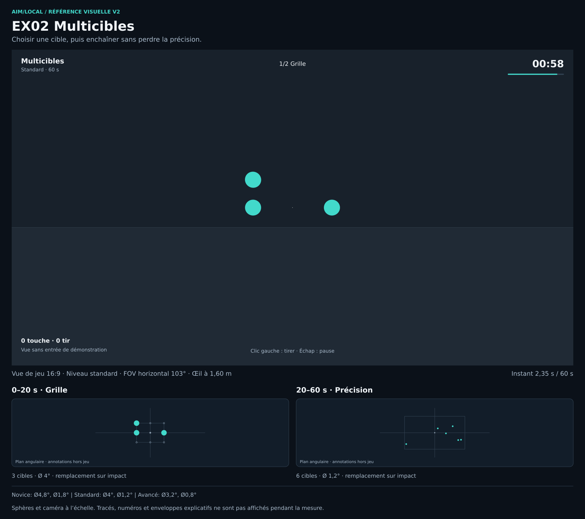

**Enjeu.** Conserver une séquence de sélection et de clics malgré une charge visuelle différente. La grille sert de phase de cadence lisible ; la dispersion précise demande davantage de correction finale.

| Phase | Durée | Cibles simultanées | Diamètre N / S / A | Placement |
|---|---:|---:|---|---|
| `grid` | 20s | 3 | 4,8 / 4,0 / 3,2° | Neuf nœuds yaw−10/0/+10°, pitch−7/0/+7° |
| `precision` | 40s | 6 | 1,8 / 1,2 / 0,8° | Dispersion yaw±22°, pitch±12° |

Toutes les cibles sont à4m, immobiles, sans expiration et sans variation de taille. Au départ de la grille, mélanger les neuf nœuds et retenir les trois premiers. Après un hit, les deux autres cibles restent en place ; choisir uniformément un nœud libre différent de celui qui vient d’être touché. Il reste six nœuds admissibles. Aucun ordre de cible n’est imposé.

Dans la précision, placer six centres avec la séparation silhouette0,75°. Comme les diamètres sont égaux, les distances minimales de centres sont2,55°,1,95° et1,55° selon niveau. Après un hit, le nouveau centre doit aussi être à au moins3° de l’ancien centre du même slot. Le spawn ne repose pas sur la position du viseur.

À20s, les cibles de grille non touchées sont censurées comme fin de phase ; elles ne deviennent pas des échecs. Les six cibles précises sont créées et la phase de40s commence. Aucun score C global ne récompense principalement la phase la plus rentable en débit.

**Mesures.** C et précision de chaque phase, dispersion des temps entre hits, nombre de changements de cible engagés sans hit. Une analyse de trajet n’attribue un « détour » que si la cible de destination est connue ; elle ne devine pas l’intention du joueur. **Visuel normatif.** Grille de neuf centres, trois sphères actives ; panneau précision avec six positions valides et la cote de séparation des silhouettes.

### 7.3 EX03 — Temporisées

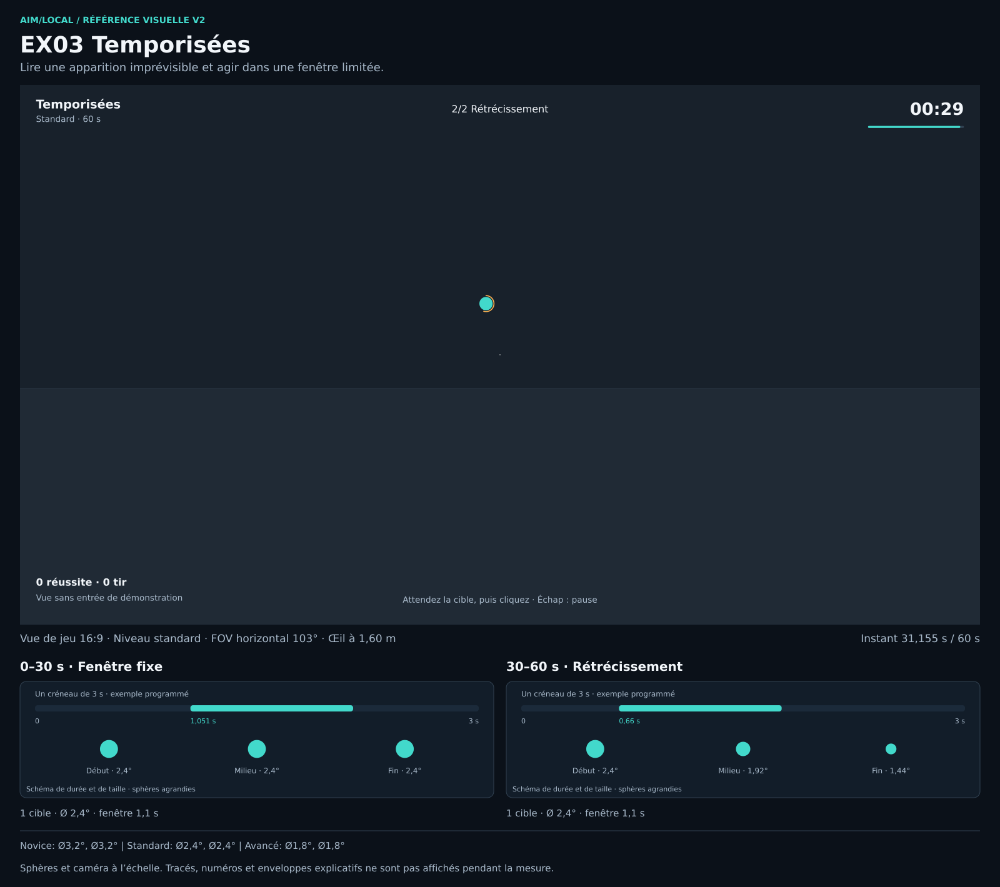

**Enjeu.** Réagir et confirmer un tir dans un délai connu du système, sans que la réussite accélère ou ralentisse les apparitions suivantes. La deuxième phase ajoute une diminution de taille explicitement annoncée.

| Paramètre | N | S | A |
|---|---:|---:|---:|
| Diamètre initial des deux phases | 3,2° | 2,4° | 1,8° |
| Diamètre final phase fixe | 3,2° | 2,4° | 1,8° |
| Diamètre final phase rétrécissante | 1,92° | 1,44° | 1,08° |
| Fenêtre visible logique | 1,4s | 1,1s | 0,8s |
| Créneaux par phase | 10 | 10 | 10 |
| Durée d’un créneau | 3s | 3s | 3s |
| Délai d’apparition dans le créneau | U[0,65;1,15]s | identique | identique |

Une cible au plus, d4m, yaw±16°, pitch±9°. Pour l’opportunité `j=0..9`, le début de créneau local est `3j` ; l’apparition est `3j+delay_j` ; la deadline est `onset_j+TTL`. Le dernier créneau commence à27s. Même le cas le plus long termine à29,55s, donc la phase de30s contient exactement dix opportunités complètes.

Préconstruire délais et positions. La transition de centre est comprise entre6 et24° depuis la position programmée précédente ; la première utilise l’origine neutre. Un succès enlève la cible jusqu’au prochain créneau. Un miss laisse la cible active jusqu’au hit ou à la deadline. Tous les fronts de tir de la phase entrent dans `S`, y compris les tirs avant apparition ou après disparition ; ils ne créent pas d’opportunité supplémentaire.

La phase fixe garde son diamètre. La phase rétrécissante interpole linéairement **le diamètre angulaire** entre100% et60% sur la durée de la fenêtre, puis calcule le rayon physique correspondant. Le retrait ne ralentit pas à proximité de la limite et ne continue pas après expiration. Une jauge extérieure facultative ne modifie pas le bord utile.

Les onsets et deadlines sont logiques, absolus et immuables ; `first_rendered_frame` ne les repousse pas. Si aucune image moteur contenant la cible n’est produite avant sa deadline, enregistrer `render_failure`/opportunité non rendue. Ne pas compter cela comme un raté humain. La séance est non comparable et expose l’incident dans son résultat.

Chaque opportunité a une seule issue finale : hit, expired, censored_phase ou censored_technical. Un hit ne peut pas être ensuite compté expired. Le score P et ses compteurs restent séparés entre phase fixe et rétrécissante. **Visuel normatif.** Frise des créneaux3s, marqueur d’apparition, portion visible, espace restant, plus trois contours cotés début/milieu/fin pour la deuxième phase.

### 7.4 EX04 — Clic mobile

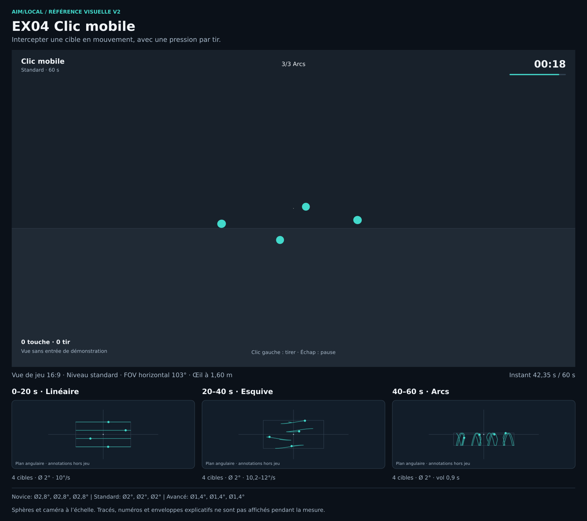

**Enjeu.** Cliquer sur une cible qui se déplace, avec une lecture différente selon la phase. Quatre cibles restent actives, une par couloir ou chambre. Aucune n’expire parce que le joueur attend un meilleur moment.

| Paramètre | N | S | A |
|---|---:|---:|---:|
| Diamètre identique aux trois phases | 2,8° | 2,0° | 1,4° |
| Linéaire : vitesse de yaw | 6°/s | 10°/s | 14°/s |
| Évasif : norme de yaw | 5,95–7°/s | 10,2–12°/s | 17–20°/s |
| Évasif : plateau après rampe | 0,8–1,4s | 0,5–1,1s | 0,3–0,8s |
| Évasif : rampe nominale | 0,18s | 0,14s | 0,10s |
| Évasif : cap accélération de yaw | 150°/s² | 300°/s² | 650°/s² |
| Arcs : hauteur au-dessus du plancher angulaire | 6° | 9° | 12° |
| Arcs : durée de vol | 1,1s | 0,9s | 0,75s |
| Arcs : vitesse de yaw | 5°/s | 8°/s | 12°/s |

Les trois phases durent20s chacune, d=4m. Les couloirs linéaires ont pitch−9°,−3°,+3°,+9° et yaw±20°. Tirer chaque yaw initial uniformément et son signe avec probabilité1/2. Le rebond horizontal est instantané. Après hit, le nouveau centre du slot reste dans le même couloir et se trouve à au moins4° du centre détruit.

Les couloirs évasifs gardent les mêmes centres de pitch, avec oscillation±1,2° de période4s ; le pitch total reste entre−10,2 et+10,2°. Yaw est limité à±22°, avec contrôle de bord déclenché à±19°. Les normes, plateaux, rampes et caps sont ceux du tableau ; inversion0,7. La distance minimale de respawn est4°. Deux couloirs adjacents gardent au moins3,6° de séparation verticale : plus que2,8° de diamètre maximal +0,75° de marge.

Les quatre chambres des arcs sont yaw `[-22,-14]`, `[-10,-2]`, `[2,10]`, `[14,22]`, toutes au plancher pitch−8°. Les sommets sont respectivement−2°,+1°,+4° selon niveau. La distance minimale de respawn est3°. Une contrainte4° serait impossible depuis certains centres de chambre : une demi-largeur4° de yaw ne donne pas4° de distance sphérique à pitch−8°.

Les vitesses de lancement vertical valent environ21,8182°,40° et64°/s ; les accélérations sont−39,6694°,−88,8889° et−170,6667°/s². Le JSON contient les valeurs calculées complètes. Repos au sol U[0,05;0,18]s, yaw continu, inversion à l’atterrissage0,5, bord prioritaire.

**Mesures.** C par phase ; pour les arcs, hits classés en montée, sommet, descente et repos, sans bonus caché de catégorie. Le sommet peut être une fenêtre plus facile ; attendre diminue le débit de façon naturelle. Pour l’évasif, délai de hit depuis la dernière inversion descriptif, sans le confondre avec un temps de réaction stimulus→réponse. **Visuel normatif.** Trois panneaux : quatre couloirs à flèches rectilignes ; sinusoïdes de pitch et inversions irrégulières ; quatre chambres avec arcs, hauteur, période de vol et sol angulaire cotés.

### 7.5 EX05 — Suivi fluide

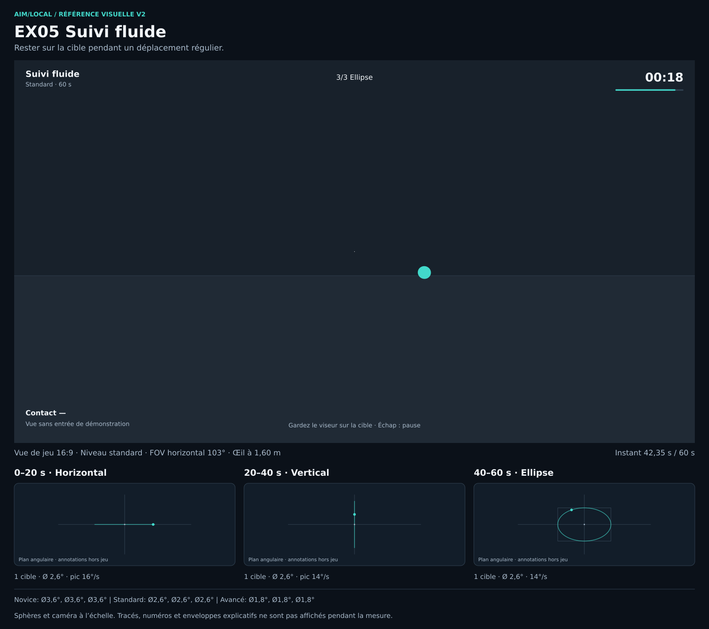

**Enjeu.** Régler la continuité du geste sur un axe, puis deux axes. La cible est invincible et aucune action de tir n’est nécessaire. Son diamètre reste le même entre les trois phases d’un niveau.

| Paramètre | N | S | A |
|---|---:|---:|---:|
| Diamètre H/V/ellipse | 3,6° | 2,6° | 1,8° |
| Horizontal : amplitude | 18° | 18° | 18° |
| Horizontal : vitesse maximale | 12°/s | 16°/s | 20°/s |
| Horizontal : accélération maximale | 8°/s² | 14,222222°/s² | 22,222222°/s² |
| Vertical : amplitude | 14° | 14° | 14° |
| Vertical : vitesse maximale | 10°/s | 14°/s | 18°/s |
| Vertical : accélération maximale | 7,142857°/s² | 14°/s² | 23,142857°/s² |
| Ellipse : amplitudes yaw/pitch | 16°/10° | 16°/10° | 16°/10° |
| Ellipse : vitesse le long de l’arc | 10°/s | 14°/s | 18°/s |

Une cible, d4m. Les sinusoïdes H et V durent20s chacune ; l’ellipse occupe les20dernières secondes. Le vertical reste à4m comme les autres phases : son amplitude14° protège la géométrie du sol sans changer subrepticement la distance ou la taille physique.

Les phases initiales sont tirées à chaque début de phase. La transition peut déplacer instantanément la cible vers une nouvelle trajectoire : elle correspond à un changement de phase annoncé, pas à une téléportation cachée du modèle fluide. Le temps nécessaire pour rejoindre cette nouvelle cible fait partie de la phase suivante. Conserver séparément ce délai initial et les pertes de contact ultérieures.

La cible reste présente pendant toute sa phase. Une sortie du réticule ne réinitialise ni le mouvement ni le score. L’ellipse garde sa vitesse d’arc ; les sinusoïdes affichent clairement une vitesse **maximale** et non constante.

**Mesures.** T de chaque phase, indice `1000×Σcontact/Σexposition`, erreur angulaire moyenne/p90, durée des pertes et contact dans les portions centrales/extrémités. Les diagnostics par portion utilisent la position ou la phase connue du mouvement et sont annoncés comme diagnostics. **Visuel normatif.** Les trois routes à échelle angulaire, les amplitudes, les diamètres et des flèches ou échantillons temporels qui rendent visible la variation de vitesse des sinusoïdes.

### 7.6 EX06 — Suivi réactif

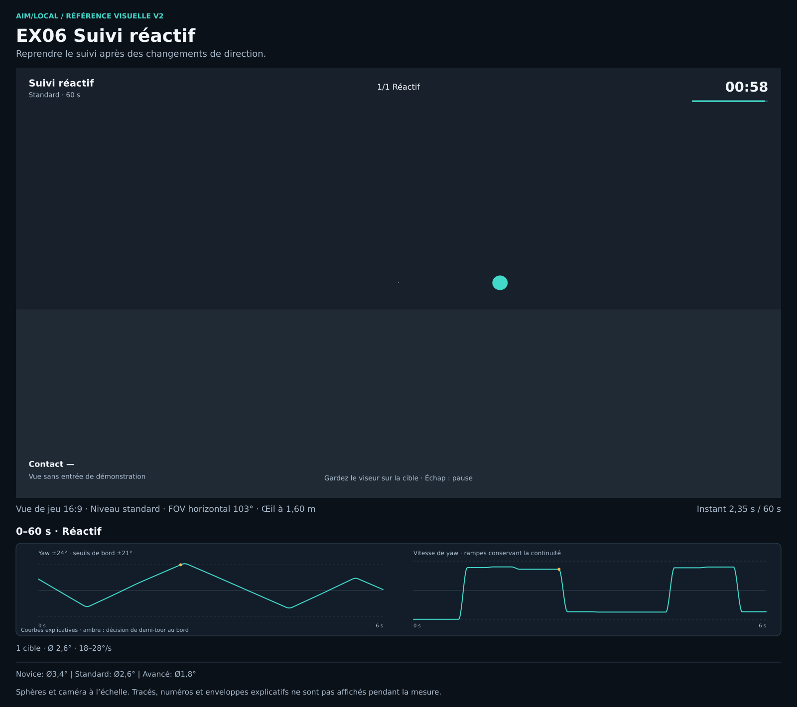

**Enjeu.** Répondre à une inversion qui peut se produire avant le bord. Une seule cible garde son identité pendant60s ; il n’existe pas de respawn périodique ni de pause positive à vitesse nulle.

| Paramètre | N | S | A |
|---|---:|---:|---:|
| Diamètre | 3,4° | 2,6° | 1,8° |
| Norme de vitesse de yaw | 12–18°/s | 18–28°/s | 26–38°/s |
| Plateau après rampe | U[0,65;1,30]s | 70%U[0,70;1,20]+30%U[0,28;0,45]s | 60%U[0,45;0,90]+40%U[0,20;0,35]s |
| Durée nominale de rampe | 0,18s | 0,14s | 0,10s |
| Cap d’accélération de yaw | 350°/s² | 700°/s² | 1200°/s² |
| Probabilité d’inversion spontanée | 0,7 | 0,7 | 0,7 |

D4m, pitch0, enveloppe yaw±24°, seuils de bord±21°. Les distributions de durée sont des mélanges tirés à chaque événement, pas un cycle « long,court,long,court ». Des continuations de même signe peuvent se suivre ; les bords imposent leur propre événement si nécessaire. Les durées incluent des valeurs intermédiaires uniformes, pas seulement les extrémités du tableau.

Le compilateur produit le script continu jusqu’à60s et vérifie toute rampe, y compris les demi-tours de bord et les segments tronqués par la fin. L’aperçu utilise ce même générateur et une graine d’illustration identifiable. Il ne montre pas une oscillation régulière vendue comme le mouvement réel.

**Mesures.** T global ; contact pendant les250ms suivant un changement effectif de signe ; délai jusqu’à une réacquisition stable ; pertes >200ms. Une réacquisition stable nécessite50ms de contact brut continu et sa date est le début de cet intervalle. La fusion de trous de20ms est seulement un diagnostic de fragmentation, pas une façon de fabriquer ces50ms. Si une nouvelle inversion arrive avant la fin des250ms, censurer la fenêtre précédente au nouvel événement. Séparer les événements spontanés et forcés par un bord.

**Visuel normatif.** Bande yaw±24°, seuils±21°, trajet temporel réellement issu d’un script et courbe vitesse→temps avec rampes. Identifier les inversions spontanées et les demi-tours de bord. Une ligne régulière en zigzag est insuffisante pour documenter ce mécanisme.

### 7.7 EX07 — Contrôle 3D

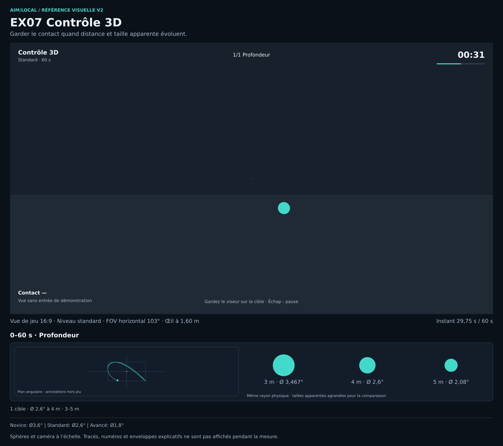

**Enjeu.** Maintenir le geste sur une cible dont la perspective évolue, sans confondre profondeur, déplacement angulaire et diminution programmée du rayon.

| Paramètre | N | S | A |
|---|---:|---:|---:|
| Diamètre de référence à4m | 3,6° | 2,6° | 1,8° |
| Pulsation yaw `ω_h` | 0,45rad/s | 0,60rad/s | 0,84rad/s |
| Pulsation pitch `ω_p` | 0,6375rad/s | 0,85rad/s | 1,19rad/s |
| Pulsation distance `ω_d` | 0,375rad/s | 0,50rad/s | 0,70rad/s |
| Borne de vitesse angulaire | 11,029°/s environ | 14,705°/s environ | 20,588°/s environ |
| Vitesse radiale maximale | 0,375m/s | 0,50m/s | 0,70m/s |
| Accélération radiale maximale | 0,140625m/s² | 0,25m/s² | 0,49m/s² |

Une cible persistante60s. Yaw±20°, pitch±10°, distance3–5m. Le rayon est constant et les trois phases initiales indépendantes. La borne de vitesse angulaire est conservatrice : `sqrt((20ω_h)²+(10ω_p)²)` ; le cosinus du pitch réduit parfois la composante horizontale réelle. Le JSON stocke les bornes calculées, sans multiplicateur temporel restant à appliquer.

À4m, la taille est celle du tableau. À3m, elle paraît plus grande ; à5m, plus petite. Les valeurs min/max du diamètre apparent figurent dans `size`. Ne pas ajouter une animation de pulsation ou une remise à4m tous les dix secondes.

**Mesures.** T, erreur angulaire, contact par tranches de distance `[3,3,6667)`, `[3,6667,4,3333)`, `[4,3333,5]` si ce diagnostic est activé ; ces tranches restent descriptives et n’ajoutent aucun score pondéré. **Visuel normatif.** Vue angulaire du domaine plus profil de profondeur montrant la même sphère à3/4/5m, avec diamètre apparent calculé. La profondeur ne doit pas être représentée par trois sphères physiquement de rayons différents.

### 7.8 EX08 — Transitions

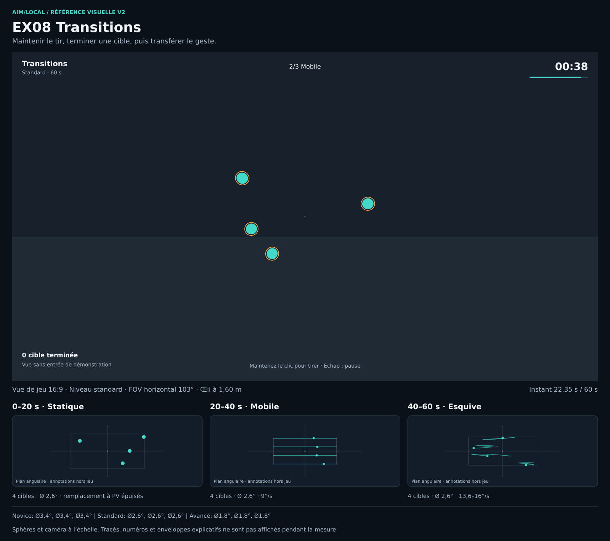

**Enjeu.** Rejoindre une cible, rester dessus le temps nécessaire, confirmer la destruction et passer à une autre. Les quatre cibles ont une réserve de vie ; un clic unique n’équivaut pas à une élimination.

| Paramètre | N | S | A |
|---|---:|---:|---:|
| Diamètre identique aux trois phases | 3,4° | 2,6° | 1,8° |
| PV identiques aux trois phases | 30 | 40 | 50 |
| Dégâts utiles par seconde | 100 | 100 | 100 |
| Temps idéal de contact pour tuer | 0,30s | 0,40s | 0,50s |
| Mobile : vitesse de yaw | 6°/s | 9°/s | 14°/s |
| Mobile : durée d’un demi-tour | 0,24s | 0,24s | 0,24s |
| Mobile : retrait du centre au début du demi-tour | 0,45° | 0,675° | 1,05° |
| Mobile : accélération maximale | 75°/s² | 112,5°/s² | 175°/s² |
| Évasif : norme de vitesse de yaw | 8,5–10°/s | 13,6–16°/s | 20,4–24°/s |
| Évasif : plateau après rampe | 0,8–1,3s | 0,45–1,0s | 0,30–0,75s |
| Évasif : rampe nominale | 0,18s | 0,14s | 0,10s |
| Évasif : cap accélération de yaw | 200°/s² | 400°/s² | 800°/s² |

Quatre cibles, d4m. Chaque phase dure20s. Statique : dispersion yaw±26°, pitch±12°, mêmes règles de séparation que les autres cibles. Mobile : pitch−9°,−3°,+3°,+9°, yaw±22°, croisière et demi-tours périodiques lissés. Évasif : mêmes centres de couloir, oscillation verticale±0,9° de période4s, yaw±24°, inversion spontanée0,7 et contrôle de bord avec retrait3°.

Les périodes des cycles mobiles sont 14,846666667 s, 9,957777778 s et 6,465714286 s selon niveau. Le JSON conserve les valeurs calculées. La vitesse de yaw du tableau reste distincte de la vitesse sphérique légèrement inférieure dans les couloirs inclinés en pitch.

Les PV ne se régénèrent pas. Sortir du contact conserve les dégâts déjà infligés à cette instance. Aucun délai de vie ne détruit une cible délaissée. À la destruction, le nouveau centre du slot doit être à au moins6° de l’ancien centre ; les autres cibles conservent leurs dégâts. Aucun dommage excédentaire ne traverse la destruction pour affecter une remplaçante.

À20s et40s, le travail incomplet de toutes les cibles vivantes est crédité avant censure. Exemple Standard : un kill et deux cibles ayant reçu20PV puis10PV correspondent à `1+20/40+10/40=1,75` unités de travail pour la phase. Si une cible atteint exactement40PV à la frontière, compter un kill, pas un kill plus une fraction résiduelle. Les nouvelles cibles de phase repartent à40PV ; ce changement est explicite et les partials précédents ne sont pas perdus.

**Mesures.** Score S de chaque phase, indice de programme, kills entiers, travail équivalent, temps de contact utile, kill→premier dégât sur une autre cible, durée de maintien par kill, nombre de cibles entamées puis quittées. Un délai inter-kills combine transfert et maintien ; ne pas l’intituler « temps de switch » sans distinction. **Visuel normatif.** Trois panneaux correspondant aux phases, une sphère à PV pleins et une à PV partiels de même diamètre, anneau extérieur de vie, exemple de crédit au passage de phase. Aucun rétrécissement visuel de la sphère ne représente la perte de PV.


<a id="chapitre-8"></a>

## 8. Références visuelles et contrat d’interface

### 8.1 Ce qui est livré et comment le lire

Le dossier `visuels/` contient, pour chacun des huit exercices, **une planche explicative et une vue de jeu à 1920×1080**. Les planches sont calculées depuis les configurations Standard ; elles ne constituent pas huit illustrations inventées indépendamment du moteur. Les contours utilisent la projection du cône tangent à la sphère. Le sol, le mur, la caméra et les dimensions viennent des mêmes paramètres que le catalogue. L’atlas permet d’examiner les trois niveaux et chaque phase sur un axe de temps.

Les deux types d’image ont des rôles distincts :

| Référence | Contenu | Usage par Codex |
|---|---|---|
| `EX01…EX08_<nom>.svg/.png` | Vue de jeu, objectifs, nombres, chronologie et schémas de mouvement | Comprendre et vérifier les mécanismes ; garder les schémas hors de l’épreuve. |
| `EX01…EX08_vue_jeu.svg/.png` | Arène à la taille de référence et HUD, sans trajectoire de debug | Comparer caméra, projection, silhouettes, couleurs et zones d’interface. |
| `00_vue_ensemble.svg/.png` | Catalogue des huit cartes | Construire les vrais composants de navigation. |
| `UI02_preparation.svg/.png` | Fiche avant lancement | Présenter niveau, durée, phases et aperçu sans ajouter de variantes. |
| `UI03_resultats_exercice.svg/.png` | Résultat de séance fictif | Afficher de vraies mesures par phase, leurs dénominateurs et leurs conditions. |
| `UI04_calibration_parcours.svg/.png` | Préparation et calendrier CAL | Expliquer l’engagement de temps avant le démarrage. |
| `UI05_calibration_mesure.svg/.png` | Écran CAL pendant la mesure | Conserver les consignes utiles et masquer les résultats intermédiaires. |
| `UI06_calibration_resultat.svg/.png` | Exemple positif issu des fixtures CAL | Présenter une décision conditionnelle, les deux journées et les quatre gestes. |
| `M01_cibles_et_etats.svg/.png` | Fenêtre, PV, profondeur et remplacement | Distinguer transformations réelles et décor informatif. |

Une planche peut agrandir un schéma de mécanisme **en le disant explicitement**. La vue de jeu principale ne grossit jamais les cibles. Les trajectoires colorées, numéros, axes yaw/pitch et cercles de transition appartiennent à la documentation. Le runtime de référence n’affiche aucun de ces éléments pendant la mesure.

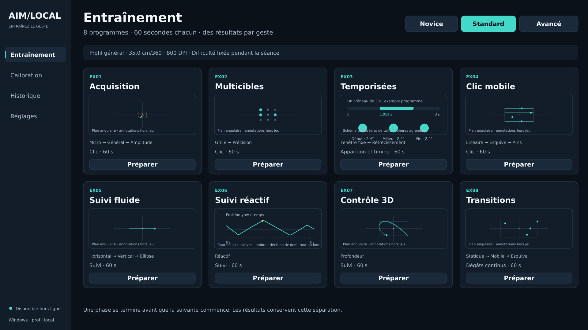

### 8.2 Direction graphique et matériaux

Le fond est une pièce sobre, sans texture photographique ni animation. Le mur et le sol donnent un repère spatial stable ; le fond ne doit pas devenir un second exercice de détection. Les cibles actives sont des sphères opaques turquoise. L’ambre sert aux informations de fenêtre, de PV ou de priorité. Un bouton actif et une cible partagent une couleur de famille, mais pas un rôle interactif pendant la séance : le HUD de jeu ne contient aucun bouton cliquable.

| Élément | Valeur sRGB | Règle |
|---|---|---|
| Fond application | `#0B1119` | Écrans de navigation. |
| Surface | `#121D29` | Cartes et panneaux. |
| Surface élevée | `#1B2A3A` | Champs, boutons secondaires et pistes. |
| Bordure | `#314252` | Séparation discrète, sans halo. |
| Texte principal | `#F2F6FA` | Titres, valeurs et commandes. |
| Texte secondaire | `#A9BACB` | Explications, unités, dénominateurs. |
| Mur | `#18212B` | Matériau opaque non éclairé. |
| Sol | `#202A35` | Même stabilité d’exposition. |
| Cible active | `#42D9CB` | Corps et hitbox alignés. |
| Accent ambre | `#FFB454` | Information externe au corps ; jamais une hitbox agrandie. |
| Inactif | `#77899B` | Aperçu documentaire ou état explicitement non actif. |
| Succès / prudence / erreur | `#81D6A5` / `#FFCA74` / `#FF8897` | Toujours accompagnés d’un texte. |
| Viseur | `#FFFFFF`, contour `#071018` | Point central stable, sans animation au clic. |

Le JSON `interface.theme.json` contient les tokens réellement employés. Les valeurs hexadécimales décrivent la couleur souhaitée à l’écran ; vérifier la conversion sRGB/linéaire et le tonemapping du moteur, au lieu de compenser à l’œil dans plusieurs matériaux. La caméra n’applique ni exposition automatique, bloom, TAA, flou, profondeur de champ, secousse ni zoom au tir.

Les deux polices DejaVu Sans livrées sont embarquées avec leur notice. Les textes ne dépendent pas d’une police trouvée sur le poste du joueur. Les corps essentiels et commandes visent au moins 16 px à 1080p ; les valeurs usuelles sont 20 px pour le corps, 17 px pour le secondaire, 32 px pour les titres et 34 px pour le timer. Les petites annotations des schémas et surtitres documentaires ne deviennent pas des contrôles de production. La mise à l’échelle UI et le reflow sont décrits au chapitre architecture ; Godot permet d’importer les fontes et de les appliquer via un Theme. [AV12]

### 8.3 La cible n’est pas une icône d’interface

Le corps est un mesh 3D dont le centre et le rayon proviennent du modèle. Le clic utilise la sphère analytique correspondante. Ne pas dessiner un cercle UI dont le rayon en pixels reste constant quand la distance, le FOV ou la direction changent. Ne pas appliquer d’échelle liée au facteur Windows, au zoom de l’interface ou à la résolution du menu.

Le profil de référence ne comporte pas de point central sur la cible, de zone critique, de headshot, d’aim assist, de magnétisme ou de tolérance invisible autour du mesh. Une limite tangentielle est comptée comme intersection selon le contrat numérique commun ; elle n’ajoute pas une marge angulaire constante à toutes les cibles.

| État | Corps visible | Collision / score | Feedback |
|---|---|---|---|
| Préparée, avant apparition | Non | Inactif | Aucun indice prématuré dans l’arène. |
| Apparue logiquement, en attente de premier rendu | Prête pour présentation | Pas d’impact admissible avant le marqueur de cette génération | Ne pas décaler le calendrier. |
| Active | Oui, rayon du modèle | Admissible suivant le geste demandé | Fenêtre/PV si la mécanique en a besoin. |
| Impact sans destruction, EX08 | Oui, même rayon | PV diminués ; prochain contact possible | Arc de PV raccourci. |
| Détruite | Non pour le corps actif | Collider désactivé immédiatement | Effet optionnel de 60 ms, non interactif. |
| Expirée | Non | Issue finale unique | Aucun bonus ; indicateur de bilan après séance. |
| Censurée par fin de phase | Non | Pas d’échec humain imputé | Diagnostic technique ou frontière prévue. |

Le feedback de destruction de 60 ms peut être un petit anneau qui s’éteint à l’ancien centre. Il ne retarde pas le remplacement, ne conserve pas la collision et ne change pas le rayon des autres cibles. La génération suivante a son propre marqueur de premier rendu. Ne pas afficher une apparition en fondu si sa hitbox est déjà active : le corps apparaît avec son opacité finale.

**PV.** L’arc est calculé à 1,2 fois le rayon apparent du contour, largeur de référence 2 px, départ en haut, sens horaire. Sa fraction vaut `remaining_hp / maximum_hp`. Il est distinct de la cible et ne reçoit aucun impact. Aucun rétrécissement du corps avec les dégâts. À `HP=0`, détruire la cible ; ne pas laisser un cercle fantôme sélectionnable.

**Fenêtre temporelle.** Un arc extérieur indique le temps encore disponible. EX03 fixe conserve le corps ; EX03 rétrécissant réduit linéairement le **diamètre angulaire** de 100 % à 60 % sur sa durée de vie. Le cercle de temps et le rayon ne décrivent pas la même grandeur. La taille à la deadline est la limite mathématique : l’état actif est déjà fermé à cet instant selon l’intervalle défini.

**Priorité CAL-SWITCH.** Quatre petites équerres ambrées extérieures identifient le slot prioritaire, en plus d’une consigne textuelle de tâche. Les corps gardent leur contraste ; seuls les dégâts sur le slot prioritaire comptent. Ce marqueur ne se déplace pas selon le regard et ne préannonce pas la priorité suivante.

**Audio local.** Produire ou embarquer avant le départ les trois sons décrits dans le thème : impact 900 Hz/20 ms, destruction 1 400 Hz/40 ms, phase 660 Hz/60 ms ; fréquence d’échantillonnage 44 100 Hz, amplitude maximale 0,1, attaque 2 ms, relâchement 8 ms. En cas de destruction au premier hit, jouer la destruction seule. Pas de son de contact à chaque tick et pas d’empilement illimité de voix. Le volume utilisateur et la coupure des sons se règlent hors séance et restent constants dans un plan CAL. Ces sons courts sont des choix de design, pas des valeurs d’un produit concurrent.

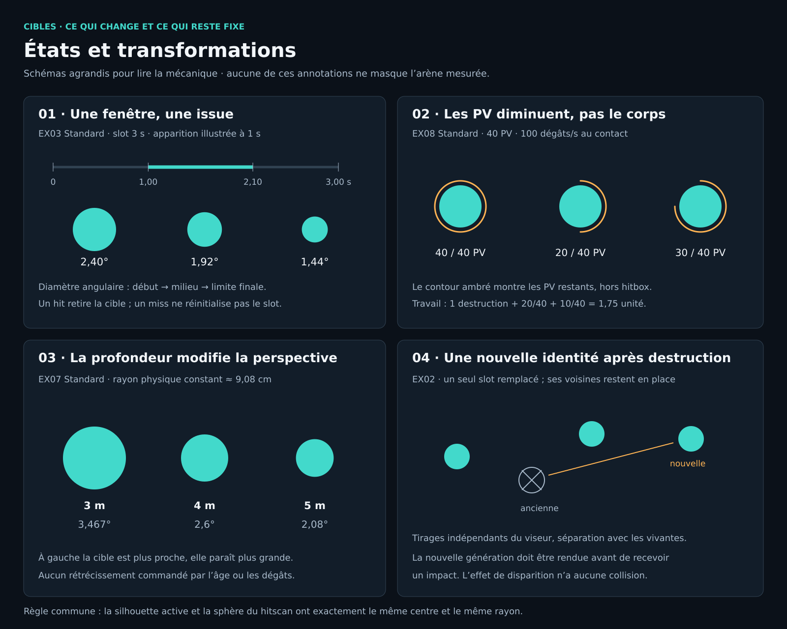

### 8.4 Lecture visuelle des huit exercices

| Programme | Corps à présenter | Mouvement et variation visibles | Éléments à exclure du rendu mesuré |
|---|---|---|---|
| EX01 Acquisition | Une sphère, dont la taille change seulement à la frontière des phases | Remplacement après impact ; amplitudes micro, générales puis larges | Cercle d’annulus, marqueur du centre précédent, ligne du prochain déplacement. |
| EX02 Multicibles | Trois cibles sur neuf nœuds en grille, puis un ensemble de précision selon le niveau | Seul le slot détruit est remplacé ; aucune attraction vers le viseur | Les six nœuds de grille non occupés, liens d’ordre, numéros de slots. |
| EX03 Temporisées | Une seule opportunité à la fois | Attente variable dans un slot fixe de 3 s ; fenêtre puis disparition ; shrink uniquement dans la deuxième phase | Prévisualisation du prochain emplacement, relance du slot après miss, fade retardant artificiellement l’échéance. |
| EX04 Clic mobile | Quatre cibles dans leurs couloirs ou chambres | Défilement linéaire, esquive puis arcs ; hauteur et rythme visibles selon le niveau | Cloisons de couloirs, rails, trace de trajectoire, ombre servant de cible secondaire. |
| EX05 Suivi fluide | Une sphère de taille angulaire constante | Horizontal, vertical puis ellipse à vitesse sphérique contrôlée | Traînée, prédiction d’avance, saut de vitesse dans l’ellipse. |
| EX06 Suivi réactif | Une sphère sur l’axe horizontal | Plateaux non périodiques et transitions de vitesse bornées ; règles propres aux bords | Flash avant inversion, métronome, changement de couleur annonçant le tirage. |
| EX07 Contrôle 3D | Une sphère de rayon physique constant | Deux axes et distance 3–5 m ; taille apparente liée à la perspective | Shrink d’âge, pulsation de matériau, redimensionnement UI de compensation. |
| EX08 Transitions | Plusieurs sphères avec arcs de PV | Acquérir et maintenir jusqu’à destruction ; statique puis mobile puis évasif | One-shot présenté comme maintien, régénération silencieuse, corps qui rétrécit à chaque dégât. |

Les tracés de phase dans les planches servent à lire les chemins. Pour EX06, une courbe position/temps et une courbe vitesse/temps rendent les inversions interprétables ; une simple ligne horizontale dans l’arène ne les expliquerait pas. Pour EX07, la planche montre le même rayon à 3, 4 et 5 mètres. Pour EX03, la frise indique séparément l’attente, l’intervalle actif et le reste du slot.

### 8.5 Écrans et parcours

**Catalogue.** Sidebar de 232 px à la taille de référence, contenu à x=272, marge droite 32, écarts de 24. Huit cartes en quatre colonnes et deux rangées à 1920×1080 ; reflow en deux colonnes sous 1 500 unités logiques et une sous 900. Chaque carte expose nom, geste, 60 s, phases et dernière séance compatible. Pas de badge de « sensibilité idéale » dans ce catalogue. Le clic ouvre la préparation, sans lancer immédiatement la mesure.

**Préparation.** En-tête avec nom et description du geste. Sélecteur exclusif Novice/Standard/Avancé. Les trois phases, ou la phase unique, ont une durée lisible. Un aperçu animé montre la configuration résolue, sans score enregistré ; un bouton permet de le suspendre. Un seul aperçu est animé à la fois. Le bouton principal « Démarrer · 60 s » reste désactivé tant que la configuration, le viewport et les ressources ne sont pas prêts. Le profil de sensibilité actuel est visible mais ne se modifie pas pendant le compte à rebours.

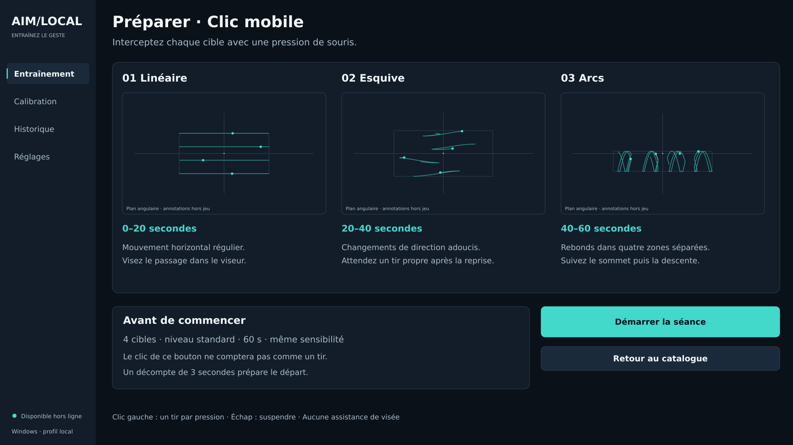

**Décompte.** Trois secondes, corps de cible masqué avant le départ, consigne unique correspondant à la mécanique. Le clic de démarrage est consommé par l’interface ; l’armement attend le relâchement. Pas de remise à zéro de caméra en cours de phase. Une orientation nominale initiale peut être fixée avant le décompte ; elle est journalisée.

**Pendant le programme.** Nom/niveau en haut à gauche, phase en haut au centre, temps restant en haut à droite, petit indicateur d’avancement sous le timer, mesures autorisées en bas à gauche et consigne courte en bas. Le centre reste libre, hormis le viseur. Les chiffres ne sautent pas de largeur : utiliser des chiffres tabulaires et réserver la largeur de la valeur. L’aide ne doit pas couvrir une cible admissible ; sa zone appartient à la marge basse de l’arène de référence.

**Frontière de phase.** Préavis en haut pendant les deux dernières secondes, sans obscurcir ni bloquer le jeu. À la frontière, changer le nom, les paramètres et les instances selon la machine d’état. Pas d’écran intermédiaire. Les chronologies restent exactement 60 s. Les animations UI ne possèdent pas leur propre horloge de score.

**Résultat public.** Afficher niveau, date, version, durée active et état de validité. Présenter chaque phase avec réussites, tirs, précision, temps ou contact, puis les diagnostics pertinents. Une moyenne de trois médianes n’est pas la médiane de séance : recalculer sur les événements ou conserver les statistiques par phase. Les comparaisons historiques utilisent uniquement les clés compatibles. Les actions sont Rejouer, Choisir un exercice et Détails/export. L’historique ne se transforme pas en classement entre familles de scores.

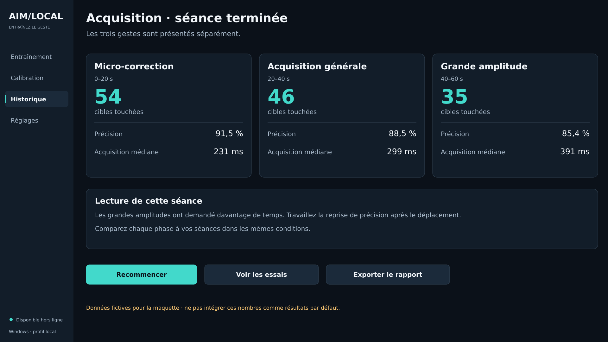

**Préparation CAL.** Demander gain actuel, DPI déclarés, objectif et profil de rendu ; proposer un contrôle de rotation. Afficher les candidats effectifs, les durées et le calendrier avant génération du plan immuable. « Express » désigne une présélection, pas une conclusion finale. Le joueur peut décider de s’en tenir à cette étape ; le statut est alors `exploratory_only` et le réglage initial reste la valeur par défaut.

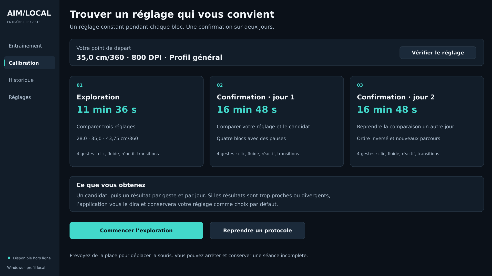

**Mesure CAL.** Le bloc indique la journée, la période et la tâche, ainsi que le temps restant. Les scores, écarts, taux de réussite et pronostics sont masqués. Le gain reste celui du bloc pendant les récupérations. Un label neutre A/B peut être employé ; cela ne rend pas l’expérience aveugle, car la différence de contrôle peut être perceptible. Aucune animation d’encouragement corrélée à la performance n’est ajoutée.

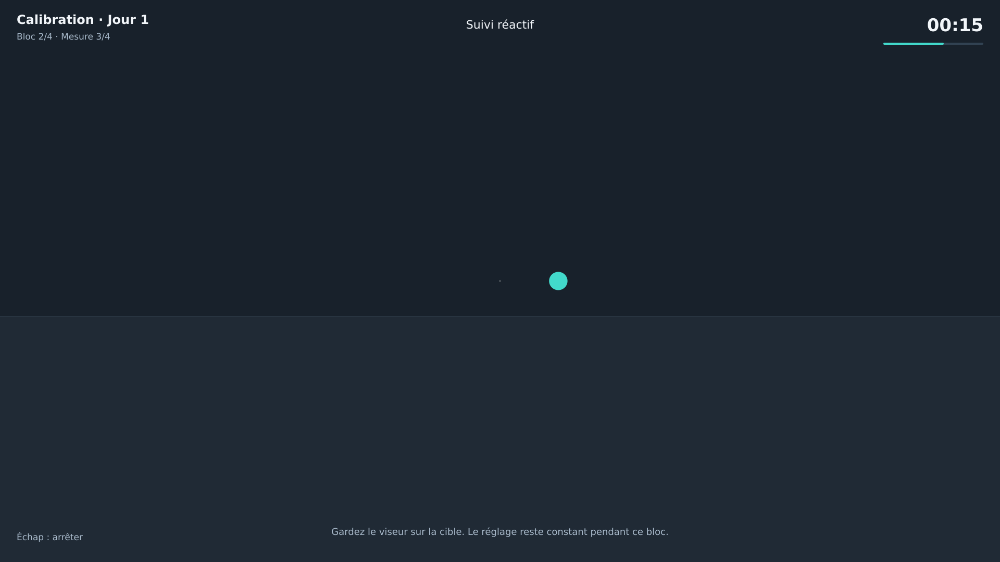

**Résultat CAL.** Traduire le statut du moteur en texte. L’exemple livré illustre `repeated_improvement` avec candidat 28 cm/360 face à 35 cm/360, et des différences de **+3,08 et +3,20 points** sur deux jours. Les nombres proviennent de la fixture positive synthétique ; ils ne sont pas les résultats de l’utilisateur. Montrer les quatre gestes, les réussites brutes, les conditions, les pauses et l’identifiant du plan. Les barres utilisent une échelle commune explicitée ; un résultat négatif a une barre de l’autre côté de zéro. Ne pas tronquer à zéro les pertes dans l’UI réelle.

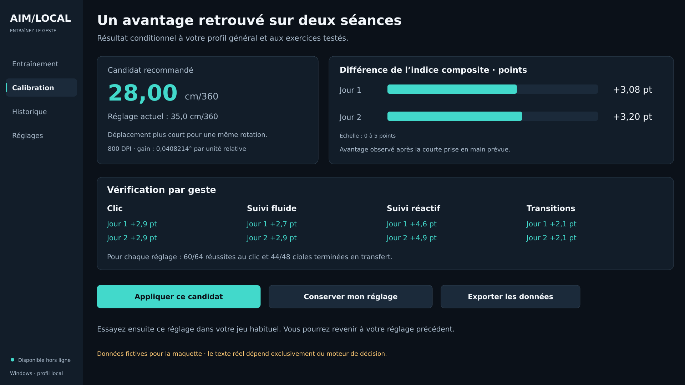

| Statut interne | Titre utilisateur proposé | Action principale |
|---|---|---|
| `unstable_conditions` | Conditions de mesure insuffisantes | Expliquer la cause observée et conserver le réglage. |
| `incomplete` | Comparaison à terminer | Reprendre seulement ce que le protocole autorise. |
| `exploratory_only` | Un candidat à vérifier | Préparer la confirmation, sans appliquer automatiquement. |
| `repeated_regression` | Le réglage actuel reste préférable sur ces essais | Conserver le réglage actuel. |
| `repeated_improvement` | Un avantage retrouvé sur deux séances | Proposer le candidat, application volontaire et réversible. |
| `mixed_tradeoff` | Les gestes ne favorisent pas tous le même réglage | Montrer le compromis, garder l’actuel par défaut. |
| `close_observed` | Résultats proches dans cette comparaison | Garder l’actuel ; ne pas annoncer une équivalence démontrée. |
| `undetermined` | Ces essais ne permettent pas de trancher | Conserver l’actuel et exposer la cause. |

### 8.6 Navigation, adaptation et contenus dynamiques

Tous les boutons et champs sont des composants natifs Godot. L’ordre clavier suit l’ordre de lecture. Le focus visible utilise une bordure de 2 px au minimum ; quitter un modal restaure le focus sur son déclencheur. Les états désactivés possèdent une explication textuelle. Les erreurs de lecture, de sauvegarde et de configuration ne sont pas assimilées à un score faible.

À 720p ou avec échelle UI élevée, les menus défilent verticalement et les cartes changent de colonne. Le rendu d’arène garde le FOV et le rapport 16:9 ; les bandes restantes ne sont pas des zones de cible. Les textes ne doivent jamais être rasterisés dans une grande image de maquette. Les SVG livrés ne sont pas le fond interactif de l’application : ils servent de référence de reconstruction.

Les couleurs personnalisées, le volume et le viseur peuvent se régler avant une séance de pratique. Le profil utilisé est enregistré. Une calibration fige ces éléments sur l’ensemble du plan ; changer de contraste ou de viseur crée une autre condition. Le mode de réduction des animations retire les effets cosmétiques ; il ne ralentit pas les trajectoires et ne prolonge pas les fenêtres.

Le footer des fichiers documentaires peut indiquer graine, unités et noms de modèles. Ces détails appartiennent à l’onglet technique ou à l’export dans l’application ; le joueur qui démarre une séance doit voir un geste et une consigne compréhensibles.

---


<a id="chapitre-9"></a>

## 9. Contrat d’exécution, de tir et de mesure

### 9.1 Machine d’états de la séance

~~~mermaid
stateDiagram-v2
    [*] --> Preparation
    Preparation --> Chargement: définition choisie
    Chargement --> Decompte: ressources et manifeste prêts
    Decompte --> Actif: départ volontaire
    Actif --> PausePratique: pause autorisée
    PausePratique --> Decompte: reprise volontaire
    Actif --> InvalideCAL: interruption de mesure
    Actif --> Finalisation: durée terminée
    Finalisation --> Resultat: rapport sauvegardé
    InvalideCAL --> Resultat: motif enregistré
    Resultat --> [*]
~~~

Un programme public dure 60 s de **temps actif**. Le décompte initial de 3 s et les pauses ne sont pas inclus dans ces 60 s. Une pause de pratique suspend les horloges et libère le bouton tenu. La reprise conserve positions, phases et temps actif, exige un nouveau relâchement/armement et utilise un décompte de 3 s sans score. Le rapport conserve les pauses ; une séance interrompue ne devient pas un record strictement comparable à une séance continue.

Une calibration ne reprend pas une cellule notée au milieu d’une interruption. Le protocole du chapitre 12 définit la reprise de l’ensemble du rôle de journée. Quitter proprement ou planter au milieu d’un gain temporaire ne doit jamais remplacer le profil durable du joueur.

### 9.2 Horloge et événements

Utiliser une horloge monotone, avec temps relatif entier en microsecondes et compteur de séquence croissant. La date UTC et la date locale sont des métadonnées de séance. Elles ne servent pas à calculer la vitesse, les dégâts ou une deadline. Godot distingue les ticks monotones des fonctions d’heure système ; le comportement effectif doit être vérifié dans la version du dépôt. [S19]

Les événements portent au minimum :

| Champ | Règle |
|---|---|
| `event_sequence` | Entier strictement croissant ; tranche les timestamps égaux. |
| `received_time_us` | Horloge monotone du callback d’entrée. |
| `logical_time_us` | Temps actif auquel l’événement est appliqué. |
| `kind` | Type connu : motion, press, release, focus, capture, phase, spawn, render marker, etc. |
| `payload` | Champs fermés propres au type. |
| `phase_id` | Phase active à cette date, après application des événements calendaires prioritaires. |
| `target_id/generation` | Identité complète lorsqu’un événement concerne une cible. |

À une date logique donnée :

1. Intégrer contact et dégâts de l’intervalle précédent ; rechercher les destructions au bon instant.
2. Finaliser la séance si la date atteint sa fin, sinon finaliser la phase si nécessaire.
3. Appliquer deadlines, changements de priorité et événements de mouvement programmés, selon leurs priorités.
4. Créer les nouvelles instances ou opportunités.
5. Appliquer les entrées dans l’ordre de réception, avec chaque clic à sa place dans la séquence.
6. Publier un snapshot immuable vers le rendu.

L’ordre exact aux transitions de phase est fixé au chapitre 4. Une deadline de clic est exclusive. Une intégrale de dégâts peut atteindre le seuil exactement à sa frontière ; cette destruction est enregistrée une fois, avant clôture. Un événement futur ne corrige jamais rétroactivement la pose d’un clic passé.

### 9.3 Pose de regard et gain de souris

Le contrat est `received_pose_hold_v1`. La pose change à la réception d’un mouvement valide et reste constante entre deux mouvements. Un lissage de replay ne modifie pas le calcul des scores.

~~~text
yaw_deg   += dx_received × gain_deg_per_relative_unit
pitch_deg -= dy_received × gain_deg_per_relative_unit
pitch_deg = clamp(pitch_deg, -89, +89)
~~~

Ce clamp limite l’orientation de la caméra, pas les positions des cibles. Le yaw peut être conservé comme rotation déroulée pour les métriques ; sa représentation de rendu est réduite de manière stable modulo 360. Définir clairement ce choix dans les traces. Les rotations donnent la direction géométrique du chapitre 4 ; leur signe doit être testé par un mouvement dans chaque sens.

Le gain n’est multiplié ni par `delta`, ni par le DPI de l’écran, ni par la résolution, ni par `ui_scale`. Les DPI de la souris servent à **interpréter nominalement** le gain en centimètres, pas à le multiplier une seconde fois.

Utiliser `InputEventMouseMotion.screen_relative` dans le chemin prévu, capture explicite et accumulation désactivée. Ce champ évite l’effet du scaling du contenu documenté pour d’autres coordonnées, mais il ne certifie pas des paquets HID munis d’un timestamp matériel. [S13] [S14] Le chemin réel doit être testé avec l’exécutable Windows. La description de Raw Input par Microsoft n’autorise ni une autodétection fictive des DPI, ni l’invention d’un horodatage absent des structures employées. [S22] [S23] [S24]

Le traitement du clic utilise un front de pression, pas un sondage du bouton une fois par image. Un mouvement valide est traité exactement une fois. Ne pas effacer des deltas pour rattraper un frame lent ou recaler automatiquement le joueur.

### 9.4 Collision de référence

L’autorité est la sphère analytique issue du même centre et du même rayon que le mesh. Les volumes physiques destinés au debug ne constituent pas un second système de score.

Avec origine de rayon `o`, direction unitaire `a`, centre de cible `c`, rayon `r` :

~~~text
q = o - c
b = dot(a, q)
c_term = dot(q, q) - r*r
discriminant = b*b - c_term
t_near = -b - sqrt(discriminant)
t_far  = -b + sqrt(discriminant)
~~~

Un discriminant strictement négatif hors tolérance numérique donne un miss. Choisir la plus petite intersection positive admissible, dans les plans de coupe. Pour plusieurs sphères, choisir l’intersection la plus proche ; départager une égalité numérique par l’identité stable. Une pression ne tue jamais deux cibles. Les configurations empêchent normalement le recouvrement des silhouettes ; le cas dégénéré reste défini pour les tests.

La tolérance numérique n’élargit pas la cible d’une marge de confort. Les calculs scalaires de référence du modèle utilisent binary64, y compris les coordonnées intermédiaires du hitscan. Si les vecteurs de rendu du build utilisent une précision différente, conserver les calculs d’autorité dans des scalaires de précision suffisante puis convertir pour dessiner ; ne pas supposer que tous les types Vector3 ont la même précision sur tous les builds. [S20]

Les constantes suivantes sont des choix numériques de la V2, regroupés dans `donnees/runtime.contract.json` :

| Constante | Valeur / formule | Application |
|---|---|---|
| Epsilon binary64 | `2.220446049250313e-16` | Valeur machine employée dans la tolérance relative ci-dessous. |
| Epsilon angulaire | `1e-9` degré | Tests angulaires et encadrement du contact ; convertir une fois si le calcul est en radians. |
| Tolérance discriminant | `64 × epsilon_binary64 × max(1 m², b², abs(c_term), r²)` | Même unité que le discriminant. Dans l’intervalle de moins cette tolérance à zéro, ramener à zéro ; en dessous, miss. |
| Égalité des intersections | `1e-9` m | Deux distances plus proches que cette limite sont départagées par l’identité stable. |
| Erreur de silhouette | `0.5` px au viewport réellement rendu | Écart maximal au contour tangent de référence ; ne pas corriger en augmentant la hitbox. |
| Erreur de projection de point | `0.5` px au viewport réellement rendu | Caméra et centres, distincte du test de silhouette. |

Ces tolérances stabilisent l’arrondi à la frontière ; elles ne compensent pas une mauvaise caméra, une unité incorrecte ou des centres divergents. Les fixtures géométriques restent à porter et à vérifier dans le moteur.

Pour un regard depuis l’œil fixe, le test d’angle `angle(a,u) ≤ asin(r/d)`, avec cible devant le joueur, est une vérification indépendante du hitscan. Le bord appartient à la cible selon cette convention mathématique. La polygonisation du mesh doit s’approcher de la sphère avec l’erreur visuelle tolérée ; elle ne devient pas un collider polygonal plus petit.

### 9.5 Apparition logique et rendu réel

Chaque instance distingue :

| Repère | Signification |
|---|---|
| `logical_onset_us` | Début fixé par le modèle ou le manifeste. |
| `first_rendered_frame` | Première frame moteur enregistrée pour cet état de cible utile au rendu. |
| `render_onset_proxy_us` | Repère logiciel associé à cette frame. |
| `deadline_us` | Fin logique immuable d’une fenêtre, si elle existe. |
| `resolved_time_us` | Hit, kill, expiration ou censure. |

Un simple `visible=true` n’atteste pas que la cible a été dessinée dans une zone utile : tenir compte de l’état du viewport et des panneaux. Distinguer une absence due au regard du joueur d’un problème technique de ressource, de viewport ou de rendu.

Aucun impact n’est attribué à une remplaçante qui n’a jamais été rendue. **Le marqueur de rendu ne retarde jamais le début ni la fin du dénominateur planifié.** En suivi public, E vaut exactement la durée active de phase ; en CAL, E vaut 24 s. Le temps d’acquisition initial, le regard détourné et le culling causé par le joueur restent dans E. Une panne technique peut invalider la mesure, jamais raccourcir discrètement sa fenêtre pour améliorer le ratio.

Les événements `frame_post_draw` et similaires restent des proxies du moteur. Ils ne mesurent pas le scanout de l’écran ni la latence physique jusqu’aux yeux. [S21] Les rapports nomment séparément latence depuis le début logique et délai depuis le proxy de rendu. Un replay reproduisant les mêmes collisions conserve ces marqueurs en plus des entrées.

Le modèle est évalué au temps logique de l’événement. Le rendu interroge le même modèle au temps de son snapshot ; il ne crée pas un second mouvement interpolé en shader. Des images moins fréquentes peuvent réduire l’information disponible au joueur : l’indépendance mathématique des trajectoires au FPS ne prouve pas une indépendance humaine de la performance au FPS.

### 9.6 Intégration bornée du contact

Compter « une frame sur cible » ne suffit pas : 60 et 240 FPS donneraient des durées et des kills différents. Découper le temps aux changements d’entrée, aux activations/désactivations du bouton, aux bornes de mouvement, aux marqueurs de rendu et aux événements de cible.

Sur un intervalle sans discontinuité, le regard est constant. Poser :

~~~text
g(t) = erreur_angulaire_au_centre(t) - rayon_angulaire(t)
L = borne_vitesse_angulaire_cible + borne_vitesse_du_rayon_angulaire
h = largeur_intervalle
m = milieu_intervalle

si g(m) + L*h/2 < -epsilon : tout l'intervalle est en contact
si g(m) - L*h/2 > +epsilon : tout l'intervalle est hors contact
sinon : subdiviser
~~~

Le test utilise une borne valide sur tout l’intervalle, pas la seule vitesse au milieu. Les impulsions de rebond et changements de phase sont des frontières obligatoires. Pour EX07, inclure la variation de rayon apparent induite par la distance. Pour EX03, inclure le taux de rétrécissement.

Un pas initial maximal de 1/240 s est un choix de subdivision, sans signification de polling matériel. Conserver une borne inférieure et supérieure du temps de contact. L’incertitude cumulée maximale de CAL est **0,05 point de pourcentage de la durée**, donc 12 ms pour 24 s. Utiliser le milieu de l’encadrement comme estimation et conserver ses bornes.

Pour une destruction, rechercher le premier instant où l’intégrale atteint les PV restants, avec une tolérance temporelle cible de **0,1 ms**, puis continuer le temps restant sur le nouvel état. Ne pas transférer à une remplaçante tout le reliquat d’une frame avant son premier rendu.

Les limites de départ sont 8 192 évaluations de `g` par tranche initiale d’au plus 1/240 s, et 4 000 000 par phase, tous appels de subdivision et de recherche de kill inclus. Ces plafonds bornent le travail ; ils ne garantissent pas un budget de frame sur toute machine. Cesser la recherche dès que le budget de cette tranche/phase est atteint. Si l’incertitude ne descend pas assez, lever `unresolved_integration_error` et refuser la mesure CAL ; la pratique conserve un rapport non comparable. Ne pas continuer un score approximatif comme si le contrat avait été satisfait. Les tolérances ci-dessus sont numériques ; elles ne décrivent ni le bruit humain, ni l’incertitude d’un capteur, ni la durée d’affichage physique.

### 9.7 Mesures secondaires et attribution

Les scores de référence sont définis au chapitre 4. Afficher le score entier par `floor(x+0.5)` à la fin, conserver sa valeur non arrondie et tous les compteurs. Une précision sans tir vaut `null`, affiché « — ». Une latence sans observation n’est jamais « 0 ms ».

| Mesure | Définition exploitable | Précaution |
|---|---|---|
| Débit | Hits ou kills / durée active | Ne pas comparer des mécaniques et tailles différentes. |
| Précision | Hits / fronts de tir | Un timeout ne crée pas de tir fictif. |
| Succès de fenêtres | Opportunités réussies / opportunités prévues complètes | Conserver séparément les incidents techniques. |
| Acquisition initiale | Première arrivée/hit depuis le début d’une phase | Le départ de phase et la première cible ont leur propre catégorie. |
| Acquisition sur remplacement | Hit suivant moins naissance de l’instance | En multicible libre, inclut le choix de priorité du joueur. |
| Transition de maintien | Premier contact avec une autre cible moins kill précédent | Exclure la première acquisition de séance de cette distribution. |
| Contact utile | Durée de contact, avec bouton si la mécanique le demande | Le dénominateur principal n’est jamais le seul temps de tir. |
| Erreur au centre | Angle regard–centre | Un décentrage peut rester un hit. |
| Erreur au bord | max(0, erreur−rayon angulaire) | Le rayon est instantané en profondeur et en shrink. |
| Erreur normalisée | Erreur / rayon angulaire instantané | Outil de lecture ; aucune équivalence universelle de difficulté. |
| Reprise stable | Début de 50 ms de contact brut continu après une perte | Censurer si l’événement suivant arrive avant cette confirmation. |
| Contact après inversion | Contact sur l’union des fenêtres de 250 ms suivant les inversions | Séparer bord et inversion spontanée ; pas de double comptage. |
| Dispersion de rythme | Médiane/P90 des intervalles entre hits, avec effectif | Ne pas déduire une intention du joueur. |

La fusion des interruptions de moins de 20 ms est permise **pour les diagnostics d’épisodes uniquement**. Ces pertes restent dans le score brut. Le retour stable exige 50 ms consécutives avant fusion. Enregistrer `kept_contact`, `already_off_target_at_change` et les observations censurées.

Le quantile de référence utilise le rang supérieur `ceil(p*n)` dans la liste triée, indices à partir de 1. Les statistiques indiquent toujours n et la méthode. Conserver des traces permet de recalculer les diagnostics versionnés sans réécrire le score historique.

### 9.8 Dépassement et corrections

Pour une cible unique imposée, projeter l’erreur du tir dans le plan tangent de la cible. L’axe longitudinal est le sens d’arrivée depuis le regard initial ; l’autre axe lui est perpendiculaire. Stocker erreur signée longitudinale, transversale, amplitude programmée et amplitude réellement parcourue.

Un tir au-delà du centre n’est pas une preuve de sensibilité trop élevée. Une correction tardive, une décision de tir, une trajectoire mobile ou le délai de rendu peuvent produire le même résultat. Les travaux sur la cinématique montrent l’intérêt de distinguer les composantes du geste ; ils ne valident pas une règle automatique fondée sur le seul signe d’une erreur. [S09]

Pour le multicible libre, l’attribution au centre géométrique le plus proche porte explicitement `target_attribution=nearest_geometric`. Elle n’est pas employée pour conseiller un nouveau gain. Aucune simulation consistant à multiplier une ancienne trace par un autre gain ne prédit la trajectoire qu’un humain aurait exécutée avec ce gain.

<a id="chapitre-10"></a>

## 10. Pratique, progression et historique

### 10.1 Utiliser les phases sans recréer un catalogue parallèle

Le joueur sélectionne une carte et un niveau. Les phases expliquent la progression du geste dans cette minute. Un écran de résultats montre les phases côte à côte ; il peut conseiller de rejouer une carte selon une difficulté observée.

Le moteur peut lancer une phase seule dans ses tests et dans l’éditeur interne. Cette capacité ne crée pas un nouveau sélecteur public. Une extension ultérieure du catalogue exige une décision explicite et des paramètres versionnés.

### 10.2 Progression de difficulté

Ne pas changer la taille ou la vitesse au milieu d’une séance pour maintenir un taux de réussite donné. Cela détruirait la comparabilité et brouillerait l’apprentissage du comportement.

Après au moins trois séances complètes du même programme/niveau, sur au moins deux dates locales distinctes, une suggestion peut être préparée. Choix initiaux à valider lors du pilote : clic public précision ≥90 % sur toutes les phases ; EX03 succès ≥80 % et précision ≥90 % ; suivi contact ≥85 % sur toutes les phases ; switching contact utile/temps actif ≥80 %. Il faut remplir la condition lors des trois séances retenues, sans incident technique, sans fabriquer un score à partir des seules meilleures phases.

La suggestion propose le niveau suivant ; le choix reste au joueur. Elle n’est ni un diagnostic de compétence universelle ni un seuil Voltaic. Une session sur le niveau suivant est un nouveau contexte de record. Les conditions d’un retour vers un niveau plus accessible restent simples : choix volontaire ou tâche durablement incomprise, sans punir le joueur pour un mauvais jour.

### 10.3 Routines compactes

Les durées ci-dessous incluent un décompte de 3 s par programme et les repos indiqués. Elles n’incluent pas une attente volontaire dans un menu.

| Routine | Ordre | Repos entre programmes | Budget programmé |
|---|---|---:|---:|
| Mise en route | EX01 → EX05 → EX08 | 20 s | 3 min 49 |
| Travail du clic | EX01 → EX02 → EX03 → EX04 | 30 s | 5 min 42 |
| Travail du suivi | EX05 → EX06 → EX07 → EX08 | 30 s | 5 min 42 |
| Tour complet | EX01 à EX08, une fois chacun | 20 s | 10 min 44 |

Aucun score global ne somme des tâches hétérogènes. Chaque programme conserve son rapport et son niveau. Le temps de repos peut être prolongé volontairement ; l’application affiche alors la durée réelle.

### 10.4 Comparaisons et suivi dans le temps

La clé de comparaison exacte inclut version du catalogue, programme, difficulté, phase ou agrégat, formule de score, gain exact, DPI déclaré, FOV, résolution d’arène, input, présentation et conditions techniques. Les graines peuvent différer pour une pratique répétée ; leur difficulté et leur distribution restent identiques. Une analyse de calibration emploie en plus ses manifestes appariés.

L’historique peut filtrer et juxtaposer des contextes différents avec leurs étiquettes. Il ne transforme pas cela en un record strict partagé. Le passage à un gain différent conserve les anciens résultats et commence une nouvelle série pour les comparaisons qui exigent un gain fixe.

Un module longitudinal peut préparer une proposition de comparaison après **30 séances complètes compatibles, sur au moins 3 dates, représentant 30 minutes de temps actif**, en utilisant les 30 dernières séances compatibles sur 30 jours. Il décrit les mesures disponibles par geste. Un déséquilibre de performances ou de corrections peut justifier une comparaison A/B ; il ne détermine pas à lui seul la direction du changement.

Après une comparaison terminée, attendre au moins sept jours et six nouvelles séances compatibles avant une nouvelle suggestion automatique. Le joueur peut lancer volontairement une comparaison plus tôt. Le système ne modifie aucun gain pendant la pratique ordinaire et ne conseille pas une nouvelle sensibilité à chaque record.

Ces seuils de suggestion sont des choix de produit, à ajuster prospectivement à partir du pilote. Ils ne sont pas présentés comme la méthode publique exacte de Mouselabs.


<a id="chapitre-11"></a>

## 11. Architecture Godot et distribution Windows

Les noms de nœuds et modules sont des responsabilités proposées, à raccorder au dépôt réel. Les pages officielles `/stable/` consultées le 12 octobre 2026 peuvent décrire une version différente de celle du projet ; épingler le moteur et ses templates avant le portage.

### 11.1 Livraison Windows autonome

#### 11.1.1 Contrat de distribution

Le joueur final doit pouvoir télécharger une archive, l’extraire avec Windows et lancer l’application, **sans installer Godot, Python, Node.js, un serveur local, un navigateur intégré ou un runtime WebView**. Les outils éventuels de génération du catalogue, de validation JSON, de fabrication de figures ou de signature appartiennent à la chaîne de développement. Ils ne sont pas des dépendances du jeu.

Le binaire de référence est un export **Windows x86_64 Release de Godot/GDScript** avec les templates correspondant exactement au moteur retenu. Les exports ARM64 restent une distribution distincte à réceptionner ; un exécutable ARM64 ne doit pas être présenté comme compatible avec tous les PC x64. L’export Windows associe un runtime optimisé aux données du projet [AV01].

Deux formes sont acceptables :

| Forme | Contenu livré | Règle |
|---|---|---|
| Exécutable avec ressources embarquées | AIMLocal.exe, plus notices si elles ne sont pas accessibles dans l’application | binary_format/embed_pck=true ; adapté au profil de référence sans bibliothèque native supplémentaire. |
| Dossier autonome | AIMLocal.exe, AIMLocal.pck, notices et bibliothèques requises par le renderer sélectionné | Le joueur conserve le dossier entier ; il n’installe aucun de ces composants dans le système. |

**PCK embarqué ne veut pas dire DLL embarquées.** Godot expose notamment des options d’export pour les bibliothèques ANGLE et Direct3D 12. Si le renderer ou une extension les exige, elles doivent accompagner le binaire. L’option d’intégration du PCK concerne les ressources du projet [AV02]. La documentation Windows indique aussi une limite d’environ 3,89 Go pour l’exécutable avec PCK embarqué ; le projet doit rester très en dessous [AV01].

Ne pas annoncer un fichier unique avant d’avoir contrôlé le contenu réel de l’export. Ne pas supprimer une DLL parce que l’application démarre sur le poste de développement : elle peut être déjà présente sur ce poste.

#### 11.1.2 Renderer retenu

**Profil de référence proposé : Compatibility, driver opengl3.** La scène décrite ici utilise des meshes, matériaux opaques simples et éléments 2D disponibles sans éclairage avancé. Ce choix vise une scène légère et un périmètre de compatibilité clair ; il ne constitue pas une promesse de FPS sur tout GPU.

La documentation des projets exportés donne actuellement Windows 10 comme plancher logiciel et OpenGL 3.3 pour ce chemin de compatibilité. Elle distingue ce socle des performances réellement atteintes par un projet. Ces exigences doivent être vérifiées pour la version moteur effectivement épinglée [AV03].

| Profil | Rôle | Conditions |
|---|---|---|
| reference_gl_v2 | Profil initial réceptionné | Compatibility/OpenGL, rendu 100 %, MSAA 4× proposé, effets avancés désactivés. |
| Profil de secours éventuel | Résoudre une incompatibilité GPU observée | Driver réellement disponible dans le build, bibliothèques incluses, paramètres et image réceptionnés. |
| Profil Mobile/Forward+ éventuel | Seulement après besoin démontré | Export, préchauffage et recette propres ; aucune comparaison CAL en mélangeant les profils. |

Godot documente des replis entre drivers et vers Compatibility, avec un risque de différence visuelle [AV04]. Le rapport conserve le **renderer et le driver effectivement démarrés**, pas seulement la préférence sauvegardée. Une modification de renderer implique un redémarrage hors épreuve. L’application n’effectue pas un changement opportuniste de renderer, de résolution ou de MSAA entre deux gains comparés.

Les valeurs ci-dessus sont une **cible de livraison**, pas le résultat d’un test matériel déjà réalisé. Publier la configuration minimale de l’application après réception sur des machines réelles. Ne pas reprendre les 2 Go de RAM ou les 150 Mo indicatifs de Godot comme mesures du logiciel.

#### 11.1.3 Contenu à inclure

Inclure les scènes, scripts, shaders, ressources importées, polices, sons, icônes, catalogue, manifestes requis et notices. Un chargement local ne doit pas dépendre d’un CDN ou d’une URL distante.

Les fichiers JSON/TXT ne sont pas automatiquement équivalents à des ressources Godot importées : ResourceLoader ne lit pas les fichiers texte ordinaires et la documentation avertit qu’ils ne sont pas tous exportés par défaut [AV05]. Prévoir des filtres ciblés pour les fichiers lus par FileAccess, puis vérifier leur présence dans **l’export**, sans utiliser le dossier du projet comme secours.

Un manifeste de livraison conserve : identifiant du build, version et hash du moteur/template, architecture, renderer/driver prévu, presets d’export, version du catalogue, liste des fichiers distribués et SHA-256. Les certificats et clés de signature ne font jamais partie de cette liste publique.

Le branding natif doit être finalisé : icône .ico, nom du produit, numéro de version et description de l’exécutable. La signature éventuelle est réalisée sur le poste de livraison ; le joueur n’installe pas les outils de signature [AV01].

#### 11.1.4 Données personnelles et répertoires

Les ressources restent dans **res://**. Les réglages et rapports sont écrits dans **user://**. Activer un répertoire utilisateur personnalisé stable, par exemple :

~~~text
application/config/use_custom_user_dir = true
application/config/custom_user_dir_name = "AIMLocal"
~~~

Sur Windows, cette configuration mène à **%APPDATA%\AIMLocal**, d’après la convention documentée par Godot [AV06]. Utiliser les API de chemin de Godot ; ne pas concaténer un nom d’utilisateur ou supposer que le disque est C:.

| Répertoire logique | Contenu |
|---|---|
| user://settings/ | Profils et préférences versionnés. |
| user://reports/ | Rapports de séance immuables. |
| user://calibration/ | Plans figés, résultats, checkpoints et reprises. |
| user://diagnostics/ | Logs et traces, avec politique de rétention visible. |
| user://exports/ | Exports explicitement demandés depuis l’interface. |

« Autonome » ne signifie pas que l’application écrit à côté de son .exe. Ce répertoire peut être en lecture seule. Le mode autonome de l’éditeur Godot n’est pas celui des projets exportés [AV06].

Avant de changer le répertoire actuellement utilisé par l’application, résoudre son chemin effectif, recopier et contrôler les fichiers compatibles, enregistrer la migration, puis conserver les originaux jusqu’à validation. Aucun ancien rapport ne reçoit une fausse empreinte V2. Une erreur d’écriture conserve les données en attente et le profil précédent ; l’UI n’affiche pas « sauvegardé » avant confirmation du service.


### 11.2 Scène Godot concrète

#### 11.2.1 Responsabilités et nœuds

| Élément proposé | Type / responsabilité |
|---|---|
| AppRoot | Node : navigation, cycle de vie et services. |
| SessionController | Node : machine d’états et calendrier des phases. |
| InputRouter | Node : réception ordonnée, capture, focus et journal des commandes. |
| SessionModel | Objets GDScript de données ; autorité pour temps, cibles, poses et score. |
| ArenaViewport | SubViewport 3D : une seule arène active, résolution explicite. |
| ArenaPresenter | Node3D : traduit un snapshot du modèle en transforms et couleurs. |
| WorldEnvironment | Fond et traitement colorimétrique fixes. |
| Room | Node3D : mur et sol statiques. |
| EyeRoot/YawPivot/PitchPivot/Camera3D | Caméra sans déplacement du joueur ni roll. |
| TargetPool | Pool de MeshInstance3D partageant les ressources de mesh et matériau. |
| ArenaSurface | TextureRect ou conteneur équivalent présentant uniquement le viewport 3D. |
| HudLayer | CanvasLayer : viseur, temps, phase et informations minimales. |
| MenuLayer | CanvasLayer : écrans Control, containers, formulaires, catalogue, résultats. |
| ModalLayer | CanvasLayer au-dessus des menus : pause, erreur et confirmation locale. |

Un TextureRect pour présenter le viewport 3D est normal. **L’ensemble de la fenêtre ou d’un formulaire ne doit pas devenir une image**. Les boutons, champs, tableaux et textes sont de vrais Control ; ils conservent focus, sélection, tailles et contenu dynamique.

Le modèle ignore les nœuds de rendu. Il n’interroge pas un MeshInstance3D pour connaître la position « vraie » d’une cible. L’aperçu et la séance demandent des snapshots au même moteur, avec un contexte distinct qui exclut l’aperçu de l’historique.

#### 11.2.2 Repère et caméra

Conserver l’œil (0,1.6,0) m, X à droite, Y vers le haut, direction nominale −Z. L’arène et les cibles restent dans ce monde fixe. Aucun parent du pool de cibles ne suit les rotations du joueur.

~~~text
projection = Camera3D.PROJECTION_PERSPECTIVE
keep_aspect = Camera3D.KEEP_HEIGHT
fov = 70.53280043291679
near = 0.05
far = 100.0
h_offset = 0.0
v_offset = 0.0
frustum_offset = Vector2.ZERO
~~~

Avec un viewport 16:9, cette configuration conserve le FOV vertical et donne H=103°. Godot expose KEEP_HEIGHT, la projection, les méthodes de projection de rayon et unproject_position [AV07]. L’équivalence indiquée est documentaire et mathématique ; un test dans la version moteur réellement utilisée reste requis.

Si le modèle utilise yaw positif vers la droite et pitch positif vers le haut, les pivots doivent produire :

~~~text
direction = (cos(pitch) sin(yaw), sin(pitch), -cos(pitch) cos(yaw))
YawPivot.rotation.y = -yaw_radians
PitchPivot.rotation.x = pitch_radians
~~~

Les autres transforms de ces pivots restent neutres. Tester les quatre signes ; éviter un second renversement de Y dans le profil de sensibilité. Le gain s’applique au mouvement reçu ; il n’est pas multiplié par le temps d’une frame.

#### 11.2.3 Mur, sol et horizon

Les valeurs suivantes sont alignées sur **donnees/interface.theme.json**, qui constitue l’autorité du thème :

| Élément | Géométrie | Présentation |
|---|---|---|
| Mur frontal | QuadMesh de 80×40 m, centre (0,20,−18), face vers +Z | Couleur #18212B ; opaque, sans texture contrastée. |
| Sol | PlaneMesh de 80×80 m, centre (0,0,−20) | Couleur #202A35, aucune variation animée. |
| Fond hors mur | Couleur d’environnement identique au fond du mur | Évite un contour lumineux parasite. |
| Repères de frontière | Tracé projeté non interactif seulement si prévu par le preset | Aucun guide angulaire ni traînée de déplacement ajouté par défaut. |

À l’orientation nominale, l’horizon géométrique est à y=540 px, mais la jonction du mur z=−18 avec le sol y=0 est à **y≈607,8772 px** en 1920×1080. La ligne de rebond à pitch−8° est encore une autre construction. Une figure qui place ces trois lignes au même endroit suggère une fausse géométrie.

Les cibles décrites restent devant le mur. Toute future paroi placée devant elles doit entrer dans la logique d’occlusion ; un mur visible ne peut pas être traversé par le hitscan sans règle déclarée.

#### 11.2.4 Cibles et matériaux

Créer un SphereMesh partagé de **rayon 1 m, hauteur 2 m**, avec 64 segments radiaux et 32 anneaux. Godot distingue hauteur totale et rayon [AV08]. Chaque instance applique une échelle uniforme égale au rayon physique voulu. Ne pas modifier la ressource partagée pour changer une seule cible.

Le rayon provient du modèle : r=d×sin(D/2) pour une taille angulaire constante, ou rayon physique constant pour la profondeur. La transform du mesh et la sphère analytique du hitscan utilisent **le même rayon et le même centre**. Aucune cible n’est grossie dans les vues de jeu ou dans l’aperçu pour être plus lisible ; les schémas de mécanisme explicitement étiquetés « agrandis » restent documentaires.

Matériau de référence : StandardMaterial3D opaque, SHADING_MODE_UNSHADED, couleur unie, sans texture, émission, alpha, effet de contour ni spéculaire. Les ombres sont désactivées. Ce matériau rend la frontière prévisible ; le sol et le mur fournissent les repères de profondeur.

Le profil de référence n’a besoin d’aucune lumière dynamique. Un DirectionalLight3D peut être prévu pour un thème ultérieur, désactivé dans le profil mesuré. Les effets bloom, flou de mouvement, profondeur de champ, TAA, auto-exposition et secousse caméra restent désactivés.

Le contour facetté du mesh est une approximation de la sphère. Le choix 64/32 doit satisfaire la tolérance visuelle sur les plus grandes tailles projetées ; ce n’est pas une raison pour réduire la sphère mathématique. Si la tolérance échoue, augmenter la tessellation hors séance.

#### 11.2.5 Pool et MultiMesh

Un pool de **16 instances** est un plafond d’implémentation initial proposé ; valider que chaque phase publiée respecte cette capacité. Les ressources sont allouées avant le départ. La réapparition réutilise une instance et actualise son identifiant de génération, sa pose et ses marqueurs de rendu.

Pour les quelques cibles simultanées du catalogue, des MeshInstance3D séparés facilitent identité, debug et premiers rendus. Ne pas imposer MultiMesh pour un gain non mesuré.

MultiMesh permet l’instanciation GPU de nombreuses copies avec moins de soumissions, mais regroupe la visibilité spatiale ; l’AABB du groupe doit convenir à toutes les instances [AV09]. Si un besoin mesuré conduit à l’utiliser, conserver une table indépendante instance_index→target_id/generation, un AABB explicite et la même autorité CPU. Aucun mouvement calculé exclusivement dans un vertex shader ne doit diverger du hitscan.


### 11.3 Coordonnées, figures et interface

#### 11.3.1 Trois espaces distincts

Le code distingue le **monde 3D** en mètres/angles, le **rectangle d’arène** en pixels réellement présentés, et l’**interface** en unités de mise en page avec son facteur d’échelle.

Pour le profil de référence, l’arène prend le plus grand rectangle 16:9 inscrit dans la zone disponible. Les bandes restantes ne contiennent pas de cible. Le viewport est rendu à la taille de ce rectangle, échelle 3D100 %. Un agrandissement de fenêtre ne doit pas étirer une ancienne image de l’arène tout en laissant sa résolution cachée inchangée.

Une implémentation déterministe possible désactive le stretch global de la fenêtre, calcule arena_rect_px, dimensionne ArenaViewport à sa taille entière et place ArenaSurface exactement sur ce rectangle. MenuLayer possède sa propre échelle ; HudLayer est ancré au rectangle d’arène. Les Control locaux utilisent containers et anchors.

Godot fournit également les modes de stretch, la séparation du rendu 3D et des éléments 2D, et les ancres de Control [AV10]. Si le projet utilise déjà canvas_items, le conserver est possible **si la même transformation finale est démontrée**. Ne pas cumuler une mise à l’échelle manuelle avec un stretch global non pris en compte.

Calcul conseillé pour les menus : ui_scale=max(1,hauteur_fenetre_px/1080)×facteur_utilisateur. Le facteur utilisateur est réglable hors séance ; le root UI reçoit taille_fenetre/ui_scale. Cela évite de réduire automatiquement une police 20 px à13,3 px en720p. En4K, l’échelle de base vaut2. Les breakpoints dépendent de la largeur logique disponible après division.

L’UI n’utilise jamais cette échelle pour calculer la caméra, la taille des cibles ou le gain de souris. Le HUD suit une transformation explicite de son rectangle de référence vers l’arène ; les paramètres du thème restent figés pendant une calibration.

#### 11.3.2 Projection exacte utilisée par les figures

Pour un point q en repère caméra, q.z<0, un rectangle W×H et des pixels carrés :

~~~text
f = W / (2 tan(HFOV/2)) = H / (2 tan(VFOV/2))
screen_x = origin_x + W/2 + f × q.x/(-q.z)
screen_y = origin_y + H/2 - f × q.y/(-q.z)
~~~

En1920×1080 et H103, f=763.6184800011154 px. Pour une direction yaw/pitch :

~~~text
x = 960 + f × tan(yaw)
y = 540 - f × tan(pitch)/cos(yaw)
~~~

Le facteur 1/cos(yaw) en Y est nécessaire. Des cartes rectangulaires yaw/pitch et des projections perspectives ne sont pas interchangeables.

| Direction | Projection du centre |
|---|---|
| yaw0°, pitch0° | (960 ; 540) px |
| yaw10°, pitch0° | (1094,646541 ; 540) px |
| yaw0°, pitch7° | (960 ; 446,239440) px |
| yaw10°, pitch7° | (1094,646541 ; 444,793032) px |
| yaw22°, pitch12° | (1268,521892 ; 364,940741) px |

La silhouette d’une sphère hors axe ne se réduit pas à un cercle centré sur cette projection. Avec u=(centre−œil)/d, rho=asin(r/d) et e1/e2 orthonormés perpendiculaires à u, projeter :

~~~text
w(psi) = cos(rho) u
       + sin(rho) (cos(psi)e1 + sin(psi)e2)
~~~

Ces directions forment le cône tangent. Les figures livrées utilisent 128 points sur le contour tangent, sous contrôle de l’erreur en pixels ; raffiner pour les grands agrandissements. La formule de diamètre en pixels de V1 n’est exacte sous sa forme symétrique que pour une cible centrée.

La validation moteur compare ces points à unproject_position et le rayon inverse à project_ray_normal, avec la même transform et le même viewport. Tester centre, périphérie, tailles extrêmes et une résolution non16:9 avec bandes. Cette recette est à réaliser dans Godot ; les calculs indépendants ne remplacent pas son exécution.

#### 11.3.3 Thème et layout de référence

Ne pas recopier plusieurs palettes dans les scripts. **donnees/interface.theme.json** est l’autorité : fond des menus #0B1119, surface #121D29, surface surélevée #1B2A3A, bord #314252, texte #F2F6FA, texte secondaire #A9BACB. L’arène conserve #18212B/#202A35 ; la cible principale #42D9CB ; l’alternative #FFB454 ; les cibles inactives #77899B.

Les tokens sont donnés en sRGB. La fabrique des matériaux et le thème appliquent la conversion colorimétrique une seule fois. Une différence d’apparence entre renderers appelle une réception et une version de présentation.

Grille1920×1080 : sidebar232 px, contenu à x272, marge droite32, espacement des cartes24. Huit cartes publiques se disposent en **4 colonnes×2 lignes**. Sous1500 unités logiques disponibles, passer à2 colonnes ; sous900, à1. Les textes s’enroulent et les zones de contenu défilent ; ne pas les couper à hauteur fixe.

Employer MarginContainer, VBoxContainer, HBoxContainer, GridContainer, ScrollContainer, PanelContainer, Label, Button, LineEdit et OptionButton. Les coordonnées nominales de la figure ne deviennent pas des positions fixes pour toutes les fenêtres.

Police du thème : **DejaVuSans.ttf / DejaVuSans-Bold.ttf**, embarquées avec leurs licences effectives. Corps20 px, secondaire17, titre32, timer34 ; minimum16 à1080p pour le corps essentiel et les contrôles. Les annotations techniques des schémas ne sont pas des contrôles de jeu. Le joueur n’installe pas ces polices dans Windows. Les figures doivent employer les mêmes fichiers.

Éviter SystemFont comme autorité de mise en page. Les glyphes et tailles employés pendant une séance sont préparés au chargement. Godot documente le pré-rendu des glyphes, le cache par taille des polices rasterisées et les particularités MSDF [AV12]. MSDF n’est pas obligatoire ; choisir une méthode et la figer pendant CAL.

Vérifier accents, œ/Œ, apostrophe typographique, signe moins, degré et espaces des unités. Réserver la largeur des nombres ou utiliser des chiffres tabulaires si la ressource les prend en charge. Une traduction modifiée impose de renouveler les glyphes pré-rendus concernés.

Inclure une page « À propos / Licences », accessible hors séance, avec licence Godot et notices des polices, sons et autres assets distribués. Godot rappelle l’attribution du moteur et des composants tiers [AV13].

#### 11.3.4 Correspondance figure → composants

| Figure de spécification | Éléments à implémenter | Limite |
|---|---|---|
| Catalogue | Grille de cartes, vrais filtres, boutons et labels ; aperçu d’une phase identifié | Aucun PNG plein écran avec zones de clic invisibles. |
| Fiche d’exercice | Control avec résumé, niveaux, durée, phases et bouton ; viewport d’aperçu | Aucune seconde simulation approximative. |
| Arène | Meshes3D, caméra, viewport et HUD | Aucune profondeur fictive par simple dessin de cercles2D. |
| Plan CAL | Périodes, repos et tâches issus du plan immuable | Aucune chronologie manuelle divergent du plan. |
| Résultat CAL | Statut, gains réellement comparés, graphiques et effectifs calculés | Aucun pourcentage de confiance inventé. |
| Planche de mécanique | Axes/trajectoires issus des contrats du générateur | Un schéma simplifié est étiqueté comme tel. |

Les SVG/PNG sont des **figures de spécification et références de réception**. Les textes restent des labels dans l’application. Les icônes peuvent être importées ; les tracés simples peuvent être dessinés par un Control dédié. Une source SVG ne garantit pas qu’elle restera vectorielle à chaque étape d’import : vérifier la version moteur [AV12].

Chaque figure porte identifiant, thème, scénario/niveau/phase, temps de simulation s’il y a lieu, caméra, résolution et statut « schématique » ou « projection calculée ». Les coordonnées angulaires et physiques du catalogue restent l’autorité.

#### 11.3.5 HUD, priorité et feedback

Le HUD suit les rectangles du thème : programme(32,24,460,58), phase(700,24,520,50), timer(1696,24,192,54), progression(1696,82,192,4), métriques(32,974,320,74), aide(530,1008,860,40), dans la référence1920×1080. Le timer est donc en haut à droite en V2. Cette décision remplace son centrage proposé dans V1.

Viseur : **cœur blanc de diamètre2 px, contour sombre radial1 px**, soit diamètre externe4 px à1080p. Centre(960,540). Le thème du viseur ne modifie pas la collision.

Anneau de vie : facteur extérieur1,2, trait2 px à1080p, départ−90°, sens horaire, fraction PV_restants/PV_max. La priorité utilise quatre crochets externes orange ; l’échéance un arc externe distinct. Aucun de ces éléments n’est une hitbox.

Les sons locaux et préparés suivent les fréquences/enveloppes du thème. L’effet visuel de destruction de60 ms ne masque pas une nouvelle cible et ne change aucun rayon utile. Les valeurs de score visibles peuvent s’actualiser à10 Hz ; cela ne réduit jamais la fréquence de calcul du score ni celle du viseur.

Un passage de phase à20 ou40 s ne recrée pas le monde et ne recapture pas la souris. L’étiquette et l’avertissement prévu par le thème suffisent. Aucun décompte supplémentaire n’est ajouté à une séance annoncée comme60 s.


### 11.4 Input, focus et indépendance du rendu

#### 11.4.1 Routage des événements

Le seul routeur de gameplay traite les événements dans leur ordre de réception. Il utilise **screen_relative**, non affecté par le scaling du contenu, et désactive l’accumulation pour les nouvelles mesures comme dans V1 [AV14]. La provenance reste « unités relatives non mises à l’échelle » ; ce n’est pas une capture de paquets HID horodatés matériellement.

Ne pas multiplier le delta par dt, le traiter dans _input puis de nouveau dans _process, ou reconstruire les clics uniquement en pollant un bouton par frame. Conserver temps monotone de réception, numéro de séquence, capture et payload. À timestamp égal, la séquence départage motion→click→motion : le clic utilise la pose après le premier mouvement et avant le second.

La pose logique et les cibles sont évaluées au temps de l’événement, indépendamment de la dernière transform affichée. **received_pose_hold_v1** maintient la pose entre événements reçus ; aucune interpolation rétroactive ne profite d’un mouvement futur.

#### 11.4.2 Contrat de focus

| État | Souris/interface | Conséquence |
|---|---|---|
| Menu/résultat | Curseur visible, navigation clavier | Aucun tir. |
| Chargement | Interface minimale | Aucun score actif. |
| Familiarisation/jeu | Capture, HUD non interactif | Événements vers le moteur. |
| Pause de pratique | Curseur libéré, menu focalisé | Temps actif figé, tir tenu libéré. |
| Perte de focus | Capture et tir logiquement relâchés | Pause ou invalidation selon protocole. |
| Reprise | Action volontaire, boutons relâchés, décompte prévu | Aucun tir hérité du clic sur Reprendre. |

Esc dépend de l’état. Fermer un panneau rend le focus au contrôle d’origine. Une touche maintenue ne valide pas plusieurs modales. Retirer les contrôles cachés du parcours et définir explicitement le premier focus. Godot recommande de définir les voisins de navigation et de ne pas employer les actions ui_* de focus comme commandes de gameplay [AV15].

Le clic qui active Démarrer n’est pas réutilisé comme tir. L’armement exige le relâchement du bouton et un état prêt. Cela n’autorise pas à jeter arbitrairement le premier déplacement après capture. Une fois le jeu actif, aucun delta valide n’est supprimé pour recentrer ou stabiliser artificiellement le joueur.

#### 11.4.3 Présentation et mesure

À chaque frame, ArenaPresenter demande un état au temps de présentation retenu. La mesure reste une fonction des événements et programmes. Désactiver l’interpolation physique automatique des cibles si elle introduit une seconde trajectoire visuelle.

L’apparition logique, la génération de cible et son premier marqueur de rendu sont distincts. Un nœud visible=true hors frustum ou masqué par un panneau ne prouve pas une présentation utile. Les identifiants préparés pour la frame sont associés à **first_rendered_frame / render_onset_proxy_us**.

Le signal de fin de dessin reste un **proxy applicatif**, pas un instant d’affichage physique. Un replay exigeant le même score rejoue les mêmes marqueurs. Deux FPS différents ne garantissent pas deux expériences humaines identiques.

Pour le score contact_v2, le dénominateur E vaut **la durée planifiée entière de la phase**, acquisition initiale et regard hors zone compris. Le marqueur first_rendered_frame autorise uniquement le numérateur de contact ; il ne décale ni ne raccourcit E. Le catalogue impose exposure_never_retimed=true. Une panne de présentation invalide la mesure comparative sans transformer la durée restante en fenêtre plus favorable.

La dynamique utilise pose_at(t) et des programmes préconstruits, pas position+=vitesse×delta dans les nœuds visuels. Un tick logique240 Hz ne prouve pas240 observations indépendantes.


### 11.5 Chargement et budgets

#### 11.5.1 Barrière avant le départ

La barrière « prêt » exige définition et manifeste validés, programmes construits, pools alloués, ressources chargées, viewport définitif, préparation des variantes de rendu et conditions de départ satisfaites.

Un chargement asynchrone peut employer load_threaded_request puis consulter son statut. Appeler load_threaded_get avant la fin peut bloquer le thread appelant [AV05]. Aucun appel équivalent ne doit survenir au premier hit.

Pour Compatibility, Godot recommande de montrer les matériaux/shaders nécessaires au moins une frame dans le frustum pendant le chargement. Les mécanismes modernes et le shader baker ne suppriment pas toutes les étapes dépendant du GPU/driver [AV16].

Le préchauffage fait réellement passer les combinaisons utilisées par le rendu : glyphes, anneaux, priorité et feedback inclus. Un objet éliminé avant dessin ne prépare pas le pipeline. Ne pas promettre « zéro stutter » après une attente fixe de2 s : observer la fin des chargements et les premières utilisations, puis tester à cache froid.

#### 11.5.2 Budget initial

Objectifs d’ingénierie pour une **machine de référence à désigner**, scène1080p, renderer de référence, jusqu’à16 cibles et MSAA4×. Ce ne sont pas des performances déjà démontrées :

| Poste | Cible / règle |
|---|---|
| Simulation/input | P95≤1 ms par frame ; mesurer également la charge à haute fréquence d’événements. |
| GPU arène/HUD | P95≤2,5 ms si l’instrumentation est fiable. |
| Images complètes | Objectif240 FPS sur la machine désignée ; vérifier les frametimes. |
| Géométrie | Moins de100000 triangles visibles pour la base et le pool maximal. |
| Soumissions | Cible<80 appels de dessin pendant la séance, à mesurer. |
| Ressources actives | Pas de chargement tardif de scène, shader, texture ou police. |
| Aperçus | Un seul aperçu animé dans le catalogue ; tous arrêtés pendant une séance. |
| Historique | Pas de reconstruction de tous les rapports pendant un exercice. |

Les budgets CPU/GPU ne s’additionnent pas en une latence de bout en bout. Une mesure GPU indisponible vaut null avec raison ; la durée CPU d’une soumission n’est pas un substitut.

Préallouer une file d’événements de capacité justifiée, par exemple32768 entrées, avec pic d’occupation et débordements. Aucun événement n’est effacé pour rattraper le rendu. Un débordement rend la mesure non admissible.

Les traces/persistances utilisent des buffers et un service distinct. Aucun hash du catalogue, JSON de rapport complet ou tri d’historique à chaque mouvement ; aucun nouveau nœud créé dans les callbacks d’input.

#### 11.5.3 Qualité

La qualité couvre toutes les phases ; une transition n’efface ni hitch ni compteurs. Les statistiques ne se limitent pas aux dernières4096 frames.

Conserver mean_fps=n/somme(dt), median_fps=1/median(dt), P99 au rang supérieur. Le seuil d’admissibilité CAL et l’objectif240 FPS ont des rôles différents ; aucun ne certifie une équivalence perceptive entre machines.

Tester500/1000 Hz et les fréquences supérieures effectivement disponibles. Le débit des callbacks observés reste nommé comme tel, sans devenir un polling matériel détecté. Une souris immobile pendant100 ms n’est pas une panne.


<a id="chapitre-12"></a>

## 12. Calibration de sensibilité : protocole soutenu et comparaison sur deux jours

### 12.1 Les trois défauts structurels de V1

#### 12.1.1 Changer de gain toutes les 45 secondes mesure trop fortement le changement lui-même

Avec 12 secondes de prise en main et 24 secondes notées, le joueur peut passer une part importante de chaque essai à réapprendre l’amplitude du geste. Une restauration du gain de départ après chaque cellule renforce ce problème : même deux cellules successives du challenger sont séparées par un retour vers A. Le protocole peut avantager la sensibilité à laquelle le joueur revient le plus facilement, alors que l’intention du produit est de choisir un réglage que l’on va conserver.

**Correction V2 : un gain reste appliqué pendant une période complète de 192 secondes, qui contient une minute de prise en main puis les quatre tâches.** Il reste aussi appliqué pendant le repos suivant. Deux périodes consécutives sur B sont réellement consécutives sur B. La garantie de restauration intervient à la fin de la séance ou lors de son abandon, pas entre les tâches.

La minute de prise en main est un choix de durée. Elle ne démontre pas une adaptation complète. L’étude de Boudaoud, Spjut et Kim comporte 13 participants analysés, huit séances de 500 acquisitions, un seul gain par séance, et environ dix minutes par séance. Les auteurs excluent la première moitié des essais de leur analyse pour tenir compte d’un apprentissage marqué à l’intérieur de la séance. Cette étude motive la prudence envers une adaptation supposée immédiate ; elle ne valide ni une minute ni le protocole présent. [S17]

#### 12.1.2 Quatre batteries rapprochées ne garantissent pas quatre répétitions indépendantes

Une formule de Student peut être calculée correctement tout en donnant une interprétation trop assurée. L’apprentissage, la fatigue et le gain précédent relient les observations ; quatre compétences ne sont pas quatre participants, et 64 cibles ne sont pas 64 réplications indépendantes du choix de sensibilité. Une variance nulle de nombres arrondis n’est pas une information suffisante sur la performance future.

**Correction V2 : deux effets journaliers sont calculés, puis décrits.** Le système présente leur moyenne, leurs valeurs séparées et l’étendue des quatre contrastes appariés. Il applique des règles d’action conservatrices définies avant la comparaison. Il ne présente ni intervalle de confiance de confort, ni probabilité de « bonne sensibilité », ni équivalence démontrée. Deux jours restent peu de données ; le changement de vocabulaire doit refléter cette limite.

#### 12.1.3 Un parcours de 50 minutes et un score composite peuvent produire une conclusion sur la fatigue ou sur la stratégie de score

Une longue sélection suivie d’une longue confirmation consomme du temps sur de nombreux changements de réglage. Le classement peut aussi favoriser un joueur qui sacrifie plusieurs réussites pour tirer plus vite, si la formule récompense assez la vitesse. Le fait que les quatre scores soient bornés entre 0 et 1 ne rend pas leurs unités psychologiques identiques.

**Correction V2 : supprimer la sélection obligatoire de 22 minutes.** Une exploration de 11 min 36 choisit une alternative. Cette alternative est ensuite comparée au départ pendant deux séances de 16 min 48, sur des défis nouveaux. Le résultat expose les quatre compétences et bloque une promotion générale si la réussite brute baisse trop. Le budget total est de **45 min 12, réparti sur trois séances**, hors attentes, reprises et changements de difficulté. Un joueur qui connaît déjà le challenger peut aller directement à la comparaison de deux jours.

### 12.2 Portée de la conclusion et sources

La question du protocole est : **« Ce réglage effectivement essayé a-t-il montré un meilleur compromis, de façon répétée, après la prise en main courte prévue et dans ces conditions ? »** Ce n’est pas : « Quel est mon optimum physique définitif, au millième près, pour tous les jeux et après plusieurs semaines ? »

Les sources servent à comprendre le problème et les produits de référence. Les chiffres de taille, de cadence, de durée, de décision et de qualité proposés ci-dessous sont des **paramètres de conception**, pas des normes découvertes dans la littérature.

| Source primaire | Ce qu’elle appuie | Ce qu’elle ne fournit pas |
|---|---|---|
| Aimlabs, présentation de Mouselabs, 2025 [S02] | Suivi en arrière-plan, exploitation d’informations de flick et de suivi, mises à jour alimentées par la pratique | Formule publique reproductible de l’optimiseur, preuve que notre protocole donne la même recommandation |
| Aimlabs, notes de version 1.3.2, 2023 [S01] | Dépendance de la recommandation au choix des tâches et à leurs propriétés | Un réglage universel indépendant des tailles, mouvements et compétences |
| KovaaK’s Sensitivity Matcher [S18] | Vérification et transfert d’un gain de rotation entre logiciels | Sélection du meilleur gain à partir des performances |
| Boudaoud et al., 2022 [S17] | Étude contrôlée du gain dans une tâche FPS, compromis spatial et adaptation pendant la séance | Norme universelle de cm/360, délai court garanti d’adaptation, validation des quatre CAL |
| Donovan et al., 2022 [S09] | La stratégie vitesse/précision compte dans l’analyse du geste | Règle causale « overshoot = sensibilité trop élevée » applicable automatiquement |

Un overshoot peut servir à décrire le geste. Il ne suffit pas à identifier sa cause. Le suivi passif peut proposer un moment pertinent pour comparer deux réglages ; il ne peut pas reconstruire la performance contrefactuelle à un gain jamais essayé à partir d’une trace enregistrée à A.

### 12.3 Invariants d’une comparaison

#### 12.3.1 Paramètres figés

Le plan est sauvegardé avant le premier score et contient : identifiant du protocole, version du moteur et des générateurs, ressources de tâches, poids, niveaux, gains binaires réellement appliqués, DPI déclarés, FOV, résolution rendue, renderer, échelle de rendu, écran/fréquence déclarés, plafond FPS, VSync, convention d’entrée, viseur, palette, audio, option de masquage A/B, limites de qualité et toutes les graines.

La position des yeux est `(0 ; 1,6 ; 0)` m, le joueur ne se déplace pas, et les cibles CAL sont à **4 m**. Pour une sphère de diamètre angulaire `D`, le rayon vaut `r = 4 × sin(D/2)` avec conversion correcte des degrés. Le décor peut comporter un mur à `z = −18 m` ; ce mur ne définit pas la distance des cibles et ne sert pas de collider de tir.

La difficulté et l’objectif ne changent pas entre A et B. Un changement de DPI, FOV, modèle de mouvement, taille, fenêtre temporelle ou formule de score appelle un nouveau plan. Les données restent dans l’historique, avec leur identité d’origine ; elles ne sont pas fusionnées silencieusement.

#### 12.3.2 Trois objectifs, pas des poids ajustés après avoir vu les résultats

| Objectif | CLICK | SMOOTH | REACTIVE | SWITCH |
|---|---:|---:|---:|---:|
| Polyvalent | 0,25 | 0,25 | 0,25 | 0,25 |
| Acquisition | 0,45 | 0,15 | 0,15 | 0,25 |
| Suivi | 0,15 | 0,30 | 0,35 | 0,20 |

Ces poids expriment la préférence du produit. Ils ne prétendent pas qu’un point de suivi et un point de clic représentent la même quantité de compétence humaine. Les quatre résultats et les comptes bruts sont toujours conservés.

#### 12.3.3 Le départ est exact ; les autres candidats sont représentables avant les essais

Le réglage de départ A est le gain réellement appliqué, conservé avec ses bits IEEE-754 et une écriture décimale permettant le retour exact à ces bits. Le libellé arrondi en cm/360 ne doit pas devenir le nouveau départ.

Pour un gain linéaire en degrés par unité d’entrée relative :

```text
cm_nominal_par_360 = 914.4 / (DPI_déclarés × gain)
```

Le mot « nominal » rappelle que des DPI déclarés ne sont pas une mesure physique certifiée. La comparaison peut être cohérente dans l’application même si le chiffre physique annoncé par le capteur est légèrement différent.

La grille locale habituelle est `{c0/1,25 ; c0 ; c0×1,25}`. Un mode explicitement choisi avant l’exploration emploie `1,50`. Bornes techniques initiales : **5–150 cm/360** ; aucun départ hors bornes n’est modifié automatiquement. Après conversion à la précision de réglage du profil, reconvertir en gain réel et en cm/360, vérifier les bornes, puis dédupliquer les gains effectifs.

La V2 limite aussi le rapport entre chaque candidat et le départ à **1,50**, dans le sens le plus grand, après représentation. Aux bornes, cela peut donner deux candidats au lieu de trois. On ne fabrique pas une troisième valeur à ×1,5625 pour ensuite découvrir qu’elle est incompatible avec la confirmation locale. Les exposants sont parcourus dans un intervalle fini, dans l’ordre `−1,+1,−2,+2,…`, en rejetant les résultats hors contraintes.

Deux labels qui appliquent le même gain ne sont pas deux candidats. Le constructeur retourne `DUPLICATE_EFFECTIVE_GAIN` ou `NO_DISTINCT_REPRESENTABLE_LOCAL_CHALLENGER`. Les essais de QA avec gain identique sont des fixtures identifiées comme telles ; cette exception ne s’expose pas dans le parcours utilisateur.

### 12.4 Quatre tâches de 24 secondes

Les CAL ont leurs propres utilités. Elles partagent le visuel et les primitives des exercices publics, tout en fixant le calendrier avant l’entrée humaine.

| Tâche | Contenu Standard | Calendrier | Utilité |
|---|---|---|---|
| `CAL_CLICK_R2` | 1 cible, diamètres 1°/2°, amplitudes planifiées 4–8°/18–30° | 16 créneaux de 1,5 s ; apparition retardée de 0,10–0,25 s ; fenêtre active 1,20 s | Réussite du premier tir pondérée par sa latence |
| `CAL_SMOOTH_R2` | 1 cible invincible, diamètre 2,4°, amplitude horizontale 14°, vitesse maximale 18°/s | Trajectoire continue de 24 s | Contact valide / 24 s |
| `CAL_REACTIVE_R2` | Ressource exacte EX06/standard/reactive, diamètre 2,6° | Trajectoire commune précompilée, 24 s | Contact valide / 24 s |
| `CAL_SWITCH_R2` | 3 positions, diamètre 2,6°, 20 PV, dégâts à 100 PV/s | 12 créneaux de 2 s ; priorité retardée de 0,10–0,25 s ; fenêtre active 1,70 s | Destruction pondérée par son délai, TTK idéal déduit |

Le délai de début est tiré uniformément parmi les entiers **100 000 à 250 000 microsecondes inclus**. Le JSON stocke le délai et les dates logiques en microsecondes ; les valeurs en secondes sont un affichage de ces mêmes dates. Cela évite une ambiguïté de quantification entre le manifeste et le moteur.

#### 12.4.1 Machine d’état CLICK

Une cible reste statique. Les centres sont dans yaw±25° et pitch±12°. Le sac comporte quatre occurrences de chacune des quatre combinaisons petite/grande taille × courte/longue amplitude. Les positions sont tirées dans l’anneau sphérique correspondant, puis validées dans l’enveloppe. La référence du tirage suivant est la cible précédente **prévue**, même si elle a été ratée. La première référence est la direction centrale nominale. La caméra ne se recentre pas après un échec.

Pour chaque opportunité `i`, définir :

```text
slot_start = i × 1,5 s
onset = slot_start + jitter[i]
deadline = onset + 1,20 s
slot_end = slot_start + 1,5 s
```

| État | Visuel et entrée | Transition |
|---|---|---|
| `pre_onset` | Cible future invisible. Le premier front de tir dans ce créneau est prématuré. | Front ⇒ `resolved_premature`, utilité 0 ; sinon onset ⇒ `active_unrendered` |
| `active_unrendered` | Cible activée logiquement ; aucune réussite autorisée avant `first_rendered_frame`. | Premier front ⇒ échec prématuré ; première image ⇒ `active_visible` |
| `active_visible` | Premier front évalué contre la sphère visible correspondante. | Hit ou miss ⇒ opportunité résolue ; deadline ⇒ timeout |
| `resolved_hit`, `resolved_miss`, `resolved_premature` | Cible masquée ; aucun tir ne répare la tentative. | Fronts suivants ⇒ `extra_shot` diagnostique ; slot suivant ⇒ nouvelle opportunité |
| `interwindow` après deadline | Aucune cible active ; tirs tardifs conservés en diagnostic. | Nouveau créneau à son heure prévue |

Un premier tir prématuré avant l’apparition peut empêcher la cible d’apparaître : l’absence de `first_rendered_frame` dans ce cas est une conséquence de l’échec humain, pas automatiquement une panne du rendu. Les pressions pendant le décompte, avant le créneau, ne sont pas des essais ; le départ exige un bouton relâché. Une pression conservée ne produit pas de nouveau front de clic.

La deadline est exclusive pour un nouveau clic : un événement de pression daté exactement à la deadline arrive après l’expiration. Au début exact d’un nouveau créneau, celui-ci est créé avant le routage des nouvelles pressions ; un tir à cette frontière est donc prématuré dans le nouveau créneau.

```text
tau[i] = premier_tir[i] - onset[i]
u[i] = 1 - tau[i] / 1,20 si premier tir valide, visible et réussi
u[i] = 0 sinon
U_CLICK = somme(u[i]) / 16
```

`tau` a pour origine la date logique du manifeste. La date de première image est une **barrière d’éligibilité**, pas un nouveau zéro de score adapté à chaque PC. Conserver aussi le délai depuis ce proxy de rendu pour diagnostiquer les variations d’affichage. Un proxy logiciel de première image ne mesure pas directement le moment où les photons atteignent les yeux.

L’amplitude effectivement parcourue dépend de l’erreur précédente ; elle est donc enregistrée en plus de l’amplitude planifiée. Ne pas appeler « temps de mouvement moteur pur » une latence comprenant l’apparition, la détection et la décision de tirer.

#### 12.4.2 Suivi continu

SMOOTH utilise :

```text
yaw(t) = 14 × sin((v_max / 14) × t + phase) degrés
pitch = 0 ; distance = 4 m
v_max Standard = 18°/s
a_max Standard = 18²/14 ≈ 23,143°/s²
U_SMOOTH = contact_valide / 24 s
```

REACTIVE réutilise **le même générateur que EX06**. Standard : vitesses de plateau 18–28°/s ; 70 % de durées entre 0,70 et 1,20 s, 30 % entre 0,28 et 0,45 s ; probabilité d’inversion 0,70 ; rampe de vitesse smoothstep de durée au moins `max(0,14 ; 1,5×|v1−v0|/700)` s. Le déclenchement de bord à ±21° préempte l’événement en conservant position et vitesse ; la nouvelle vitesse pointe vers l’intérieur. Aucun clamp de position ou téléportation ne masque une trajectoire mal construite.

Le compilateur commun `motion_reference_v2.0` fournit les morceaux analytiques et événements. Le programme de 24 s n’effectue aucun tirage pendant la boucle de rendu. L’inversion effective utilisée pour les diagnostics de réacquisition est le changement de signe de vitesse, pas automatiquement le début de rampe ; conserver ces deux dates séparément.

```text
U_REACTIVE = contact_valide / 24 s
```

Le temps initial pour rejoindre la cible appartient aux 24 secondes. Le contact ne compte qu’à partir de la première image de la cible. La fenêtre logique reste de 24 secondes : le protocole ne compense pas une machine lente en lui retirant le délai d’apparition du dénominateur. La qualité de rendu est contrôlée séparément. Le clic n’est requis dans aucun suivi CAL.

#### 12.4.3 Machine d’état SWITCH

Les trois centres fixes sont dans yaw±23°, pitch±10°, séparés d’au moins 10°. Chaque position reçoit exactement quatre priorités, sans répétition immédiate. Les positions sont les mêmes dans toute la tâche ; le calendrier ne dépend pas du nombre de destructions.

Pendant `pre_onset`, toutes les positions sont neutres et non dommageables ; la future priorité n’est pas révélée. À l’onset, la priorité change et ses PV sont remis à leur valeur complète. Elle devient dommageable après `first_rendered_frame` de ce nouvel état. Les autres cibles restent désaturées. Après destruction, la priorité est masquée jusqu’au créneau suivant. À la deadline, une cible inachevée cesse de recevoir des dégâts et l’opportunité vaut zéro.

**Le bouton peut rester maintenu entre les créneaux.** Une nouvelle pression avant l’affichage de priorité ne cause pas l’échec automatique de SWITCH ; elle ne produit simplement aucun dégât avant le rendu. Importer ici la règle du premier clic de CLICK détruirait la mécanique de maintien que l’on cherche à mesurer.

```text
slot_start = i × 2 s
onset = slot_start + jitter[i]
deadline = onset + 1,70 s
ttk = PV / 100
tau = date_destruction - onset
u = clamp((1,70 - tau) / (1,70 - ttk), 0, 1) si détruite
u = 0 sinon
U_SWITCH = somme(u) / 12
```

L’intégration des dégâts de l’intervalle précédent se termine à la deadline. Si les PV atteignent exactement zéro à cette frontière, la destruction est enregistrée avec utilité zéro, puis l’opportunité se ferme ; elle n’est pas aussi comptée comme un échec. Un contact partiel n’est jamais converti en destruction pour rendre la métrique plus flatteuse.

#### 12.4.4 Tailles et niveau avant toute comparaison

| Paramètre | Novice | Standard | Avancé |
|---|---:|---:|---:|
| CLICK, diamètres | 1,6° / 2,8° | 1° / 2° | 0,7° / 1,4° |
| SMOOTH, diamètre / vitesse maximale | 3,4° / 12°/s | 2,4° / 18°/s | 1,6° / 24°/s |
| REACTIVE | Ressource EX06 novice | Ressource EX06 standard | Ressource EX06 advanced |
| SWITCH, diamètre / PV / TTK | 3,4° / 15 / 0,15 s | 2,6° / 20 / 0,20 s | 1,8° / 30 / 0,30 s |

Une familiarisation initiale au départ dure 60 s : quatre segments de 15 s. Elle donne des instructions jouables et vérifie que la tâche est comprise. Pour un diagnostic de difficulté, utiliser 10 opportunités CLICK complètes, 7 SWITCH complètes et 15 secondes de suivi ; ne pas diviser arbitrairement ces essais par le dénominateur d’une épreuve de 24 s.

Le niveau Standard est proposé par défaut. Si une utilité de familiarisation est inférieure à 0,10 ou supérieure à 0,95, proposer un niveau voisin avant de figer le plan. Un essai supplémentaire de 24 s par tâche modifiée s’ajoute au budget. Au plus deux changements par tâche ; ensuite expliquer que la configuration est à revoir. Cette heuristique ne mesure pas scientifiquement un niveau de joueur.

Une fois les données de confirmation acquises, si la moyenne groupée des huit utilités d’une tâche est <0,10 ou >0,95, la tâche est marquée peu informative et le résultat est `undetermined`. Ne pas retirer la compétence ni refaire seulement ses mauvais essais à une autre taille pour conserver le reste du calcul.

### 12.5 Le compromis vitesse/précision reste explicite

L’utilité CLICK est une préférence pour réussir vite avec un coût fini de l’échec. Elle n’est pas neutre entre toutes les stratégies. Exemple illustratif : 95 % de réussite à 0,40 s donne une utilité d’environ 0,633 ; 80 % à 0,20 s donne environ 0,667. Une recherche fondée seulement sur cette utilité pourrait préférer le second comportement. Le filtre de réussite brute doit donc être visible et calculé sur les observations.

Après la confirmation, chaque gain possède **64 opportunités CLICK** et **48 opportunités SWITCH**. Pour promouvoir B, la réussite CLICK ne doit pas baisser de plus de **5 points de pourcentage**, et la proportion de destructions SWITCH de plus de **1/12, soit 8⅓ points**. Cela représente, avec les effectifs fixes, au plus **3 succès CLICK en moins** et **4 destructions SWITCH en moins**. La différence CLICK de 4/64 vaut 6,25 points et échoue à la garde ; ne pas arrondir ce résultat à un vague « environ 5 % ».

Les gardes s’ajoutent aux utilités et aux pertes par compétence. Elles ne font pas de la formule un test universel du comportement en match. Pour juger le compromis, présenter les hits/opportunités, les kills/opportunités et les distributions de latence valides. Ne pas comparer uniquement la latence des succès : un réglage qui élimine ses tentatives lentes par davantage de misses pourrait y paraître artificiellement rapide.

Les médianes et quantiles de latence servent à expliquer le résultat. La décision primaire demeure celle qui a été fixée avant l’essai. Les erreurs, absences de tir et pertes de contact humaines restent dans les dénominateurs.

### 12.6 Déroulement, ordre et budget

#### 12.6.1 Une période de 3 min 12, au même gain

| Temps relatif à la période | Action | Durée |
|---|---|---:|
| 0–60 s | Prise en main du gain, quatre mini tâches de 15 s | 60 s |
| 60–63 / 63–87 / 87–93 s | Décompte / tâche 1 / récupération | 33 s |
| 93–96 / 96–120 / 120–126 s | Décompte / tâche 2 / récupération | 33 s |
| 126–129 / 129–153 / 153–159 s | Décompte / tâche 3 / récupération | 33 s |
| 159–162 / 162–186 / 186–192 s | Décompte / tâche 4 / récupération | 33 s |

La cible notée n’est jamais prévisualisée pendant le décompte. Le joueur revient volontairement dans le cône central de 1° ; le moteur ne recale pas la caméra. Les attentes de préparation, les pauses prolongées et leurs durées réelles sont enregistrées et ajoutées au temps affiché. **192 secondes est le minimum programmé**, pas une promesse sur la durée réelle d’une séance interrompue.

#### 12.6.2 Express : une présélection exploratoire

L’express contient une permutation aléatoire unique des trois gains, tirée avant les scores. L’ordre des tâches est CLICK, SMOOTH, SWITCH, REACTIVE dans chaque période. Il n’est pas possible d’équilibrer tous les biais d’ordre avec une seule période par gain : l’écran l’annonce comme une exploration.

```text
60 s de préflight
+ 3 × 192 s de périodes
+ 2 × 30 s de repos entre périodes
= 696 s = 11 min 36
```

Les périodes commencent aux secondes **60, 282 et 504**. Les 12 épreuves notées représentent 288 secondes. Avec deux gains, les périodes commencent à 60 et 282, et le total vaut **474 secondes, soit 7 min 54**.

Pour chaque candidat complet : `G = 100 × Σ w_j U_j`. L’alternative ayant le meilleur G devient le challenger proposé. Si plusieurs alternatives sont à moins de 0,25 point de la meilleure, choisir celle dont le rapport logarithmique au départ est le plus faible, puis l’identifiant stable lexical en dernier recours. Si A est en tête, conserver A est l’action par défaut ; comparer la meilleure alternative reste une option clairement exploratoire.

Une enveloppe descriptive regroupe les **points effectivement essayés** à moins de 3 points du meilleur G, sans baisse de plus de 5 points dans une tâche face à A. Montrer des marqueurs sur l’axe en cm/360. Ne pas colorer automatiquement toute la continuité entre deux points comme une plage validée. Si le meilleur point est au bord, indiquer le côté non exploré. Aucun ajustement de parabole ni réglage interpolé n’est ajouté au résultat.

#### 12.6.3 Confirmation : le gain reste soutenu, l’ordre s’inverse entre les jours

Le challenger est figé ; on crée un nouveau plan de confirmation avec une nouvelle graine, sans réutiliser les scores de l’express. Les alias A et B signifient toujours « départ » et « challenger ». Une graine propre au plan tire l’une des deux séquences pour la première journée ; l’autre est imposée à la seconde.

| Rôle du jour | Séquence possible 1 | Séquence possible 2 | Ordre des tâches dans chaque période |
|---|---|---|---|
| Jour 1 | A–B–B–A | B–A–A–B | CLICK, SMOOTH, SWITCH, REACTIVE |
| Jour 2 | B–A–A–B | A–B–B–A | REACTIVE, SWITCH, SMOOTH, CLICK |

Les périodes **1↔2** partagent leurs quatre défis notés ; les périodes **3↔4** partagent quatre nouveaux défis. Le second jour utilise encore d’autres défis. L’ordre des tâches reste identique dans les quatre périodes d’un jour ; il est inversé entre les deux jours. Les mini tâches de prise en main utilisent des défis distincts des défis notés, appariés selon la même organisation.

```text
Chaque journée : 60 + 4 × 192 + 3 × 60 = 1008 s = 16 min 48
Débuts des périodes : 60, 312, 564, 816 s
Deux journées : 2016 s = 33 min 36, dont 768 s notées
Express trois gains + confirmation : 2712 s = 45 min 12
```

Les deux journées acceptées ont des dates locales différentes et leurs départs sont espacés de **12 à 168 heures** ; 24 heures est la suggestion d’interface. La confirmation ne débute pas dans la même séance que l’express : au moins 12 heures après la fin de celui-ci. Ces bornes organisent le parcours ; elles ne prouvent pas que fatigue, consolidation ou apprentissage ont disparu.

En régime `ABBA`, A occupe les positions 0 et 3, B les positions 1 et 2. Les deux moyennes sont centrées à la même position 1,5. Un effet de période additif de la forme `a+b×index` s’annule donc algébriquement dans la différence journalière. L’inverse `BAAB` a la même propriété. Cela ne corrige pas automatiquement une dérive courbe, une adaptation asymétrique selon le gain précédent, une attente de réussite ou des temps réels très irréguliers. Les horaires réels restent indispensables au diagnostic.

#### 12.6.4 Ce que les deux jours disent de l’habituation

Les deux jours vérifient une répétition du constat dans deux moments distincts. Ils ne créent pas une durée d’adaptation démontrée. Enregistrer le réglage habituel, l’expérience antérieure du challenger et la pratique volontaire entre les jours ; ne pas attribuer automatiquement toute différence à la sensibilité seule.

Le résultat peut proposer un essai de pratique du challenger. Si le joueur souhaite savoir si ce réglage reste pertinent après plusieurs jours d’usage, ouvrir une **nouvelle comparaison**, dont le contexte mentionne cette pratique. Ne pas ajouter des séries à la confirmation précédente jusqu’à obtenir le statut souhaité, ni mélanger une mesure avant familiarisation longue et une mesure après celle-ci comme si leur état d’adaptation était identique.

### 12.7 Calcul complet et huit résultats possibles

#### 12.7.1 Unités et agrégation

Pour chaque jour `s`, chacune de ses deux paires `p`, et tâche `j` :

```text
d[s,p,j] = 100 × (U_B[s,p,j] − U_A[s,p,j])
C[s,p]   = somme_j(w[j] × d[s,p,j])
E[s,j]   = (d[s,0,j] + d[s,1,j]) / 2
D[s]     = (C[s,0] + C[s,1]) / 2
effet_moyen = (D[1] + D[2]) / 2
étendue_jours = [min(D[1],D[2]), max(D[1],D[2])]
étendue_paires = [min(C), max(C)]
```

Les quatre contrastes appariés contribuent aux deux journées. Leur décompte ne devient pas une affirmation d’indépendance. Les 64 clics et 48 opportunités de maintien sont des dénominateurs pour la réussite, pas des journées supplémentaires. La dispersion affichée n’est pas un intervalle de confiance.

Tout calcul emploie les valeurs non arrondies. Le calculateur tolère `10⁻⁹ point` uniquement pour stabiliser les égalités aux seuils ; ce n’est pas une marge de performance cachée. Par exemple, le critère `C>0` signifie numériquement `C>10⁻⁹`, et `D≥2` signifie `D≥2−10⁻⁹`.

#### 12.7.2 Ordre de décision exact

Les erreurs de construction sont traitées avant ce tableau : mauvais gain, gain dupliqué, mauvais nombre d’observations, utilité impossible, ressource inconnue, hash incohérent. Un fichier invalide n’obtient pas artificiellement un résultat de performance.

| Priorité | Statut | Condition | Action normale |
|---:|---|---|---|
| 1 | `unstable_conditions` | Condition incompatible non résolue, reprise technique épuisée ou défaut terminal documenté | Conserver A et expliquer le défaut |
| 2 | `incomplete` | Données obligatoires ou vérification de compatibilité encore manquantes, reprise possible | Conserver A ; reprendre le plan compatible |
| 3 | `exploratory_only` | Express complet et compatible | Présenter le candidat à comparer, sans promotion confirmée |
| 4 | `repeated_regression` | `D[1]≤−2`, `D[2]≤−2` et les quatre `C<0` | Conserver A ; montrer les pertes observées |
| 5 | `repeated_improvement` | `D[1]≥2`, `D[2]≥2`, quatre `C>0`, toutes les huit gardes `E[s,j]≥−5`, et gardes brutes CLICK/SWITCH satisfaites | Proposer B avec application explicite et retour possible |
| 6 | `mixed_tradeoff` | Le motif global précédent est positif, mais une garde échoue ; **ou** une compétence gagne au moins 5 points les deux jours et une autre perd au moins 5 points les deux jours | Montrer le compromis ; ne pas présenter une amélioration générale |
| 7 | `close_observed` | Chaque `abs(D)≤2`, chaque `abs(C)≤3`, chaque `abs(E)≤5`, et écarts bruts absolus ≤3 réussites CLICK et ≤4 kills SWITCH | Conserver A par défaut ; décrire les résultats proches |
| 8 | `undetermined` | Aucun cas précédent, ou une tâche peu informative au plancher/plafond | Montrer les observations ; aucun changement recommandé |

Le contrôle plancher/plafond précède les règles de performance 4 à 7. L’ordre du tableau tranche les cas de frontières : un effet global à +2 remplissant toutes les gardes relève de l’amélioration répétée, même s’il touche aussi la frontière de proximité. Une perte globale répétée prend priorité sur un éventuel bénéfice d’une compétence ; ce bénéfice reste visible dans le détail.

Une différence entre les deux contrastes d’un même jour supérieure à **6 points** ajoute `order_sensitive_pair_span`. Des effets journaliers de signes opposés ajoutent `opposite_day_effect_signs`. Ces drapeaux décrivent une dépendance au déroulement ; ils ne diagnostiquent pas automatiquement de la fatigue ni une panne. Le critère des quatre `C>0` empêche déjà de promouvoir de nombreux cas où l’avantage ne se retrouve que dans un ordre.

**`close_observed` ne signifie pas « équivalence statistique démontrée ».** Des écarts nuls peuvent correctement produire ce statut sans inventer une certitude infinie. Pour revendiquer un jour l’équivalence ou une garantie probabiliste, il faudrait un plan et une validation adaptés à cette inférence, avec des marges et un modèle justifiés. Le présent produit n’en a pas besoin pour fournir une décision utile et honnête.

#### 12.7.3 Données manquantes et cohérence des compteurs

Une tâche humainement ratée mais techniquement complète produit un zéro valide. Une tâche interrompue produit une donnée manquante. Ne pas imputer la seconde par zéro et ne pas retirer la première pour améliorer le résultat.

Chaque période acceptée contient 16 opportunités CLICK et 12 SWITCH. Les compteurs de réussite sont des entiers dans ces bornes. Pour ces deux tâches, l’utilité ne peut pas dépasser la fraction de réussites, puisque l’utilité d’une réussite est au plus 1 et celle d’un échec vaut zéro. Le calculateur rejette un résumé violant cet invariant.

### 12.8 Conditions techniques, pauses et reprises

Pour les épreuves notées, conserver au minimum les limites suivantes dans le snapshot : FPS moyen ≥55 ; P99 des intervalles d’image ≤25 ms ; intervalle maximal ≤100 ms ; différence relative des FPS médians de deux cellules appariées ≤10 %, calculée par `(max−min)/((max+min)/2)`. Pour l’express, appliquer le contrôle relatif au groupe entier des candidats d’une même tâche. Un affichage nominal 60 Hz à 59,94 Hz n’est pas rejeté par le seul seuil moyen ; ces limites ne prouvent pas une équivalence de performance entre 60 et 240 Hz.

Définir `mean_fps = nombre_intervalles / somme(dt)` et `median_fps = 1 / median(dt)`. Le P99 est le quantile par rang supérieur. Une absence de déplacement souris pendant 100 ms n’est pas une panne ; la perte de focus, la capture, la file d’entrée et l’horloge demandent des événements d’instrumentation distincts.

Une perte de capture, une pause pendant la mesure, une configuration modifiée, un mauvais manifeste, un spawn de secours ou une erreur d’intégration non résolue invalide **l’époque complète du jour concerné**. Rejouer seulement un essai ou une paire déplacerait ces observations dans un autre historique de gains et pourrait casser `ABBA/BAAB`.

L’unité de reprise est donc la journée entière, sur de nouveaux défis communs, avec la même séquence du rôle de jour. La première époque complète et techniquement valide est celle qui est acceptée ; on ne choisit jamais la meilleure époque. Au plus deux tentatives par rôle de jour. Les essais invalides et remplacés restent sauvegardés avec la cause et `superseded_for_analysis`.

Si le premier jour est valide et le second incomplet, le premier reste conservé. Le second peut être repris dans la fenêtre de 168 heures. Au-delà, les deux jours d’une nouvelle comparaison sont recréés. Une incompatibilité de version ou de profil demande aussi un nouveau plan. Les progrès de l’ancien plan restent consultables sans être mélangés.

Toute interruption non prévue de plus de 15 minutes au milieu d’un jour appelle une nouvelle époque complète. Le système offre une note facultative de fatigue de 0 à 10 aux repos longs ; à partir de 7 il propose de s’arrêter ou de prolonger la pause. Un score faible ou une fatigue déclarée n’est pas, à lui seul, une cause permettant d’effacer une mesure valide.

Les reprises et pauses rallongent le budget affiché. Une reprise complète ajoute jusqu’à 16 min 48 pour le rôle de jour recommencé, en plus du temps déjà consommé avant son interruption. L’express peut être abandonné et reconstruit comme exploration ; ses scores anciens ne s’agrègent pas à la nouvelle exploration pour fabriquer une confirmation.

### 12.9 Manifeste, snapshots et transaction de gain

#### 12.9.1 Défis indépendants de l’action

La graine d’un défi noté dépend du protocole, de la graine de plan, de la phase, du rôle de jour, de la paire, de l’époque et de la tâche. **Le candidat, les tirs, les hits, le score et le viseur courant sont absents de cette dérivation.** Les flux layout, timing et motion sont séparés ; les cosmétiques ne consomment pas leurs nombres aléatoires.

La référence emploie xorshift32 ; le seed est issu des quatre premiers octets big-endian d’un SHA-256 d’un tableau JSON ASCII canonique de chaînes, sans espaces ni saut de ligne. La valeur zéro est remplacée par `0x6D2B79F5`. Cette dérivation de seed ne change pas. Pour les **empreintes sémantiques des objets** (protocole, conditions, manifests, plans), appliquer séparément le contrat portable **AIM-CANON-1** du kit : nombres représentés en binary64, zéro négatif normalisé, chaînes UTF-8, clés ordonnées selon leurs octets. L’encodage Python de `1.0` et l’encodage JSON d’un autre moteur pour `1` ne doivent pas provoquer une divergence artificielle. L’empreinte des octets d’un fichier reste une autre mesure. Le manifeste complet est sauvegardé avec son hash : une graine seule ne garantit pas la conservation d’un défi si le générateur change.

CLICK et SWITCH possèdent des opportunités et coordonnées entièrement préconstruites. SMOOTH possède une expression analytique et une phase figée. REACTIVE possède une bande d’événements et de morceaux analytiques produite par le compilateur EX06 partagé. Les warmups et le préflight ont des manifests séparés ; ils exposent les 15 premières secondes de leur bande de 24 secondes sans inclure une opportunité finale partielle dans la familiarisation. Ils n’entrent jamais dans le composite de confirmation.

#### 12.9.2 Un checkpoint conserve l’histoire de la comparaison

Un checkpoint contient l’empreinte des conditions, les gains exacts, les alias, les ordres, les manifestes, le rôle de jour, l’époque active, tous les rapports bruts, les états de qualité et la raison d’une reprise. Il ne contient pas seulement « prochain index d’essai ».

Au retour après fermeture ou crash, le profil persistant d’origine reste le défaut. Le gain temporaire n’est pas écrit comme nouveau réglage habituel. La reprise relit les hashes et vérifie la compatibilité avant toute mesure ; si le milieu d’un jour a été perdu, l’époque complète est recommencée selon les règles précédentes.

```text
start_session(saved_plan, day_role, epoch):
    validate_saved_plan_and_condition_snapshot()
    restore_original_gain()
    play_preflight_at_original_gain(60)
    try:
        for period in frozen_day_schedule:
            apply_exact_temporary_gain(period.candidate)
            play_shared_separate_warmup(60)
            for task in frozen_task_order:
                require_voluntary_ready_without_preview()
                countdown(3)
                run_saved_manifest(task, duration=24)
                persist_raw_report_and_quality()
                recover(6)
            rest_if_scheduled_without_restoring_gain()
        accept_whole_epoch_if_technically_eligible()
    finally:
        restore_original_gain()

finish_confirmation():
    require_two_complete_compatible_day_epochs()
    compute_pair_differences_then_day_effects()
    apply_predeclared_descriptive_rules()
    persist_reports_result_and_exact_gain_before_offer()
    offer_explicit_apply_and_undo_if_appropriate()
```

L’application d’un résultat est explicite et réversible. Si la sauvegarde échoue, conserver A et signaler l’état d’enregistrement. La variation temporaire de gain est autorisée par le parcours ; elle ne vaut pas accord pour changer silencieusement le profil durable.

### 12.10 Exemple numérique cohérent

#### 12.10.1 Express illustratif

| cm/360 affichés | CLICK | SMOOTH | REACTIVE | SWITCH | G |
|---:|---:|---:|---:|---:|---:|
| 28 | 0,580 | 0,735 | 0,652 | 0,612 | 64,475 |
| 35, départ | 0,565 | 0,710 | 0,600 | 0,590 | 61,625 |
| 43,75 | 0,580 | 0,690 | 0,565 | 0,565 | 60,000 |

Le point à 28 est le challenger. L’enveloppe descriptive contient 28 et 35. L’extérieur du côté plus rapide reste non exploré. Les utilités viennent ici d’une fixture inventée pour vérifier le calcul ; il ne s’agit ni d’un percentile ni de résultats d’un joueur réel.

#### 12.10.2 Confirmation sur de nouveaux défis

| Jour | Paire | CLICK, B−A | SMOOTH | REACTIVE | SWITCH | C pondéré |
|---:|---:|---:|---:|---:|---:|---:|
| 1 | 1 | 3,0 | 3,0 | 5,0 | 2,0 | 3,250 |
| 1 | 2 | 2,8 | 2,4 | 4,2 | 2,2 | 2,900 |
| 2 | 1 | 3,2 | 3,2 | 5,2 | 2,4 | 3,500 |
| 2 | 2 | 2,6 | 2,6 | 4,6 | 1,8 | 2,900 |

```text
D_jour1 = (3,250 + 2,900) / 2 = 3,075
D_jour2 = (3,500 + 2,900) / 2 = 3,200
effet moyen = 3,1375 points
étendue des jours = [3,075 ; 3,200]
étendue des paires = [2,900 ; 3,500]
```

Les quatre contrastes sont positifs, les deux journées dépassent +2, aucune compétence ne perd plus de 5 points, et les deux gains ont chacun 60/64 réussites CLICK et 44/48 destructions SWITCH dans la fixture. Le résultat est `repeated_improvement`.

Texte proposé : **« Le réglage à 28 cm/360 a obtenu un meilleur compromis dans les deux séances : +3,08 puis +3,20 points. Les réussites de clic et de transfert sont restées au même niveau observé. Tu peux essayer ce réglage en pratique ; les valeurs plus rapides et l’adaptation après plusieurs jours n’ont pas été comparées ici. »**

Ne pas transformer 3,1375 points en « +3,14 % » ni en probabilité de succès. Ne pas fabriquer un intervalle de cm/360 autour du candidat. Le résultat conserve le gain binaire réellement employé ; une conversion de jeu arrondie différemment est un autre réglage et demande d’être traitée comme telle.

#### 12.10.3 Cas négatifs utiles

Le kit comporte : gains différents donnant des résultats identiques ; sham QA où les deux gains sont identiques ; régression répétée ; amélioration d’utilité accompagnée de 8 succès CLICK en moins ; signes opposés selon les jours ; dérive linéaire sans effet de gain ; seconde journée absente ; défaut technique terminal ; tâche au plancher.

Dans la fixture de compromis, A réussit 60/64 clics et B 52/64, soit −12,5 points de réussite. Une utilité CLICK meilleure ne suffit donc pas à donner `repeated_improvement`. Le résultat devient `mixed_tradeoff`.

Dans la fixture de dérive, toutes les compétences baissent de 3 points par position dans chaque journée, quel que soit le gain. Les contrastes valent `−3,+3` puis `+3,−3`; les deux effets journaliers sont nuls. Le résultat est `close_observed`, sans prétention à prouver l’équivalence.

### 12.11 Fichiers de référence et réception

| Fichier | Fonction |
|---|---|
| `donnees/calibration_v2_protocol.json` | Paramètres, règles, seuils, identifiants et ressources partagées |
| `donnees/calibration_v2_plan_example.json` | Trois séances illustratives, gains exacts, ordres, dates relatives, 44 cellules notées et 52 manifests |
| `donnees/calibration_v2_comparison_examples.json` | Entrées et sorties synthétiques du calculateur |
| `donnees/calibration_v2_plan_negative_fixtures.json` | Huit mutations de plan avec hash recalculé qui doivent être refusées |
| `outils/calibration_v2_reference.py` | Construction de grille, plans, sélection, décision et QA arithmétique |
| `rapports/calibration_v2_checks.json` | Résultats des contrôles de plan, de calcul et de géométrie |
| `rapports/calibration_v2_simulation.json` | Analyse de sensibilité Monte Carlo sous modèles artificiels explicitement décrits |

Le calculateur est en Python standard et utilise le compilateur de mouvement et le catalogue communs du kit. Ses données de confirmation sont des résumés par période, **déjà validés par le service d’éligibilité du moteur**. Il vérifie les unités, gains, compteurs et matrices ; le booléen d’éligibilité d’une fixture ne remplace pas la collecte réelle des dates, FPS, hashes et événements dans Godot.

La vérification livrée couvre l’arithmétique, les budgets, l’appariement, le déterminisme de la référence, les cas de décision et les bornes géométriques. Elle ne teste ni l’âge réel des événements souris, ni le pipeline de rendu installé, ni la perception humaine des cibles. La réception dans l’application doit inclure des exécutions réelles de ces contrats et une observation de joueurs avant de présenter la méthode comme rodée.

Le validateur de plan ne s’arrête pas à vérifier son hash. Il rapproche le gain appliqué du candidat et de l’alias, vérifie les périodes, les repos, les 24 secondes notées et les liens des cellules vers leurs conditions. Les fixtures négatives recomputent volontairement une empreinte correcte après avoir déplacé une période, remplacé son gain, introduit un candidat inconnu, raccourci une mesure ou rompu le maintien du gain pendant un repos. Ces plans doivent être rejetés parce qu’ils violent le contrat, même si leurs octets et leurs empreintes sont cohérents entre eux. Un cas positif séparé vérifie l’express à deux gains : 474 secondes et 2 490 secondes avec la confirmation.

L’analyse Monte Carlo n’injecte aucune donnée humaine. Elle sert à voir comment les règles réagissent à des bruits, dérives et effets de bascule choisis. Les taux obtenus sont conditionnels à ces modèles ; ils ne constituent pas un taux garanti de faux gagnants sur les joueurs. Les comptes bruts y restent fixés pour isoler la règle de comparaison : cette simulation ne valide donc pas à elle seule les marges de réussite.

#### 12.11.1 Résultats Monte Carlo et conséquence pour le produit

La référence a exécuté **20 000 comparaisons synthétiques par modèle**, soit 140 000 comparaisons, avec une graine de simulation fixée à `246031`. Le bruit comprend une composante commune aux quatre tâches d’une période (écart-type 2 points) et une composante par tâche (écart-type 3 points). Dans les modèles corrélés, la composante de période suit un AR(1) de coefficient 0,60. Les utilités sont bornées dans leur domaine logique ; aucun écrêtage n’a été nécessaire dans ces 140 000 tirages. Les réussites restent fixes à 15/16 pour CLICK et 11/12 pour SWITCH dans chaque période.

| Modèle synthétique | Effet constant de B injecté | Autre composante | Statuts `repeated_improvement` |
|---|---:|---|---:|
| Bruit de période indépendant | 0 point | Aucun effet de dérive | 572 / 20 000 = **2,860 %** |
| Dérive linéaire et bruit corrélé | 0 point | −1 point par position | 352 / 20 000 = **1,760 %** |
| Courbure variable selon le jour | 0 point | Dérive précédente ; amplitude de courbure normale d’écart-type 2 points | 1 827 / 20 000 = **9,135 %** |
| Bascule défavorable vers B | 0 point | −4 points dans une période B immédiatement précédée de A | 0 / 20 000 = **0 % observé** |
| Bascule favorable vers B | 0 point | +4 points dans une période B immédiatement précédée de A | 6 631 / 20 000 = **33,155 %** |
| Avantage modeste avec dérive | +3 points | Dérive −1 ; courbure d’écart-type 1 ; bruit corrélé | 6 909 / 20 000 = **34,545 %** |
| Avantage plus marqué avec dérive | +5 points | Même bruit et dérive | 13 170 / 20 000 = **65,850 %** |

La courbure est appliquée selon le motif `[+1,−1,−1,+1]` multiplié par une amplitude tirée séparément chaque jour. Ce motif illustre précisément une variation qui ne s’annule pas à l’intérieur d’un jour `ABBA`. Dans le scénario de bascule, l’état initial est A, comme le préflight du protocole. L’effet dépend du réglage précédent et non d’un avantage constant de B ; le qualifier de bénéfice durable serait une extrapolation injustifiée.

Ces résultats **ne justifient aucun réglage opportuniste des seuils après simulation**. Les seuils acceptés restent inchangés. Ils montrent les limites qu’il faut afficher : le protocole peut détecter un meilleur compromis observé après une prise en main courte ; un effet de bascule peut persister malgré les périodes de 192 secondes ; deux journées ne suffisent pas à identifier à elles seules la causalité à long terme. Une proportion de 0/20 000 ne démontre pas une impossibilité mathématique ni une probabilité réelle nulle.

L’interface doit donc proposer un **essai réversible** du gain testé, puis une nouvelle comparaison si le joueur veut vérifier son maintien après une pratique prolongée. Les mots « sensibilité parfaite », « confiance de 97 % », « optimum définitif » ou « méthode validée scientifiquement » ne correspondent pas à l’évidence disponible. Les comptes de tous les statuts, les paramètres et l’erreur Monte Carlo conditionnelle au modèle sont conservés dans le JSON, afin que cette limite soit vérifiable et ne se réduise pas à une note de bas de page.


<a id="chapitre-13"></a>

## 13. Gain, DPI, conversion et application du résultat

### 13.1 Une seule autorité de rotation

Le modèle emploie `gain_deg_per_relative_unit`, noté `g` : degrés de rotation appliqués à une unité du mouvement relatif reçu. Le document peut afficher des cm/360 à partir des DPI déclarés ; cette présentation ne doit jamais remplacer le gain réellement appliqué et enregistré.

Sous l’hypothèse d’un chemin proportionnel de mouvement relatif, sans accélération additionnelle ni coefficient caché :

~~~text
unités_par_cm = DPI / 2.54
degrés_par_cm = g × DPI / 2.54
cm_par_360 = 360 × 2.54 / (DPI × g)
           = 914.4 / (DPI × g)
g = 914.4 / (DPI × cm_par_360)
~~~

Les DPI sont une déclaration du joueur ou une mesure physique documentée, jamais un nombre prétendument déduit du rythme des callbacks. Conserver `dpi_source = declared | physical_measurement | unknown`. Si les DPI sont inconnus, la comparaison de gains effectifs reste possible ; les cm/360 sont affichés « non déterminés » et non inventés. Le protocole CAL de référence demande cependant de les renseigner pour construire ses bornes nominales et présenter les candidats dans cette unité.

Exemple nominal à 800 DPI : 35 cm/360 donne `g≈0.03265714285714286` degré/unité ; 28 cm/360 donne `g≈0.04082142857142857`. Un déplacement relatif de 1 000 unités correspond respectivement à environ 32,657° et 40,821°. Passer de 35 à 28 cm/360 augmente le gain de 25 %. Il ne s’agit pas d’une augmentation de 25 points du score.

Le gain initial A est conservé exactement dans le type numérique retenu. Ne pas reconstruire A depuis l’affichage arrondi « 35,0 cm ». Les champs de formulaire peuvent présenter des décimales lisibles ; la valeur interne et son empreinte gardent toute la précision. La valeur B réellement représentable, après éventuelle quantification imposée par l’application, doit être recalculée avant la génération du plan. Deux candidats identiques après cette étape sont un seul candidat.

### 13.2 Formulaire d’entrée et validation

| Champ | Saisie / valeur | Validation et sens |
|---|---|---|
| Mode d’entrée | Gain direct, cm/360 nominal, profil de jeu | Un seul mode actif ; les autres sont des valeurs dérivées. |
| Gain actuel | Réel positif fini | Valeur exacte de l’application si disponible ; pas une copie arrondie du texte. |
| DPI | Entier positif ou inconnu | Source conservée, rappel de maintenir le réglage matériel. |
| Sensibilité du jeu source | Réel positif | Nécessite le profil source et ses constantes vérifiées. |
| DPI source | Entier positif | Distinct du DPI d’utilisation cible. |
| FOV source | Nombre + convention | Horizontal, vertical, rapport de référence et éventuel zoom distincts. |
| Mode | Hipfire ou zoom identifié | Pas de moyenne entre les deux. |
| Inversion verticale | Booléen | Signe de commande, sans gain négatif. |
| Gain vertical distinct | Désactivé dans le profil CAL de base | S’il est supporté ailleurs, le rapport le conserve explicitement. |

Accepter la virgule décimale française dans le formulaire ; la normaliser au moment de l’analyse de saisie. Les fichiers JSON restent dans leur syntaxe standard avec point décimal. Refuser chaîne vide, infini, NaN, zéro, gain négatif et séparateur ambigu. Afficher le champ concerné, sans modifier silencieusement la donnée pour la faire entrer dans les bornes.

### 13.3 Profils de jeu et conversion

Pour un jeu dont le modèle vérifié est `g_jeu = sensibilité × k_yaw`, l’égalité de distance physique de rotation donne :

~~~text
DPI_source × sens_source × k_source
  = DPI_cible × sens_cible × k_cible

sens_cible = DPI_source × sens_source × k_source
             / (DPI_cible × k_cible)
~~~

La constante `k` doit venir d’une source primaire ou d’une mesure locale reproductible adaptée au jeu et à sa version. Le dossier ne fournit pas une liste de constantes de jeux déduites de mémoire. Le convertisseur d’Aimlabs et l’outil de correspondance de KovaaK’s illustrent l’existence de ce besoin ; ils ne remplacent pas un registre de profils contrôlés pour AIM/LOCAL. [S04] [S18]

Un profil livré comporte `game_id`, `profile_revision`, type de rotation, constante, domaine de validité, convention de FOV, mode hipfire/ADS, source, date de vérification et fixture de rotation. Un profil absent ou non vérifié offre le mode gain/cm360 manuel. Une conversion peut être mathématiquement cohérente et ne pas refléter un jeu qui applique une courbe, un multiplicateur ADS, une accélération ou une quantification différente.

Le produit `DPI × sensibilité`, souvent nommé eDPI, n’est comparable entre deux jeux que si leurs constantes et chemins de rotation concordent. L’interface affiche prioritairement le gain et les cm/360 nominaux ; elle ne présente pas un eDPI universel.

### 13.4 FOV, résolution et zoom

L’égalité de cm/360 préserve une rotation physique. Elle ne garantit pas la même distance de déplacement **sur l’écran** pour des FOV différents. Pour une caméra perspective :

~~~text
HFOV = 2 × atan(aspect × tan(VFOV/2))
VFOV = 2 × atan(tan(HFOV/2) / aspect)
~~~

Conserver angle, convention et aspect ; ne pas traiter « 103° horizontal » et « 103° vertical » comme deux libellés du même réglage. La résolution raster ne modifie pas le gain logique ; la taille en pixels de la cible suit naturellement le viewport. Les options de mise à l’échelle UI ne participent pas au calcul.

La V2 mesure un profil de visée sans zoom avec FOV verrouillé. Un futur profil ADS constitue une condition séparée et doit définir sa règle de correspondance : rotation identique, déplacement à une fraction d’écran donnée, ou autre critère annoncé. Une formule de « monitor distance » non paramétrée ne constitue pas une spécification. Ne pas réutiliser la recommandation hipfire comme preuve d’optimalité pour tous les zooms.

### 13.5 Contrôle physique et sortie transactionnelle

Le contrôle de rotation permet au joueur de déplacer sa souris d’une distance mesurée pour atteindre un repère, ou de comparer un tour complet avec son jeu. Répéter au moins trois passages sans levée de souris dans chaque direction, conserver les mesures et leur dispersion. La taille du tapis peut empêcher un tour entier ; proposer un angle partiel connu, par exemple 90°, et multiplier la distance par quatre pour le cm/360 nominal. Ce contrôle détecte des incohérences grossières ; il ne transforme pas une règle graduée en capteur précis.

Enregistrer la distance réellement mesurée et son angle, pas seulement un gain final. Ne pas piloter ni injecter des mouvements dans un autre jeu. Le joueur copie les valeurs ou les saisit lui-même ; aucune dépendance à un overlay ou à un pilote supplémentaire n’est nécessaire.

L’application de B se fait après consultation du résultat. Préparer un nouveau profil, le valider, sauvegarder l’ancien et le nouveau avec le lien au plan, puis appliquer le gain. Une erreur de persistance laisse A actif. Proposer un retour en un clic au profil exact précédent. Une fermeture, un crash ou une interruption pendant la calibration restaure A au prochain démarrage ; les gains temporaires ne doivent pas écraser la préférence normale. Le checkpoint conserve la transaction active pour permettre cette restauration.

<a id="chapitre-14"></a>

## 14. Données, empreintes, événements et persistance

### 14.1 Validation structurelle et sémantique

Le catalogue exhaustif et son schéma sont des fichiers séparés. Appliquer successivement :

1. Syntaxe UTF-8/JSON stricte, refus des doublons de clés et nombres non finis.
2. Structure JSON Schema épinglée : champs requis, types, objets fermés, unions discriminées.
3. Contraintes sémantiques : durées, sommes, domaine géométrique, continuité et ressources.

Godot documente des écarts de son parseur à la syntaxe JSON stricte. Un résultat non nul de JSON.parse_string n’est pas une validation complète [AV17]. Un validateur externe de développement n’est pas livré comme runtime chez le joueur ; l’application contient les contrôles GDScript correspondant aux imports qu’elle accepte.

| Sujet | Exigence |
|---|---|
| Objets | additionalProperties:false, y compris dans les sous-objets. |
| Variantes | oneOf avec discriminant constant et champs propres ; pas de sac de paramètres arbitraires. |
| Null | Seulement explicitement autorisé ; absence/inapplicable/non observé distingués. |
| Temps | µs entières, ≤2^53−1 pour échanges JSON. |
| Graines | La graine de session128 bits reste une chaîne de32 caractères hexadécimaux ; les anciennes graines64 bits conservent leur format de chaîne. Les champs de sous-graine explicitement nommés uint32 peuvent être des entiers JSON exacts entre1 et2^32−1 ; ne jamais convertir une graine128/64 bits en nombre binary64. |
| Gain | Fini, positif, précision conservée, valeur arrondie jamais autorité. |
| Références | IDs et assets résolus dans un registre autorisé. |
| Versions | Format, mécanique, score, présentation et protocole séparés. |
| Défauts | Tout résolu avant hash et lancement ; aucun défaut mutable en séance. |

Une valeur integer au sens JSON Schema ne garantit pas un Variant TYPE_INT après parsing Godot. Contrôler valeur entière, finie, plage et absence de booléen avant conversion.

Le kit fournit **schemas/catalogue.schema.json**, avec quatorze définitions nommées, objets fermés et variantes discriminées, et **outils/valider_catalogue.py**. Depuis la racine du kit, exécuter `python outils/valider_catalogue.py --self-test --report rapports/validation_catalogue.json`. Cet outil de développement fonctionne avec la bibliothèque standard de Python ; il applique seulement le sous-ensemble de mots-clés annoncé du schéma livré et refuse les mots-clés inconnus. Ce n’est pas une implémentation générale de JSON Schema ni une dépendance à installer sur le poste du joueur.

Le validateur distingue JSON strict, structure et cohérence sémantique. Il refuse notamment clés dupliquées, booléens utilisés comme comptes, nombres non finis, entiers hors plage exacte d’échange, propriétés inconnues, mauvaises variantes, chevauchements de phases, rayons incohérents, créneaux débordants, couloirs/chambres se chevauchant et rampes irréalisables. Son rapport conserve les empreintes du catalogue, du schéma et du validateur, les certificats d’enveloppe et les résultats des mutations négatives. L’enveloppe sphérique au repos est bornée analytiquement par intervalles ; le contrôle d’accélération de l’ellipse est échantillonné et porte explicitement cette limite. Ces résultats ne valent pas validation de toutes les histoires de spawn ni recette Godot/Windows.

### 14.2 Versions et interprétation

Vérifier min≤max, probabilités, phases contiguës et total60 s, créneaux contenus, capacité de pool, taille autorisée, frustum/sol, séparation, vitesse/accélération dans les bonnes unités, rebonds et continuité attendue. Les erreurs désignent un chemin précis et un code stable. Une donnée impossible ne se répare pas par clamp silencieux.

Un schéma ne démontre pas les inégalités géométriques continues. Couvrir les extrema, frontières, transitions et graines difficiles ; distinguer borne analytique et contrôle numérique.

Employer le contrat **AIM-CANON-1** fourni dans outils/empreintes_reference.py et ses vecteurs donnees/empreintes.fixtures.json : encodage binaire typé, nombres binary64 avec −0 normalisé en +0, chaînes UTF-8 exactes sans normalisation Unicode implicite, tri des clés sur leurs octets UTF-8 et longueurs U32 big-endian. L’API de référence est semantic_sha256(value). La dérivation publique du catalogue conserve son tuple JSON compact de six chaînes ASCII ; CAL utilise le tuple de huit chaînes et le compilateur ses sous-flux distincts, conformément au chapitre14.3. JSON.stringify(sort_keys=true,full_precision=true) ne remplace pas ces contrats. Générateur et application doivent reproduire les mêmes octets et réussir les mêmes vecteurs.

Le hash du fichier livré et l’empreinte sémantique diffèrent : les retours à la ligne peuvent changer le premier sans changer la mécanique. Ne pas modifier les anciennes empreintes.

Le plan sustained_blocks_v2 conserve gains réels, périodes/tâches, jours, manifestes, appariements, reprises et unités d’observation. Des frames ne sont pas des répétitions indépendantes ; aucun pourcentage de confiance n’est dérivé de leur nombre.

Si report_schema_version2 a déjà produit des données réelles, ajouter un champ obligatoire nécessite une nouvelle version ou un adaptateur. L’existence de V1 du cahier ne prouve pas que ce format a été implémenté. Conserver les historiques des protocoles4/5/6 et des autres protocoles réellement publiés.

### 14.3 Octets canoniques AIM-CANON-1

`outils/empreintes_reference.py` contient l’autorité exécutable de cette révision. L’empreinte sémantique est un SHA-256 de l’encodage suivant, indépendant des espaces du JSON :

| Valeur | Encodage après le préfixe global |
|---|---|
| Préfixe global | Octets ASCII `AIM-CANON-1`, puis un octet NUL. |
| Null | `Z`. |
| Booléen faux / vrai | `F` / `T`. |
| Nombre | `N`, puis sa valeur IEEE-754 binary64 big-endian sur huit octets. |
| Chaîne | `S`, longueur UTF-8 sur U32 big-endian, puis les octets UTF-8 exacts. |
| Tableau | `A`, nombre d’éléments U32 big-endian, puis chaque élément encodé dans l’ordre. |
| Objet | `O`, nombre de membres U32 big-endian, puis clé encodée comme chaîne et valeur, par ordre lexicographique des octets UTF-8 de clé. |

Tous les nombres JSON, entiers ou non, utilisent la représentation binary64. Normaliser `−0` en `+0`. Refuser les nombres non finis et les entiers dont la valeur dépasse `2^53−1` en magnitude. Les booléens ne sont jamais traités comme 0/1. Ne pas appliquer de normalisation Unicode implicite : deux chaînes dont les octets diffèrent peuvent avoir une empreinte différente même si leur apparence se ressemble.

Conserver les fixtures positives de `donnees/empreintes.fixtures.json` dans les tests GDScript. Dans un objet autoempreinté, la fonction qui prépare le contenu définit explicitement les champs d’empreinte à exclure ; l’encodeur générique ne supprime aucun champ par supposition. Le calculateur CAL fournit cette préparation pour ses plans et manifestes.

**Trois dérivations de hasard restent séparées de cet encodage.** Le catalogue public utilise le tuple JSON compact de six chaînes ASCII prévu au chapitre hasard. Le protocole CAL utilise huit chaînes `[revision, plan_seed, phase, day_role, pair, epoch, task, domain]`. Le compilateur de mouvements crée ensuite ses propres sous-flux versionnés d’initialisation et d’événements. Ces domaines servent des responsabilités différentes ; les réduire à un hash improvisé casserait les fixtures.

Un hash cohérent prouve seulement que les octets ou valeurs correspondent à l’empreinte attendue. Il ne prouve pas la validité d’un plan. Les fixtures CAL négatives recalculent légalement l’empreinte après mutation, puis démontrent que le gain appliqué, le candidat, la durée et l’ordre doivent encore être contrôlés sémantiquement.

### 14.4 Forme des objets runtime à implémenter

Le catalogue et le protocole sont entièrement chiffrés. Les types ci-dessous définissent les responsabilités de l’intégration au projet ; leur nom peut être adapté aux conventions du dépôt, leur information ne doit pas disparaître.

| Objet | Champs obligatoires utiles | Invariant |
|---|---|---|
| `SessionDefinition` | IDs programme/niveau, révisions mécanique/score/rendu, phases résolues, règles de hasard, empreinte | Immuable pendant la séance. |
| `SessionManifest` | ID de séance, seed128, hash définition, états initiaux, décisions exogènes, date de création | Pas de candidat/gain dans les seeds appariés CAL. |
| `TargetInstance` | target_id, slot_id, generation, naissance, deadline éventuelle, centre/rayon ou motion_id, PV, premier rendu, issue | Une génération et une seule issue terminale. |
| `MotionProgram` | modèle, paramètres résolus, état initial, segments/événements, version compilateur | `sample(t)` sans tirage aléatoire ni mutation. |
| `InputCommand` | séquence, temps monotone reçu, type, payload, capture, état du bouton | Ordre total stable ; aucun doublon d’application. |
| `RenderMarker` | frame_id, temps proxy, IDs/générations préparés et utiles, profil rendu | Séparé de l’apparition logique et du scanout. |
| `ConditionSnapshot` | gain effectif, DPI/source, FOV, viewport, résolution, renderer/driver, OS/build, profil UI/audio, capture | Identique sur les dimensions figées du plan CAL. |
| `PhaseReport` | durée, compteurs, contact borné, scores non arrondis, distributions, censures, qualité | Dénominateurs explicites et jamais raccourcis après observation. |
| `SessionReport` | liens définition/manifeste/conditions, dates, phases, état, causes, fichiers de trace, empreintes | Immuable après finalisation ; dérivés recalculables versionnés. |
| `CalibrationCheckpoint` | plan hash, rôle/jour/époque, cellules déjà enregistrées, gain temporaire/initial, état transaction, causes de reprise | Pas de meilleur-essai choisi après coup. |

Le plan CAL d’exemple comporte des snapshots **illustratifs**, notamment le renderer et la machine. Il porte `engine_executable=false` ; son rapport de validation indique également `runtime_ready=false`. Codex doit renseigner les conditions réelles, vérifier les ressources, générer de nouveaux IDs et sauvegarder le plan **avant** la première mesure. Retirer le drapeau sans réaliser ces opérations ne satisfait pas la spécification.

### 14.5 Journal et intégrité

Utiliser des événements structurés, pas une phrase libre comme unique preuve : `phase_started`, `target_spawned`, `first_rendered`, `shot`, `contact_enter`, `contact_exit`, `damage_threshold`, `target_killed`, `target_expired`, `phase_censored`, `focus_lost`, `input_overflow`, `quality_flag`, `report_committed`, `gain_restored`.

Une clé `(session_id, sequence_id)` rend les commandes uniques ; `(session_id, slot_id, generation)` rend les instances uniques. Le pool graphique ne constitue pas l’identité : son même nœud peut représenter des centaines de générations successives. Le journal des poses et le journal de rendu possèdent une origine monotone commune, avec une correspondance séparée vers l’heure civile.

Les événements cosmétiques n’appartiennent pas au score. Les traces d’entrée peuvent être facultatives en pratique si le joueur choisit une rétention légère ; le rapport indique alors qu’un replay exact n’est pas possible. La calibration garde les informations suffisantes à son audit local. L’application n’envoie aucune trace réseau dans cette version.

### 14.6 Sauvegarde, reprise et historique

Écrire un fichier temporaire dans le même répertoire, contrôler le contenu et l’empreinte, fermer les handles, puis effectuer le remplacement final avec le comportement réellement disponible sous Windows. Conserver un checkpoint précédent valide et un identifiant de transaction. Ne pas affirmer qu’un renommage seul garantit l’absence de perte lors d’une coupure matérielle : tester les frontières de commit dans l’application.

Le rapport de cellule est finalisé avant que le checkpoint n’annonce la cellule terminée. Une reprise reconnaît un rapport déjà committé grâce à son ID ; elle ne le compte pas deux fois. Une entrée de checkpoint sans rapport valide demeure incomplète. Les écritures ne bloquent pas le callback souris ; les buffers et erreurs sont observés par le service de persistance.

L’historique conserve les formats effectivement produits par l’existant, dont les protocoles 4/5/6 décrits par l’utilisateur. Une migration ajoute une interprétation ou un adaptateur ; elle n’invente pas rétroactivement un manifeste, une précision non sauvegardée ou un nouveau score. Les records V2 sont séparés. Un changement de taille, de score, de mouvement, de profil de présentation ou de génération suffisamment important pour modifier la tâche ouvre une nouvelle clé de comparaison.

L’export lisible comprend au minimum un JSON de rapport et un texte résumé, avec unités et limites. Un export complet optionnel inclut manifeste et traces. Les chemins absolus du poste, noms de compte et autres métadonnées inutiles peuvent être retirés de l’export utilisateur ; conserver les informations techniques nécessaires sans identifier la personne.

---


<a id="chapitre-15"></a>

## 15. Recette, preuves et limites

### 15.1 Ce qui a été vérifié pour ce livrable

Les rapports dans `rapports/` décrivent les conditions exactes, fichiers et limites des vérifications. Ils portent sur les références livrées ; ils ne sont pas un rapport d’exécution de l’application existante.

| Ensemble | Résultat de cette révision | Portée |
|---|---|---|
| Catalogue | 24 configurations, 54 phases, zéro erreur ; 47/47 mutations invalides rejetées et 4/4 témoins valides acceptés | JSON strict, structure fermée et invariants sémantiques. |
| Géométrie statique | Frustum, sol, mur et enveloppes contrôlés ; projections nominales calculées | Bornes analytiques selon les modèles déclarés, pas toutes les futures histoires de respawn. |
| Mouvements | Plus de deux millions de contrôles dans le rapport final ; aucun échec | Référence Python, échantillons finis et extrema des scripts testés. |
| Cas réactifs | 288 scripts de 60 s et 72 initialisations exactement aux seuils | Frontières, préemptions, rampes, réarmement et temps égaux. |
| Atlas géométrique | 75 instances, 104 523 poses et 108 162 paires simultanées | États illustratifs sans entrée ; marge et séparation. |
| Ellipse | Erreur relative de vitesse maximale mesurée ≈1,40×10⁻⁶ ; accélération maximale ≈52,147°/s² | Niveau Avancé sous le plafond 70°/s² ; vérification indépendante de la métrique sphérique. |
| CAL | 11 exemples couvrant les huit statuts ; plans à deux et trois gains, budgets, appariements et gains contrôlés | Calculateur descriptif et cohérence des plans. |
| Plans CAL invalides | 8 mutations réempreintées correctement refusées | Une empreinte valide ne suffit pas à accepter un mauvais candidat, horaire ou gain. |
| Simulation CAL | 140 000 comparaisons artificielles sur sept modèles | Analyse de sensibilité aux hypothèses ; aucun joueur observé. |
| Figures | 23 SVG et leurs 23 rendus PNG, inspection des compositions et des états principaux | Visuels documentaires ; pas de comparaison de captures Godot. |
| HTML documentaire | Script et équivalence numérique contrôlés dans le périmètre du rapport `atlas.validation.json` | DOM/canvas simulés pour la logique ; aucune recette visuelle d’un navigateur réel revendiquée. |

La couverture de nombreux échantillons ne constitue pas une preuve universelle d’absence de bugs. Les collisions, le score, la chaîne d’entrée, l’intégration du contact et les remplacements après une suite arbitraire de hits doivent encore être portés et testés dans Godot. Les rebonds explicitement impulsifs sont exclus des exigences d’accélération finie ; il serait incorrect d’annoncer la même continuité pour tous les modèles.

Les défauts trouvés au cours de la construction ont conduit à des corrections concrètes : départ sortant exactement sur une frontière, réarmement trop tôt après quantification et double événement à timestamp égal. Ces cas sont conservés dans les contrôles, afin que le portage ne réintroduise pas le problème.

### 15.2 Commandes de référence côté développement

Depuis le dossier du kit :

~~~bash
python outils/valider_catalogue.py --self-test --report rapports/validation_catalogue.json
python outils/valider_mouvements.py --report rapports/mouvements.validation.json
python outils/calibration_v2_reference.py check
python outils/calibration_v2_reference.py simulate --n 20000 --output rapports/calibration_v2_simulation.json
python outils/construire_visuels.py
~~~

La simulation est utile à la revue méthodologique ; elle n’est pas nécessaire à chaque compilation du jeu. Le constructeur régénère les SVG, les états et l’HTML ; les PNG livrés sont des rendus de ces SVG. La commande JavaScript de contrôle de l’atlas est donnée dans `README.md`. Ces outils appartiennent au développeur ; aucune de ces commandes n’est demandée au joueur.

Les comparaisons numériques GDScript/Python doivent lire les mêmes fixtures. Un test qui calcule son attendu en appelant la même fonction que celle testée ne démontre pas la conformité. Conserver quelques attendus analytiques indépendants et les mutations négatives.

### 15.3 Contrats à réceptionner par exercice

Le schéma fermé doit vérifier les24couples uniques programme/niveau, les54phases, les durées et frontières exactes, la présence des paramètres requis pour chaque `motion.kind`, les unités, intervalles ordonnés et valeurs numériques finies. Le validateur sémantique complète le schéma : un JSON valide syntaxiquement peut décrire une trajectoire impossible.

Les contrôles nécessaires portent sur les risques concrets suivants :

- **Géométrie :** sphères entières dans le frustum de référence, garde au sol, rayon cohérent avec diamètre/distance, bornes de profondeur, séparation des couloirs oscillants et des chambres sur la sphère.
- **Spawns :** toutes les bandes d’EX01 accessibles depuis les centres autorisés, contraintes de respawn propres au slot, nœuds de grille distincts, fallback borné sans relaxation, aucune dépendance au viseur.
- **Temps :** dix opportunités complètes par phase d’EX03 ; aucun chevauchement ni dépassement du créneau ; phases totalisant60s sans intervalle oublié ; exactitude des événements à20/30/40/60s.
- **Mouvement :** vitesse et position continues sur rampes lissées, pas d’intégration d’Euler, boucle traversant tous les événements lors d’un grand delta, contrôle de tous les extrema et racines de bord, distinction explicite des impulsions de la primitive à rebond.
- **Contact :** numérateur cohérent avec le rendu admissible ; dénominateur de suivi égal à la durée planifiée entière, acquisition initiale et pertes du joueur comprises ; erreurs techniques signalées ; dégâts bornés aux PV ; partials de20/40s conservés une fois.
- **Reproduction :** même état échantillonné à des pas de1/60,1/144 et1/240s et dans un ordre aléatoire ; mêmes poses aux timestamps communs ; effets cosmétiques sans effet sur les sous-flux de jeu.
- **Résultats :** comparaison bloquée entre niveaux, phases, versions ou conditions différentes ; aucun score global C/P implicite ; maintien des mesures de phase dans les indices T/S.

La réception humaine vérifie ensuite la lisibilité des tailles, le confort des changements de phase et l’intérêt des20/40s choisis. Elle peut conduire à une nouvelle révision de catalogue. Elle ne justifie pas d’ajouter une difficulté adaptative silencieuse à ces configurations. Les nombres doivent être corrigés explicitement, le JSON régénéré, les visuels remis en concordance et les empreintes changées.

### 15.4 Entrées, mesures et limites de temps

| ID | Cas à exécuter dans le moteur | Acceptation |
|---|---|---|
| R01 | Une trace `motion → press → motion` au même timestamp | Le tir emploie la pose intermédiaire ; chaque delta est appliqué une fois. |
| R02 | Même trace et mêmes marqueurs de rendu à 60/144/240 FPS | Poses et scores concordent dans les tolérances, sans double consommation d’événement. |
| R03 | Apparition et clic avant premier marqueur utile | Aucun hit de génération invisible ; calendrier et dénominateur inchangés. |
| R04 | Regard volontairement hors zone au début du suivi | Le temps reste dans le dénominateur ; retour possible sans bonus de fenêtre. |
| R05 | Clic à la deadline EX03 puis clic à une frontière de phase | Intervalles exclusifs/inclusifs appliqués, aucune double issue. |
| R06 | Kill exactement à 20, 40 ou 60 s | Une destruction créditée ; pas de remplaçante de l’ancienne phase ; partials sans doublon. |
| R07 | Contact interrompu 10 ms | Perte conservée dans le score brut, fusion éventuelle seulement dans le diagnostic. |
| R08 | Tangence prolongée et charge d’intégration maximale | Erreur encadrée ; arrêt/invalidation CAL si la borne n’est pas atteinte. |
| R09 | Bouton maintenu sur EX01 puis sur EX08 | Une pression unique en clic ; dégâts continus seulement dans la mécanique de maintien. |
| R10 | Deux hits entre deux images et génération nouvelle | Aucun report aveugle du temps/dégât sur une cible non encore rendue. |
| R11 | Remplacement EX02 après séquence arbitraire de hits | Les voisines gardent leurs états ; séparation avec toutes les vivantes ; seul le slot change de génération. |
| R12 | Hasard cosmétique activé ou désactivé | Mêmes stimuli et scores pour la même trace. |
| R13 | Changement de focus, de résolution ou de gain pendant CAL | Qualité et transaction cohérentes ; pas de mesure compatible fabriquée. |
| R14 | Réponse humaine médiocre mais techniquement valide | Zéro ou faible score conservé ; aucune exclusion de convenance. |
| R15 | Cas de premier tir prématuré CAL-CLICK | Une opportunité consommée, utilité zéro ; aucun faux incident de rendu si la résolution empêche légitimement l’apparition. |
| R16 | Bouton tenu entre deux priorités CAL-SWITCH | Pas de pénalité de clic prématuré copiée depuis CLICK ; seuls les dégâts admissibles comptent. |

Ces essais portent sur des risques concrets du contrat. Les élargir lorsqu’un défaut observé ou une nouvelle configuration le justifie ; ne pas multiplier des tests de forme qui reflètent simplement les lignes du code.

### 15.5 Recette Windows, présentation et données

| ID | Essai | Acceptation |
|---|---|---|
| W01 | Windows sans Godot/Node/Python, réseau coupé | Démarrage, exercice, résultat et sauvegarde. |
| W02 | Export hors dépôt et autre répertoire courant | Aucun chemin caché ni ressource absente. |
| W03 | Composition du dossier/PCK | Tout composant nécessaire distribué, aucune installation secondaire. |
| W04 | Dossier programme non modifiable | Écriture dans user:// sans élévation. |
| W05 | Premier lancement et chaque première phase | Aucun chargement tardif faussant une cellule admise. |
| V01 | Cinq points de projection du chapitre11.3.2 dans Godot | Écart≤0,5 px ; signes corrects. |
| V02 | Mur/sol nominal | Jonction≈607,8772 px et horizon distinct. |
| V03 | Sphère hors axe/grande taille | Silhouette fidèle à la sphère et à la tolérance. |
| V04 | 720p/1080p/1440p/4K et autre aspect | Texte lisible ; viseur/arène alignés. |
| V05 | Facteur UI changé hors séance | Aucun changement de gain/FOV/géométrie. |
| I01 | Démarrer/Reprendre puis bouton tenu | Aucun tir hérité de l’UI. |
| I02 | Alt-Tab, Esc, changement d’écran | Capture, état, qualité et reprise conformes. |
| I03 | Motion/clic/motion et frontière de phase | Séquence exacte, pas de double traitement. |
| P01 | Input rapide avec hitch | Aucun delta effacé ; occupation de file et flags exacts. |
| P02 | Hitch initial puis>4096 frames normales | Défaut conservé dans les statistiques. |
| D01 | Clé inconnue/dupliquée, type ou nombre invalide | Refus au bon niveau. |
| D02 | Structure correcte, géométrie impossible | Refus sémantique avec chemin exact. |
| D03 | Arrêt après rapport avant checkpoint | Rapport conservé, pas de double comptage. |
| D04 | Ancien rapport/checkpoint | Lecture ou incompatibilité explicitée. |

Ce sont des critères de réception, pas des tests de l’application déjà exécutés. Les projections indiquées ont été calculées indépendamment ; le vrai export Windows et la souris restent à réceptionner dans le projet.

### 15.6 Pilote humain avant une promesse produit

La prochaine étape après la conformité moteur est un pilote local avec des joueurs de niveaux et de styles variés. À titre de plan de développement, recruter d’abord 12 à 20 personnes pour une étude de faisabilité : compréhension des consignes, difficulté des tailles, confort, fatigue, taux d’abandon, répartition plancher/plafond et stabilité technique. Cet effectif sert à trouver des défauts de produit ; il ne dimensionne pas une étude d’efficacité ni un taux garanti de faux gagnants.

Figer avant le pilote la révision du catalogue, les métriques de décision et les critères d’exclusion techniques. Observer les huit programmes, puis le parcours CAL sur ses vraies journées. Recueillir le ressenti **après** les mesures d’une période, sans modifier les poids ou retirer des résultats parce qu’ils déplaisent au joueur.

Vérifier notamment si 60 s suffisent à comprendre une phase, si les dernières cibles restent lisibles, si la transition à 20 s interrompt trop souvent un geste, si les couloirs d’EX04 restent intéressants et si la prise en main de CAL a un coût perceptible. Le résultat peut être une révision explicite, par exemple une taille plus grande en Novice ; il ne doit pas être une correction adaptative invisible.

Pour évaluer ultérieurement l’utilité du conseil de sensibilité, il faudra un plan spécifique incluant répétabilité, conditions identiques, ordres contrebalancés et résultats après pratique prolongée. La simulation livrée expose déjà des vulnérabilités aux effets d’ordre et de bascule ; elle ne fournit pas une raison de les ignorer. Le langage produit doit rester proportionné à ce qui a effectivement été observé.

<a id="chapitre-16"></a>

## 16. Ordre d’implémentation pour Codex

### 16.1 Vérifier l’existant avant de le transformer

Codex commence par lire les instructions du dépôt, son `project.godot`, sa version réelle, ses autoloads, scènes, adaptateurs d’entrée, formats de rapports, presets d’export et tests. Il produit une correspondance entre modules actuels et responsabilités V2. La version et le commit cités dans la description utilisateur sont à vérifier, pas à recopier dans un manifeste de build comme s’ils avaient été observés.

Conserver les historiques réels, les préférences et le chemin de données utilisateur. Isoler les changements dans une branche ou un checkout adapté au dépôt. L’interface peut être remplacée progressivement avec des composants natifs ; le moteur commun des exercices doit garder une autorité unique.

### 16.2 Lots avec résultat vérifiable

| Lot | Travail | Preuve attendue avant le lot suivant |
|---|---|---|
| 0 — Inventaire | Version, modules, historiques, capture souris, export actuel | Carte de correspondance, risques observés et plan de migration concret. |
| 1 — Unités et données | Types, JSON strict, AIM-CANON-1, PRNG, géométrie et profils | Fixtures de gain, projections, hashes et refus de configurations invalides. |
| 2 — Cœur de séance | Horloges, état, input ordonné, marqueurs, hitscan, intégration du contact, identité de génération | Tests R01–R10 et événements auditables. |
| 3 — Catalogue complet | Porter les huit primitives/programmes, les 24 configurations et les spawners avec vivantes | Équivalence avec les références, frontières et tests de remplacement. |
| 4 — Présentation | Pièce, cibles, arcs, UI, vraie navigation, aperçu commun et résultats | Captures aux résolutions prévues ; silhouettes/projections dans la tolérance ; aucun score fictif. |
| 5 — CAL | Grille, préflight, gain soutenu, quatre tâches, plan et epochs, éligibilité, calculateur et UI | Fixtures des huit statuts, tests négatifs de plan et reprise/transaction de gain. |
| 6 — Migration et export | Historique, écritures, reprise après crash, paquets Windows et ressources | Exécution hors dépôt, sans outils développeur, réseau coupé. |
| 7 — Pilote | Observer les usages réels, documenter limites et révisions | Rapport de faisabilité ; ajustements explicites et nouveaux hashes si requis. |

Le lot 3 peut être livré par petites tranches internes, mais le catalogue public final reste huit cartes. Ne pas publier une carte qui affiche les futurs paramètres tout en exécutant encore l’ancien comportement. Le lot 5 utilise le score CAL dédié, jamais une moyenne improvisée des scores publics.

### 16.3 Critères de terminé

Une carte est terminée lorsque le programme, ses trois niveaux, ses phases, son modèle de tir, ses cas de fin, sa randomisation, son résultat, sa compatibilité historique et sa représentation visuelle concordent. Une capture qui ressemble à la maquette ne valide pas les vitesses. Un script qui reproduit une trajectoire ne valide pas la première image ni l’entrée souris.

La calibration est terminée lorsque le parcours produit un plan réel avant les essais, maintient le bon gain, collecte les vraies conditions, refuse une comparaison incohérente, restitue les huit statuts et restaure le profil initial en cas d’interruption. Les textes fictifs des planches doivent avoir disparu du chemin mesuré.

L’export est terminé après lancement sur une machine de réception séparée du dépôt, sans éditeur, Python, Node ou serveur installé, avec toutes les ressources locales. Une absence de machine de réception doit être signalée comme limite de livraison ; elle ne peut pas être remplacée par un simple « export réussi ».

### 16.4 Instruction de démarrage à transmettre à Codex

Le fichier `DEMARRER_AVEC_CODEX.md` reprend cette instruction pour une utilisation directe :

~~~text
Travaille dans le dépôt AIM/LOCAL existant. Lis d’abord ses instructions et vérifie
la version réelle de Godot, les modules et les formats déjà utilisés. Le dossier
AIM_LOCAL_KIT_CODEX_V2 constitue la spécification de remplacement des exercices
et de la calibration ; commence par README.md puis le cahier principal.

Implémente huit programmes publics de 60 s et trois niveaux par programme, à
partir de donnees/catalogue.v2.json. N’ajoute aucune variante publique et ne
modifie pas silencieusement une taille, une vitesse, un délai ou une distribution.
Porte les références numériques en GDScript ; Python et Node restent des outils
de développement, jamais des dépendances du joueur.

Construis une interface native Godot à partir des SVG/PNG et du thème. Les
maquettes ne doivent pas devenir une capture plein écran interactive. Les
trajectoires de debug, axes et cotes des planches restent hors de l’épreuve.

Respecte les unités angulaires, l’œil fixe, le FOV, l’ordre d’entrée, la géométrie
du hitscan, les marqueurs de premier rendu, les dénominateurs fixes et les
frontières de phase. Le spawner de remplacement vérifie toutes les instances
vivantes ; le helper static_layout de l’atlas n’est pas un spawner runtime.

Implémente sustained_blocks_v2 avec gains soutenus, nouvelles données réelles,
express exploratoire, confirmation ABBA/BAAB sur deux jours, statuts descriptifs,
conditions techniques et restauration transactionnelle du gain. Les plans et
résultats livrés sont des exemples ; ne les utilise pas comme mesures humaines.

Préserve l’historique et les réglages. Avance par les lots du chapitre16, en
fournissant les preuves utiles de chaque lot. Signale toute contradiction avant
de l’arbitrer et documente tout écart accepté. Termine par un export Windows
autonome réceptionné hors dépôt. Distingue ce qui a été testé en référence, dans
le moteur et sur la machine Windows réelle.
~~~

---


<a id="chapitre-17"></a>

## 17. Sources et traçabilité

**Date de consultation des sources publiques : 12 octobre 2026.** Cette date ne constitue pas une date de publication ou de dernière révision des pages.

Le document [U01] fournit la description de l’existant. Le dépôt, le code et le commit mentionné dans cette description n’ont pas été inspectés ou vérifiés dans ce travail. Les sources publiques servent à documenter les familles d’exercices, les méthodes décrites par leurs auteurs et les API proposées.

Les pages produit Aimlabs, KovaaK’s et Voltaic ne constituent pas une validation scientifique indépendante. Les études citées éclairent l’apprentissage, la sensibilité et les compromis vitesse/précision dans leurs conditions propres. Elles ne valident pas les nouveaux exercices ni les seuils de décision d’AIM/LOCAL. **Les paramètres, distributions, scores, durées et règles de calibration proposés sont des choix de conception originaux**, sauf attribution explicite contraire.

Les liens Godot contenant `/stable/` renvoient à une documentation susceptible d’évoluer. L’implémentation doit être confrontée à la version du moteur et aux options du build effectivement retenues. Les descriptions des API Windows ne prouvent pas le chemin d’entrée réellement emprunté par l’application.

### Description fournie, exercices, calibration et mesure

| ID | Référence | Apport et portée |
|---|---|---|
| [U01] | Document utilisateur, *EXERCICES_ET_CALIBRATION.md* | Description des exercices, scores, sauvegardes et calibration existants ; source déclarative, sans audit du code. |
| [S01] | Aimlabs, *Aimlabs 1.3.2 Patch Notes* | Ancien Universal Sens Finder ; dépendance aux tâches. |
| [S02] | Aimlabs, *Mouselabs Explained: Smarter Sensitivity Finder, Better Results* | Description publique de l’analyse pendant l’entraînement. |
| [S03] | Aimlabs, site officiel | Présentation actuelle du Sensitivity Finder et du produit. |
| [S04] | Aimlabs, *Did You Know Aimlabs Has a Sensitivity Converter Built In?* | Conversion de réglages et profils de jeux. |
| [S05] | Aimlabs, *Why Don’t Aim Trainers Look More Like Other Games?* | Contraste, environnement simple et isolation des mécanismes. |
| [S06] | Aimlabs, *We Have Updated the Aimlabs Creator’s Studio!* | Paramétrage des tâches et contrôle du FOV. |
| [S07] | KovaaK’s, catalogue public des scénarios | Diversité des familles et descriptions des scénarios. |
| [S08] | Voltaic, annonce des benchmarks KovaaK’s S5 | Clicking, tracking, switching ; contrôle, réactivité et variantes. |
| [S09] | Donovan et al., 2022, *Assessment of human expertise and movement kinematics in first-person shooter games* | Cinématique et compromis selon les tâches. |
| [S10] | Aimlabs, *Train Micros and Flicking in Counter-Strike 2 with the Aim Basics Routine* | Séparation micros, cibles mobiles et suivi. |
| [S11] | Aimlabs, *Train Every Phase of Supershot With These Six New Aimlabs Tasks* | Double impact, rétrécissement et disparitions spécialisés. |
| [S12] | Godot, *Camera3D* | FOV, conservation d’aspect, projection et frustum. |
| [S13] | Godot, *InputEventMouseMotion* | Déplacements souris, notamment `screen_relative`. |
| [S14] | Godot, *Input* | Capture et accumulation des entrées. |
| [S15] | Godot, *RandomNumberGenerator* | Graines, état et reproductibilité du générateur. |
| [S16] | Listman et al., 2021, *Long-Term Motor Learning in the “Wild” With High Volume Video Game Data* | Apprentissage au fil des séances. |
| [S17] | Boudaoud, Spjut et Kim, 2022, *Mouse Sensitivity Effects in First-Person Targeting Tasks* | Effets de sensibilité et exigences spatiales. |
| [S18] | KovaaK, *Sensitivity Matcher* | Correspondance de rotation entre jeux. |
| [S19] | Godot, *Time* | Horloge monotone et dates système. |
| [S20] | Godot, *Vector3* | Opérations vectorielles et précision numérique. |
| [S21] | Godot, *RenderingServer* | Signaux et cycle de dessin des viewports. |
| [S22] | Microsoft, *About Raw Input* | Principes du chemin Raw Input sous Windows. |
| [S23] | Microsoft, structure *RAWMOUSE* | Déplacements relatifs/absolus et indicateurs associés. |
| [S24] | Microsoft, structure *RAWINPUT* | Données d’entrée et informations de périphérique. |

### Architecture, rendu, interface et livraison Windows

| ID | Référence | Apport et portée |
|---|---|---|
| [AV01] | Godot — Exporting for Windows | Export Windows, templates, binaire et PCK embarqué. |
| [AV02] | Godot — EditorExportPlatformWindows | Options Windows, intégration du PCK et dépendances DLL du rendu. |
| [AV03] | Godot — System requirements | Conditions minimales documentées ; à confronter au build réellement livré. |
| [AV04] | Godot — Overview of renderers | Modes de rendu, fonctionnalités et choix du renderer. |
| [AV05] | Godot — ResourceLoader | Chargement des ressources et chargement asynchrone. |
| [AV06] | Godot — File paths | Chemins res:// et user://, données persistantes sous Windows. |
| [AV07] | Godot — Camera3D | Projection et conservation du FOV ; même source que [S12]. |
| [AV08] | Godot — SphereMesh | Géométrie SphereMesh et paramètres de maillage. |
| [AV09] | Godot — MultiMesh | Instanciation de meshes et limites du découpage visuel. |
| [AV10] | Godot — Multiple resolutions | Résolutions, adaptation de l’interface et étirement du contenu. |
| [AV12] | Godot — Using Fonts | Inclusion, import et rendu des polices. |
| [AV13] | Godot — Complying with licenses | Obligations de redistribution du moteur et composants ; conserver aussi les licences des assets. |
| [AV14] | Godot — InputEventMouseMotion | Mouvements relatifs de souris ; même source que [S13]. |
| [AV15] | Godot — Navigation and Focus | Navigation au clavier, focus et contrôles UI. |
| [AV16] | Godot — Shader compilations | Compilation des shaders/pipelines et préparation des variantes de rendu. |
| [AV17] | Godot — JSON | Comportement du parseur JSON Godot et validations supplémentaires du contrat strict. |

### Liens de référence

[U01]: references/EXERCICES_ET_CALIBRATION.md "Document fourni par l’utilisateur — EXERCICES_ET_CALIBRATION.md"
[S01]: https://www.aimlabs.com/articles/aimlabs/aimlabs-1-3-2-patch-notes/ "Aimlabs, Aimlabs 1.3.2 Patch Notes"
[S02]: https://aimlabs.com/articles/aimlabs/aimlabs-mouselabs-explained-smarter-sensitivity-finder-better-results/ "Aimlabs, Mouselabs Explained: Smarter Sensitivity Finder, Better Results"
[S03]: https://aimlabs.com/ "Aimlabs, site officiel"
[S04]: https://aimlabs.com/articles/aimlabs/did-you-know-aimlabs-has-a-sensitivity-converter-built-in/ "Aimlabs, Did You Know Aimlabs Has a Sensitivity Converter Built In?"
[S05]: https://aimlabs.com/articles/aimlabs/why-dont-aim-trainers-look-more-like-other-games/ "Aimlabs, Why Don’t Aim Trainers Look More Like Other Games?"
[S06]: https://aimlabs.com/articles/aimlabs/we-have-updated-the-aimlabs-creators-studio/ "Aimlabs, We Have Updated the Aimlabs Creator’s Studio!"
[S07]: https://kovaaks.com/kovaaks/scenarios "KovaaK’s, catalogue public des scénarios"
[S08]: https://app.voltaic.gg/blog/announcing-the-voltaic-season-5-aiming-benchmarks-beta-for-kovaaks/ "Voltaic, annonce des benchmarks KovaaK’s S5"
[S09]: https://www.frontiersin.org/journals/human-neuroscience/articles/10.3389/fnhum.2022.979293/full "Donovan et al., 2022, Assessment of human expertise and movement kinematics in first-person shooter games"
[S10]: https://aimlabs.com/articles/aimlabs/train-micros-and-flicking-in-counter-strike-2-with-the-aim-basics-routine/ "Aimlabs, Train Micros and Flicking in Counter-Strike 2 with the Aim Basics Routine"
[S11]: https://aimlabs.com/articles/aimlabs/train-every-phase-of-supershot-with-these-six-new-aimlabs-tasks/ "Aimlabs, Train Every Phase of Supershot With These Six New Aimlabs Tasks"
[S12]: https://docs.godotengine.org/en/stable/classes/class_camera3d.html "Godot, Camera3D"
[S13]: https://docs.godotengine.org/en/stable/classes/class_inputeventmousemotion.html "Godot, InputEventMouseMotion"
[S14]: https://docs.godotengine.org/en/stable/classes/class_input.html "Godot, Input"
[S15]: https://docs.godotengine.org/en/stable/classes/class_randomnumbergenerator.html "Godot, RandomNumberGenerator"
[S16]: https://www.frontiersin.org/journals/human-neuroscience/articles/10.3389/fnhum.2021.777779/full "Listman et al., 2021, Long-Term Motor Learning in the “Wild” With High Volume Video Game Data"
[S17]: https://arxiv.org/pdf/2203.12050 "Boudaoud, Spjut et Kim, 2022, Mouse Sensitivity Effects in First-Person Targeting Tasks"
[S18]: https://www.kovaak.com/sensitivity-matcher/ "KovaaK, Sensitivity Matcher"
[S19]: https://docs.godotengine.org/en/stable/classes/class_time.html "Godot, Time"
[S20]: https://docs.godotengine.org/en/stable/classes/class_vector3.html "Godot, Vector3"
[S21]: https://docs.godotengine.org/en/stable/classes/class_renderingserver.html "Godot, RenderingServer"
[S22]: https://learn.microsoft.com/en-us/windows/win32/inputdev/about-raw-input "Microsoft, About Raw Input"
[S23]: https://learn.microsoft.com/en-us/windows/win32/api/winuser/ns-winuser-rawmouse "Microsoft, structure RAWMOUSE"
[S24]: https://learn.microsoft.com/en-us/windows/win32/api/winuser/ns-winuser-rawinput "Microsoft, structure RAWINPUT"
[AV01]: https://docs.godotengine.org/en/stable/tutorials/export/exporting_for_windows.html "Godot — Exporting for Windows"
[AV02]: https://docs.godotengine.org/en/stable/classes/class_editorexportplatformwindows.html "Godot — EditorExportPlatformWindows"
[AV03]: https://docs.godotengine.org/en/stable/about/system_requirements.html "Godot — System requirements"
[AV04]: https://docs.godotengine.org/en/stable/tutorials/rendering/renderers.html "Godot — Overview of renderers"
[AV05]: https://docs.godotengine.org/en/stable/classes/class_resourceloader.html "Godot — ResourceLoader"
[AV06]: https://docs.godotengine.org/en/stable/tutorials/io/data_paths.html "Godot — File paths"
[AV07]: https://docs.godotengine.org/en/stable/classes/class_camera3d.html "Godot — Camera3D"
[AV08]: https://docs.godotengine.org/en/stable/classes/class_spheremesh.html "Godot — SphereMesh"
[AV09]: https://docs.godotengine.org/en/stable/classes/class_multimesh.html "Godot — MultiMesh"
[AV10]: https://docs.godotengine.org/en/stable/tutorials/rendering/multiple_resolutions.html "Godot — Multiple resolutions"
[AV12]: https://docs.godotengine.org/en/stable/tutorials/ui/gui_using_fonts.html "Godot — Using Fonts"
[AV13]: https://docs.godotengine.org/en/stable/about/complying_with_licenses.html "Godot — Complying with licenses"
[AV14]: https://docs.godotengine.org/en/stable/classes/class_inputeventmousemotion.html "Godot — InputEventMouseMotion"
[AV15]: https://docs.godotengine.org/en/stable/tutorials/ui/gui_navigation.html "Godot — Navigation and Focus"
[AV16]: https://docs.godotengine.org/en/stable/tutorials/performance/pipeline_compilations.html "Godot — Shader compilations"
[AV17]: https://docs.godotengine.org/en/stable/classes/class_json.html "Godot — JSON"
