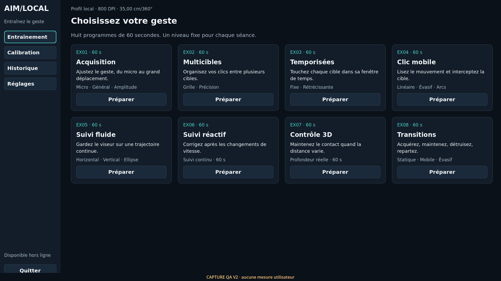
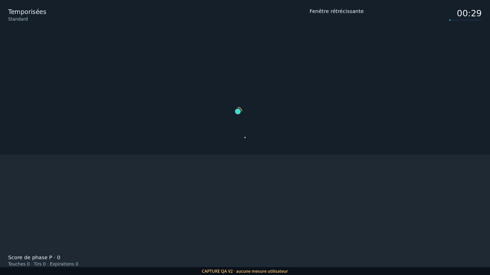
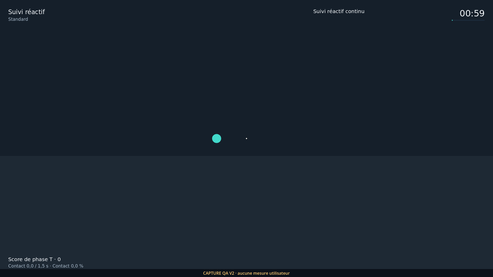
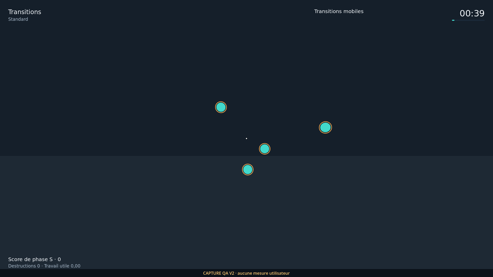
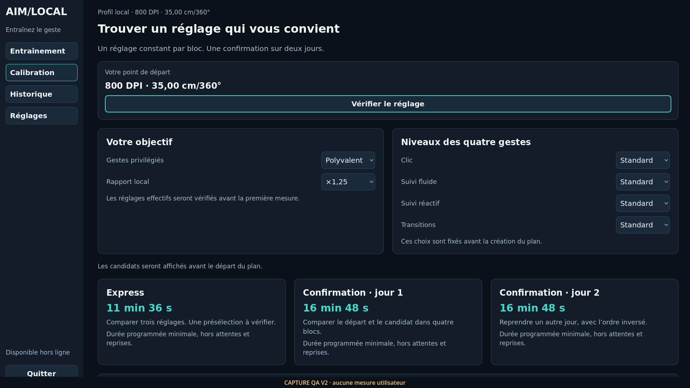
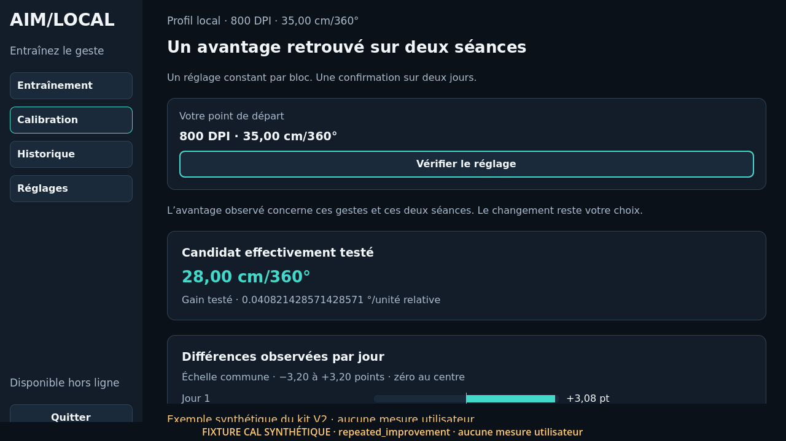

# AIM/LOCAL 1.0.0 — aperçu V2

Ces six images sont des captures réelles de `MainV2.tscn`, rendues par Godot 4.7.2 avec Compatibility/Mesa logiciel sous Linux. Run : `20261013T001220_d57612555b4af0d8`. Elles ne proviennent pas d’un générateur d’images. Elles ne prouvent pas un lancement Windows ou une performance humaine.

La [galerie complète à télécharger](https://github.com/sarbhakan/aimtrainer/raw/refs/heads/main/downloads/AimLocal-1.0.0-visuels.zip) contient **70 PNG**, son manifeste, ses empreintes et `gallery.html`, consultable hors ligne sur Mac. Les menus sont capturés en 800×450, 1280×720 et 1920×1080 ; toutes les phases Standard et un échantillon Novice/Avancé sont présents. Les exemples CAL sont explicitement synthétiques et ne peuvent pas appliquer un profil.

## Accueil

## Cibles temporisées

## Suivi réactif

## Transitions mobiles

## Préparation de la calibration

## Exemple de bilan

Commandes et contrôles : [VISUALS_V2](../../VISUALS_V2.md). Les [captures 0.9](../README.md) restent des références historiques séparées.
